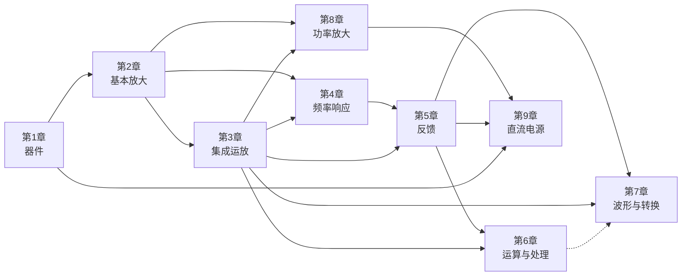
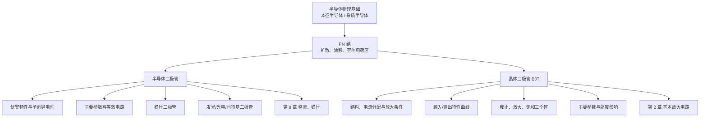
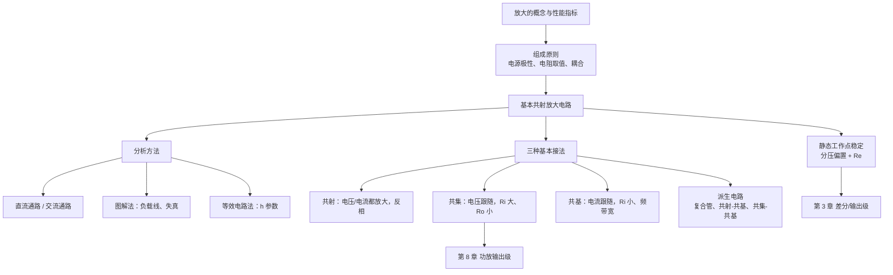
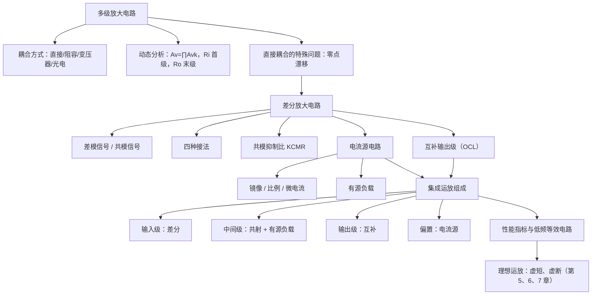
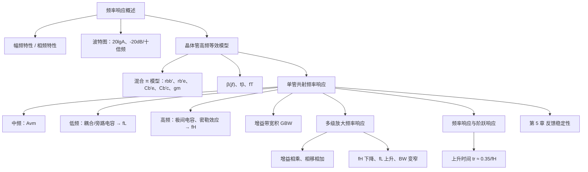
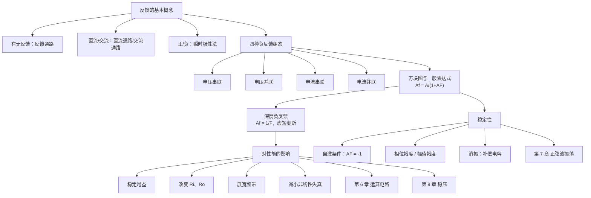
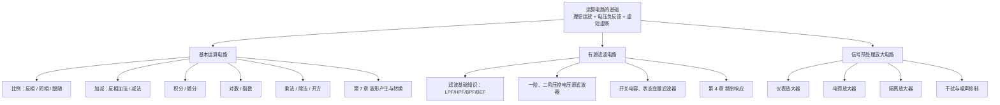
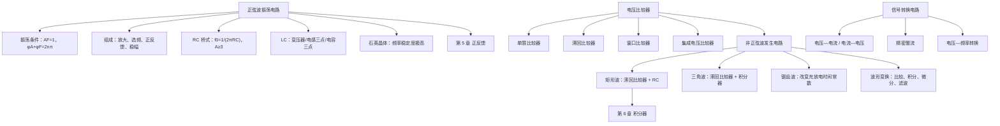
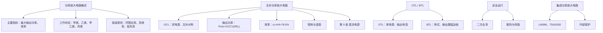
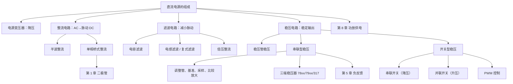

# 《模拟电子技术基础》（第五版）期末复习笔记

> **教材：** 童诗白、华成英 原主编，华成英、叶朝辉 修订，《模拟电子技术基础》第五版，高等教育出版社，2015 年。
>
> **范围：** 第 1—9 章（常用半导体器件、基本放大电路、集成运算放大电路、放大电路的频率响应、放大电路中的反馈、信号的运算和处理、波形的发生和信号的转换、功率放大电路、直流电源）。场效应管相关内容按复习要求略去。
>
> **用法：** 每章按“初学者层 6 个模块 + 复习者层 4 个模块”组织。初次学习按顺序读；考前复习可直接看每章的“速查清单”“自测题”和书末的“总复习速查表”。

---

## 全书总览

### 一、这本书在讲什么

模拟电子技术研究的是“**怎样用半导体器件处理连续变化的电信号**”。全书围绕一条主线展开：

> **器件 → 单管放大 → 多级/集成放大 → 频率与反馈 → 运放应用 → 功率与电源**

具体来说：

- 第 1 章给你“零件”：二极管、稳压管、晶体三极管；
- 第 2 章用三极管搭出“一级放大”，建立静态工作点和交流小信号分析的方法；
- 第 3 章把多级放大、差分、电流源、互补输出集成到一块芯片，得到“通用放大单元”——运放；
- 第 4 章回答“放大倍数随频率怎么变”，给出带宽和波特图；
- 第 5 章用负反馈改善性能，并讨论反馈带来的稳定性问题；
- 第 6 章用运放实现比例、加减、积分、微分、乘除和滤波；
- 第 7 章用正反馈和比较器产生波形、转换信号；
- 第 8 章解决“大功率输出”的效率、管耗和散热；
- 第 9 章解决“电从哪里来”，把交流电网变成稳定直流。

### 二、九章地图

| 章             | 关键词                         | 一句话定位              | 学完应能                           |
| ------------- | --------------------------- | ------------------ | ------------------------------ |
| 1 常用半导体器件     | PN 结、二极管、稳压管、BJT            | 认识“零件”的非线性特性与模型    | 判断器件状态、选管、算工作区                 |
| 2 基本放大电路      | Q 点、h 参数、三种接法               | 建立“先静态、后动态”的放大分析方法 | 算 \(A_v\)、\(R_i\)、\(R_o\)，判断失真 |
| 3 集成运算放大电路    | 多级、差分、电流源、互补输出              | 把单元电路集成为通用运放       | 分析差分、电流源、输出级                   |
| 4 放大电路的频率响应   | 波特图、\(f_L\)、\(f_H\)、\(GBW\) | 描述增益随频率的衰减与相移      | 估算 \(f_L\)、\(f_H\)、\(BW\)，画波特图 |
| 5 放大电路中的反馈    | 四种组态、\(A_f\)、自激             | 用负反馈换取性能，判断稳定性     | 判组态、算深度负反馈、判振消振                |
| 6 信号的运算和处理    | 虚短虚断、运算、有源滤波                | 用运放实现模拟运算与选频       | 列节点方程、设计运算/滤波电路                |
| 7 波形的发生和信号的转换 | 振荡条件、比较器、V-F                | 产生正弦/非正弦波，转换信号     | 判振荡、算频率、分析比较器                  |
| 8 功率放大电路      | OCL、效率、管耗                   | 大信号下追求功率与效率        | 算 \(P_{om}\)、\(\eta\)、管耗、选管    |
| 9 直流电源        | 整流、滤波、稳压                    | 交流电网 → 稳定直流        | 算整流/滤波参数、选稳压方案                 |

### 三、章节关系图

**读图顺序：**

1. **器件主线：** 第 1 章 → 第 2 章 → 第 3 章 → 第 6/7 章；
2. **频率主线：** 第 2/3 章 → 第 4 章 → 第 5 章；
3. **能量主线：** 第 2 章射随器 → 第 3 章互补输出 → 第 8 章 OCL/OTL → 第 9 章电源；
4. **反馈主线：** 第 5 章负反馈 → 第 6 章运算/滤波 → 第 7 章正反馈振荡 → 第 9 章稳压环。

### 四、五条必须掌握的联系链

**联系链 1：器件 → 单管放大 → 集成运放 → 运放应用。**
第 1 章 BJT 的放大条件 → 第 2 章共射/共集/共基 → 第 3 章差分、电流源、输出级组成运放 → 第 6、7 章以运放为通用单元实现运算、处理和波形发生。

**联系链 2：频率响应 → 反馈稳定性。**
第 4 章的 \(f_H\)、\(f_L\)、极点、附加相移 → 第 5 章自激振荡的相位条件和幅值条件。每个极点最多贡献 \(-90^\circ\) 附加相移，三级以上就可能达到 \(-180^\circ\)。

**联系链 3：反馈 → 运算、振荡、稳压。**
第 5 章负反馈组态 → 第 6 章运算电路与有源滤波 → 第 7 章正反馈振荡 → 第 9 章稳压环的负反馈。

**联系链 4：输出级 → 功率放大 → 直流电源。**
第 2 章射随器 → 第 3 章运放输出级 → 第 8 章 OCL/OTL 功放 → 第 9 章电源供电。

**联系链 5：二极管 → 整流与稳压。**
第 1 章二极管单向导电性 → 第 9 章桥式整流；第 1 章稳压管反向击穿 → 第 9 章稳压管稳压与基准电压。

### 五、学习路径

#### 初学者：按“器件—电路—系统”三步走

1. **第 1 章：** 重点掌握 PN 结、二极管等效电路、BJT 三个工作区；公式不必死记，先理解“为什么单向导电”“为什么能放大”。
2. **第 2 章：** 把“先静态、后动态”练熟；每道题都先画直流通路，再画交流通路。
3. **第 3 章：** 抓住“差分抑制温漂、电流源提供偏置和有源负载、互补输出增强带载”三条逻辑。
4. **第 4 章：** 记住“低频看耦合电容、高频看极间电容”，会用 \(f=1/(2πRC)\) 估算。
5. **第 5 章：** 把“判组态”练成条件反射；深度负反馈先想“虚短虚断”。
6. **第 6 章：** 所有运算电路都用节点电流法，不要背十几个公式。
7. **第 7 章：** 先记振荡条件，再记 RC 桥式和矩形波周期；比较器抓住“阈值 + 翻转方向”。
8. **第 8 章：** 记住 OCL 的三个数：\(P_{om}=V_{CC}^2/(2R_L)\)、\(\eta_{\max}=78.5\%\)、每管最大管耗 \(0.2P_{om}\)。
9. **第 9 章：** 记住“0.9、1.2、1.4”三个整流滤波系数，以及串联稳压的四个组成部分。

#### 复习者：三遍复习法

- **第一遍（2 天）：** 看每章“知识框架图 + 速查清单”，把公式和条件串起来；
- **第二遍（2 天）：** 做每章自测题，错题回到“典型电路与分析步骤”；
- **第三遍（1 天）：** 看“总复习速查表”和“全书自测题汇总”，查漏补缺。

#### 考前 7 天建议

| 天数 | 内容 |
|---|---|
| 第 1 天 | 第 1、2 章：器件 + 单管放大 |
| 第 2 天 | 第 3 章：差分、电流源、输出级 |
| 第 3 天 | 第 4、5 章：频率响应 + 反馈 |
| 第 4 天 | 第 6 章：运算 + 有源滤波 |
| 第 5 天 | 第 7 章：振荡 + 比较器 |
| 第 6 天 | 第 8、9 章：功放 + 电源 |
| 第 7 天 | 速查表 + 综合自测 + 错题回顾 |

### 六、符号约定

| 符号 | 含义 | 符号 | 含义 |
|---|---|---|---|
| \(I_{BQ},I_{CQ},U_{CEQ}\) | 静态工作点电流、电压 | \(r_{be}\) | 晶体管输入电阻 |
| \(A_v\) | 电压放大倍数 | \(A_{vs}\) | 源电压放大倍数 |
| \(R_i,R_o\) | 输入、输出电阻 | \(f_L,f_H\) | 下限、上限截止频率 |
| \(BW\) | 通频带 | \(GBW\) | 增益带宽积 |
| \(A_d,A_c\) | 差模、共模放大倍数 | \(K_{CMR}\) | 共模抑制比 |
| \(A_f,F\) | 闭环增益、反馈系数 | \(1+AF\) | 反馈深度 |
| \(U_{IO},I_{IO}\) | 输入失调电压、电流 | \(SR\) | 转换速率 |
| \(P_{om},\eta\) | 最大输出功率、效率 | \(U_Z,I_Z\) | 稳压值、稳压电流 |

**约定：** 电压、电流符号遵循教材：大写大写为直流量（\(I_{BQ}\)），小写小写为交流瞬时值（\(u_i\)），大写小写为交流有效值（\(U_i\)）。本书公式中的 \(U_T\) 常温取 \(26\,\text{mV}\)。

### 七、使用说明

- 标有“**辅助理解**”的段落是直观类比，帮助建立直觉，不替代教材定义；
- 标有“**补充练习**”的题目是编者补充的，其余自测题依据教材例题、自测题和习题改写；
- 电路图优先用“图片占位：教材 X.X 节配图”或文字描述，复杂原理图请对照教材；
- 每章末尾的“一句话总结”适合考前快速回忆，但不能代替推导。

---

## 第 1 章 常用半导体器件

> 对应教材第 1 章（印刷页 8–57）。本章只讨论“器件本身”：二极管、稳压管和晶体三极管的外特性、参数与模型。场效应管（教材 1.4 节）按复习范围略去。

### 1. 本章在全书中的位置（初学者层）

本章是全书的第一块基石。后续所有放大电路、集成运放和电源电路，都是由本章的二极管、稳压管和晶体三极管（BJT）搭起来的。只有先弄清“器件在什么电压、电流下导通、截止、放大”，后面才能看懂“电路在什么工作点上放大、为什么失真”。

### 2. 本章要解决的问题（初学者层）

**为什么需要这一章？** 因为电子电路不是由电阻、电容这种“线性元件”单独组成的，真正让电路具有放大、开关、稳压能力的，是半导体器件。它们的特点是**非线性**：电压电流不成正比，正着接和反着接表现完全不同。

本章要回答四个问题：

1. 半导体为什么能导电？掺杂改变了什么？
2. PN 结为什么单向导电？加正向、反向电压时内部发生了什么？
3. 二极管、稳压管有哪些主要参数？怎样用等效电路做工程计算？
4. 晶体三极管为什么能“用小电流控制大电流”？它的三个工作区怎样判断？

**辅助理解：** 可以把 BJT 想成一个由基极电流控制的“阀门”——基极电流是手柄，集电极电流是管道里的水流；手柄只需很小的力，就能控制很大的水流，但能量并不是手柄提供的，而是直流电源提供的。

### 3. 知识框架图（初学者层）

本章的逻辑是“**材料 → PN 结 → 二极管 → 三极管**”：二极管是一个 PN 结，三极管是两个 PN 结背靠背，但基区做得很薄，于是两个结之间产生了耦合，才有了放大作用。

### 4. 核心概念与公式（初学者层）

#### 4.1 本征半导体与两种载流子

**直观解释：** 纯净的硅晶体中，每个硅原子与邻居共用四个价电子，形成共价键。温度升高时，少量价电子获得能量挣脱束缚，成为自由电子，同时在原来的位置留下一个“空位”，称为空穴。自由电子带负电，空穴等效带正电，二者都能导电。

**教材定义：** 纯净的、具有晶体结构的半导体称为**本征半导体**。运载电荷的粒子称为**载流子**。本征半导体有两种载流子——自由电子和空穴，这是它区别于金属（只有自由电子）的特殊性质。

热激发产生电子—空穴对的过程称为**本征激发**；电子与空穴相遇而消失的过程称为**复合**。一定温度下，激发与复合达到动态平衡，载流子浓度一定：

$$n_i=p_i=K_1T^{3/2}e^{-\frac{E_{G0}}{2kT}}$$

式中 \(n_i\)、\(p_i\) 分别为自由电子、空穴的浓度，\(T\) 为热力学温度，\(k\) 为玻尔兹曼常数，\(E_{G0}\) 为热力学零度时破坏共价键所需的能量（禁带宽度，硅约 \(1.21\,\text{eV}\)，锗约 \(0.785\,\text{eV}\)），\(K_1\) 为与材料有关的常数。

**关键结论：** 温度升高，本征载流子浓度迅速增大，半导体导电性增强。这也是所有半导体器件“怕热”的根源。

#### 4.2 杂质半导体：N 型与 P 型

**直观解释：** 在本征硅中掺入少量五价元素（如磷），多出来的一个价电子很容易成为自由电子，这种半导体以电子导电为主，称为 N 型半导体；掺入三价元素（如硼），共价键缺一个电子，容易形成空穴，称为 P 型半导体。

| 类型 | 掺杂元素 | 多子 | 少子 | 固定离子 | 电中性？ |
|---|---|---|---|---|---|
| N 型 | 五价（磷、砷） | 自由电子 | 空穴 | 带正电的施主离子 | 是 |
| P 型 | 三价（硼、铝） | 空穴 | 自由电子 | 带负电的受主离子 | 是 |

**必须记住：** 杂质半导体整体仍是电中性的；多子浓度主要由掺杂浓度决定，少子浓度由温度和本征激发决定。所以“P 型带正电”是错误说法。

#### 4.3 PN 结的形成与单向导电性

**直观解释：** 把 P 型和 N 型半导体做在同一块硅片上，交界面处电子从 N 区向 P 区扩散、空穴从 P 区向 N 区扩散。扩散走后留下不能移动的离子，形成一个带内电场的**空间电荷区**（也叫耗尽层、阻挡层）。内电场阻止扩散、促进漂移，最终扩散与漂移达到动态平衡，PN 结厚度稳定。

**外加电压时：**

- **正向偏置（P 接高电位、N 接低电位）：** 外电场与内电场方向相反，空间电荷区变窄，扩散运动大于漂移运动，形成较大的正向电流。
- **反向偏置（P 接低电位、N 接高电位）：** 外电场与内电场方向相同，空间电荷区变宽，漂移运动大于扩散运动，只有很小的反向饱和电流。

这就是 PN 结的**单向导电性**。

#### 4.4 二极管的伏安特性与等效电路

二极管的电流方程与 PN 结相同：

$$i_D=I_S\left(e^{\frac{u_D}{U_T}}-1\right)$$

其中 \(I_S\) 为反向饱和电流，\(U_T\) 为温度的电压当量，常温（约 300 K）下 \(U_T\approx 26\,\text{mV}\)。

- 正向电压较小时，电流近似为零；超过**开启电压**后电流按指数规律迅速上升。硅管开启电压约 \(0.5\,\text{V}\)，导通压降工程上取 \(0.7\,\text{V}\)；锗管分别约 \(0.1\,\text{V}\) 和 \(0.2\sim0.3\,\text{V}\)。
- 反向电压下，只有很小的反向饱和电流；反向电压过大时发生**反向击穿**。

**工程等效电路（按精度选择）：**

1. **理想二极管模型：** 正偏视为短路（\(U_D=0\)），反偏视为开路。适用于电源极性判断、大信号粗略分析。
2. **恒压降模型：** 正偏时 \(U_D=0.7\,\text{V}\)（硅管），反偏开路。最常用。
3. **折线模型：** 正偏时用 \(U_{on}\) 串联一个动态电阻 \(r_D\)，更精确。
4. **小信号模型：** 在静态工作点附近，二极管等效为一个动态电阻

$$r_d=\frac{U_T}{I_{DQ}}\approx\frac{26\,\text{mV}}{I_{DQ}}$$

**注意：** \(r_d\) 与直流工作点电流成反比，\(I_{DQ}\) 越大，\(r_d\) 越小。这个“工作点决定交流电阻”的思想，第 2 章的 \(r_{be}\) 会再次用到。

#### 4.5 二极管的主要参数

| 参数 | 含义 | 选用时注意 |
|---|---|---|
| \(I_F\) | 最大整流电流（平均值） | 实际平均电流不得超过 |
| \(U_{RM}\) | 最高反向工作电压 | 一般取击穿电压的一半左右 |
| \(I_R\) | 反向电流 | 越小越好，受温度影响大 |
| \(f_M\) | 最高工作频率 | 高频时结电容不可忽略 |

#### 4.6 稳压二极管

稳压管是一种特殊的面接触型硅二极管，**工作在反向击穿区**。反向击穿后，电流在较大范围内变化，而端电压 \(U_Z\) 几乎不变，从而实现稳压。

主要参数：

- 稳定电压 \(U_Z\)：正常稳压时的端电压；
- 稳定电流 \(I_Z\)：稳压管正常工作的参考电流；
- 最大稳定电流 \(I_{Z\max}\)：由额定功耗决定，\(P_{ZM}=U_Z I_{Z\max}\)；
- 动态电阻 \(r_Z=\Delta U_Z/\Delta I_Z\)：越小稳压性能越好；
- 温度系数：\(U_Z<4\,\text{V}\) 时约为负，\(U_Z>7\,\text{V}\) 时约为正，\(4\sim7\,\text{V}\) 之间温度系数最小。

**使用要点：** 稳压管必须反向接（阴极接高电位），并且必须串联限流电阻，不能直接并在电源两端。

**其它类型二极管（了解）：**

- **发光二极管（LED）：** 正向导通时发光，导通压降一般 \(1.5\sim3\,\text{V}\)，使用时必须串限流电阻；
- **光电二极管：** 工作在反向偏置，光照使反向电流增大，可把光信号转换为电信号；
- **肖特基二极管：** 金属—半导体结，开启电压低、反向恢复时间短，适用于高频和低压整流。

**集成电路中的元件（了解）：** 集成电路以 NPN 管为主，PNP 管多为横向结构；电阻用基区扩散形成，电容用 PN 结电容，数值都很小。因此集成电路“难做大电阻、大电容”，常用**有源负载**（电流源）代替大电阻，并充分利用元件参数一致性好、对称性好的特点构成差分电路。

#### 4.7 晶体三极管的结构与电流放大作用

**结构：** 两个 PN 结、三个区、三个电极。发射区高掺杂，基区很薄且掺杂浓度低，集电区面积大。按结构分为 NPN 和 PNP 两种。

**放大的外部条件：发射结正向偏置，集电结反向偏置。**

**电流分配关系：**

$$I_E=I_B+I_C$$

$$I_C=\beta I_B,\qquad I_C=\alpha I_E$$

$$\alpha=\frac{\beta}{1+\beta},\qquad \beta=\frac{\alpha}{1-\alpha}$$

其中 \(\beta\) 为共射直流电流放大系数，\(\alpha\) 为共基直流电流放大系数。

**内部过程（NPN 管）：**

1. 发射区大量电子扩散到基区；
2. 电子在基区一小部分与空穴复合，形成基极电流 \(I_B\)；
3. 大部分电子扩散到集电结边缘，在反偏电场作用下漂移到集电区，形成 \(I_C\)。

所以 \(I_C\) 的大小受 \(I_B\) 控制，BJT 可看作**电流控制的电流源**。

#### 4.8 输出特性曲线与三个工作区

输出特性曲线描述 \(I_C\) 与 \(U_{CE}\) 的关系，以 \(I_B\) 为参变量。曲线分为三个区：

| 工作区 | 发射结 | 集电结 | 特点 | 典型用途 |
|---|---|---|---|---|
| 截止区 | 反偏或零偏 | 反偏 | \(I_B\approx0\)，\(I_C\approx0\) | 开关断开 |
| 放大区 | 正偏 | 反偏 | \(I_C\approx\beta I_B\)，曲线近似水平 | 线性放大 |
| 饱和区 | 正偏 | 正偏 | \(U_{CE}=U_{CES}\) 很小，\(I_C\) 不随 \(I_B\) 增大 | 开关闭合 |

**判断方法：** 先假定放大，算出 \(I_C\) 和 \(U_{CE}=V_{CC}-I_C R_c\)；若 \(U_{CE}>U_{CES}\)（硅管约 \(0.3\,\text{V}\)），说明确在放大区；若算出的 \(U_{CE}<U_{CES}\)，说明已进入饱和区，此时 \(I_C\) 由外电路决定，不能用 \(\beta I_B\) 计算。

#### 4.9 主要参数与温度影响

| 参数 | 含义 |
|---|---|
| \(\beta\) | 共射电流放大系数，通常在 20–200 |
| \(\alpha\) | 共基电流放大系数，接近 1 |
| \(I_{CBO}\) | 发射极开路时集电结反向饱和电流 |
| \(I_{CEO}\) | 基极开路时集电极—发射极间穿透电流，\(I_{CEO}=(1+\beta)I_{CBO}\) |
| \(I_{CM}\) | 集电极最大允许电流 |
| \(P_{CM}\) | 集电极最大允许耗散功率 |
| \(U_{(BR)CEO}\) | 基极开路时集电极—发射极反向击穿电压 |

**温度的影响（硅管）：**

- 温度每升高 \(1^\circ\text{C}\)，\(U_{BE}\) 约下降 \(2\sim2.5\,\text{mV}\)；
- 温度每升高 \(10^\circ\text{C}\)，\(I_{CBO}\) 约增大一倍；
- \(\beta\) 随温度升高而增大。

三者共同作用的结果是：温度升高，\(I_C\) 增大，工作点上移，这是第 2 章“静态工作点稳定”要解决的核心问题。

### 5. 典型电路与分析步骤（初学者层）

#### 5.1 二极管限幅电路

**电路描述：** 输入信号 \(u_i\) 经电阻 \(R\) 接到二极管阳极，二极管阴极接参考电压 \(V_{REF}\)，输出取自二极管两端。

图片占位：教材 1.2 节“二极管限幅电路”配图。

**分析步骤：**

1. **假设二极管截止：** 断开二极管，求其两端电压 \(u_D=u_i-V_{REF}\)。
2. **检验假设：** 若 \(u_D<U_{on}\)（硅管 \(0.7\,\text{V}\)），假设成立，输出 \(u_o=u_i\)；若 \(u_D\ge U_{on}\)，假设不成立，二极管导通。
3. **导通后重新计算：** 用恒压降模型把二极管替换为 \(0.7\,\text{V}\) 电压源，再列方程求 \(u_o\)。
4. **画传输特性：** 分段写出 \(u_o\) 与 \(u_i\) 的关系，拐点就在 \(u_i=V_{REF}+0.7\,\text{V}\) 处。

**关键结论：** 二极管电路的分析本质是“**假设—检验—替换**”三步，不能一上来就默认导通或截止。

#### 5.2 稳压管稳压电路

**电路描述：** 稳压管 \(D_Z\) 与负载 \(R_L\) 并联，再经限流电阻 \(R\) 接到未经稳压的直流输入 \(U_I\)。

图片占位：教材 9.4 节“稳压管稳压电路”配图（本章只作器件层面的理解，详细计算见第 9 章）。

**分析步骤：**

1. 判断稳压管是否击穿：先假设稳压管断开，求其两端电压；若大于 \(U_Z\)，则击穿稳压。
2. 击穿后，稳压管两端电压近似为 \(U_Z\)，负载电压 \(U_o=U_Z\)。
3. 由 \(I_R=(U_I-U_Z)/R\)，\(I_L=U_Z/R_L\)，得 \(I_Z=I_R-I_L\)。
4. 检验 \(I_{Z\min}\le I_Z\le I_{Z\max}\)，否则说明限流电阻选择不当。

**关键结论：** 稳压管稳压的实质是“**用电流的余量换电压的稳定**”：输入电压或负载变化引起 \(I_R\) 变化，多余或不足的电流由稳压管吸收或补充，\(U_Z\) 基本不变。

#### 5.3 晶体管工作区的判断

**电路描述：** 固定偏置共射电路，\(V_{CC}\) 经 \(R_b\) 接基极，经 \(R_c\) 接集电极，发射极接地。

**分析步骤：**

1. 求基极电流：\(I_{BQ}=(V_{CC}-U_{BEQ})/R_b\)，硅管取 \(U_{BEQ}=0.7\,\text{V}\)。
2. 先按放大区算：\(I_{CQ}=\beta I_{BQ}\)。
3. 求管压降：\(U_{CEQ}=V_{CC}-I_{CQ}R_c\)。
4. 检验：若 \(U_{CEQ}>U_{CES}\)，工作在放大区；若 \(U_{CEQ}\le U_{CES}\)，工作在饱和区，此时 \(I_{CQ}\approx V_{CC}/R_c\)。
5. 若 \(I_{BQ}\approx0\)，则工作在截止区。

**关键结论：** “先假定放大、再检验 \(U_{CE}\)”是判断工作区最稳妥的方法。

### 6. 初学者易误解点（初学者层）

**误解 1：P 型半导体带正电，N 型带负电。**
纠正：杂质半导体整体是电中性的。P 型只是空穴（多子）多，N 型只是自由电子多，固定离子电荷与载流子电荷相互抵消。

**误解 2：二极管加反向电压时完全没有电流。**
纠正：反向时有很小的反向饱和电流 \(I_S\)，且它随温度升高而明显增大；只有理想模型才把它当作零。

**误解 3：\(\beta\) 是一个固定不变的常数。**
纠正：\(\beta\) 随集电极电流和温度变化。放大区不同电流下 \(\beta\) 不同，温度升高 \(\beta\) 增大，所以“算出来的 \(I_C\)”只是工程估算。

**误解 4：三极管放大是把小电流“放大”成大电流，能量来自输入信号。**
纠正：三极管是**能量控制器件**，集电极电流的能量来自直流电源 \(V_{CC}\)，基极电流只起控制作用。没有直流电源，就没有放大。

### 7. 与前后章节的联系（复习者层）

**联系链 1：器件 → 单管放大 → 集成运放。**
本章的 BJT 是第 2 章共射、共集、共基三种基本放大电路的核心器件；第 2 章得到的 \(r_{be}\)、\(\beta\)、\(I_{CQ}\) 又直接进入第 3 章差分放大电路和电流源的计算。没有本章的“发射结正偏、集电结反偏”这一放大条件，第 2 章的静态工作点就无从谈起。

**联系链 2：二极管 → 整流与稳压。**
本章二极管的单向导电性，是第 9 章单相桥式整流电路的全部依据；本章稳压管的反向击穿特性，是第 9 章稳压管稳压电路和串联型稳压电路基准电压的来源。

**联系链 3：结电容 → 频率响应。**
本章提到的 PN 结势垒电容、扩散电容，在第 4 章会变成晶体管混合 \(\pi\) 模型中的 \(C_{b'e}\)、\(C_{b'c}\)，决定放大电路的上限截止频率 \(f_H\)。

**联系链 4：BJT 的对称性 → 差分电路。**
第 3 章利用两只特性相同的 BJT 构成差分放大电路，靠对称性抑制零点漂移；本章“同型号管特性一致”的概念是差分电路成立的前提。

### 8. 复习者速查清单（复习者层）

- [ ] 本征半导体有两种载流子：自由电子、空穴；温度升高，\(n_i\) 迅速增大。
- [ ] N 型：五价掺杂，多子为电子；P 型：三价掺杂，多子为空穴；整体电中性。
- [ ] PN 结正偏变窄、导通；反偏变宽、截止；击穿后稳压管工作。
- [ ] 二极管电流方程 \(i_D=I_S(e^{u_D/U_T}-1)\)，常温 \(U_T\approx26\,\text{mV}\)。
- [ ] 硅管导通压降 \(0.7\,\text{V}\)，锗管 \(0.2\sim0.3\,\text{V}\)；小信号电阻 \(r_d=26\,\text{mV}/I_{DQ}\)。
- [ ] 稳压管工作在反向击穿区，必须串限流电阻；参数 \(U_Z\)、\(I_Z\)、\(r_Z\)、\(P_{ZM}\)。
- [ ] BJT 放大条件：发射结正偏、集电结反偏；\(I_E=I_B+I_C\)，\(I_C=\beta I_B\)，\(\alpha=\beta/(1+\beta)\)。
- [ ] 三个工作区：截止（两结反偏）、放大（发射结正偏、集电结反偏）、饱和（两结正偏）。
- [ ] \(I_{CEO}=(1+\beta)I_{CBO}\)；温度升高，\(U_{BE}\) 下降、\(I_{CBO}\) 增大、\(\beta\) 增大。
- [ ] 二极管电路分析三步：假设—检验—替换。

### 9. 自测题（复习者层）

**1.** 本征半导体中，自由电子浓度与空穴浓度有什么关系？温度升高时二者如何变化？

**2.** 在硅中掺入五价磷后，多子是什么？少子是什么？掺入三价硼后呢？

**3.** 二极管电路：\(V_{CC}=5\,\text{V}\)，\(R=1\,\text{k}\Omega\)，硅二极管阳极经 \(R\) 接 \(V_{CC}\)，阴极接地。求二极管电流和输出端电压（取 \(U_D=0.7\,\text{V}\)）。

**4.** 稳压管 \(U_Z=6\,\text{V}\)，\(I_{Z\min}=5\,\text{mA}\)，\(I_{Z\max}=20\,\text{mA}\)，输入 \(U_I=12\,\text{V}\)，限流电阻 \(R=300\,\Omega\)。负载电流 \(I_L\) 在什么范围内稳压管能正常稳压？

**5.** 某 NPN 管 \(\beta=50\)，\(I_B=20\,\mu\text{A}\)，\(R_c=2\,\text{k}\Omega\)，\(V_{CC}=12\,\text{V}\)。判断它工作在哪个区，并求 \(U_{CE}\)。

**6.** 已知 \(I_{CBO}=2\,\mu\text{A}\)，\(\beta=80\)，求 \(I_{CEO}\)。若温度升高使 \(I_{CBO}\) 增大一倍，\(I_{CEO}\) 变为多少？

**7.** 为什么说“三极管放大电路的能量来自直流电源，而不是输入信号”？请从电流分配角度说明。

**8.（补充练习）** 双向限幅电路：输入 \(u_i\) 为正弦波（幅值 \(5\,\text{V}\)），两只硅二极管分别经 \(3\,\text{V}\) 参考电压源接到输出端，一只限制正半周、一只限制负半周。画出 \(u_o\) 的波形，并说明两个拐点的电压。

**答案与提示：**

1. 相等（\(n_i=p_i\)）；温度升高，二者都迅速增大。
2. 掺磷：多子为电子，少子为空穴；掺硼：多子为空穴，少子为电子。
3. \(I_D=(5-0.7)/1\,\text{k}\Omega=4.3\,\text{mA}\)；输出端电压为 \(0.7\,\text{V}\)。
4. \(I_R=(12-6)/0.3\,\text{k}\Omega=20\,\text{mA}\)；\(I_Z=I_R-I_L=20\,\text{mA}-I_L\)。要求 \(5\,\text{mA}\le I_Z\le20\,\text{mA}\)，所以 \(0\le I_L\le15\,\text{mA}\)。
5. 先按放大：\(I_C=50\times20\,\mu\text{A}=1\,\text{mA}\)，\(U_{CE}=12-1\times2=10\,\text{V}>0.3\,\text{V}\)，在放大区。
6. \(I_{CEO}=(1+80)\times2\,\mu\text{A}=162\,\mu\text{A}\)；\(I_{CBO}\) 增大一倍后 \(I_{CEO}=324\,\mu\text{A}\)。
7. 发射极电流由发射区多数载流子形成，这些载流子的能量来自 \(V_{CC}\) 建立的电场；基极电流只改变基区复合比例，从而控制集电极电流，本身不提供负载功率。
8. 正半周 \(u_i>3.7\,\text{V}\) 时，上方二极管导通，\(u_o\) 被限在 \(3.7\,\text{V}\)；负半周 \(u_i<-3.7\,\text{V}\) 时，下方二极管导通，\(u_o\) 被限在 \(-3.7\,\text{V}\)；中间段 \(u_o=u_i\)。波形为“削顶”的正弦波。

### 10. 一句话总结（复习者层）

**半导体器件的一切特性都源于“掺杂控制载流子、PN 结控制方向”：二极管靠一个 PN 结单向导电，稳压管靠反向击穿稳压，三极管靠两个 PN 结的配合实现“小电流控制大电流”。**

---

## 第 2 章 基本放大电路

> 对应教材第 2 章（印刷页 58–122）。本章是全书的方法论核心：建立“静态工作点 + 交流小信号模型”的分析范式。场效应管放大电路（教材 2.6 节）按复习范围略去。

### 1. 本章在全书中的位置（初学者层）

第 1 章认识了晶体管这个“可控阀门”，本章要把阀门接进电路，让它真正放大信号。本章给出的共射、共集、共基三种接法，是第 3 章集成运放内部单元电路（差分、输出级）的直接原型；本章的 \(r_{be}\)、\(A_v\)、\(R_i\)、\(R_o\) 也是第 4 章频率响应和第 5 章反馈分析的基础。

### 2. 本章要解决的问题（初学者层）

**为什么需要这一章？** 一个孤立的晶体管不会自动放大。必须给它合适的直流偏置，让它工作在放大区；必须让交流信号“进得去、出得来”；还必须保证输出波形不失真。本章要回答：

1. 什么是“放大”？放大电路为什么必须接直流电源？
2. 怎样组成一个能放大的电路？各元件起什么作用？
3. 怎样求静态工作点 \(Q\)？怎样求 \(A_v\)、\(R_i\)、\(R_o\)？
4. 怎样判断饱和失真和截止失真？怎样稳定 \(Q\) 点？
5. 共射、共集、共基各有什么优缺点？什么时候用哪一种？

**辅助理解：** 静态工作点像“跷跷板的支点”。支点太低，输入信号往下摆时管子截止；支点太高，往上摆时管子饱和。只有支点居中，输出才能完整地跟着输入摆动。

### 3. 知识框架图（初学者层）

本章的主线是：**先确定“能不能放大”（组成原则与 Q 点），再解决“放大多少”（动态参数），最后解决“哪种接法合适”（三种组态比较）**。

### 4. 核心概念与公式（初学者层）

#### 4.1 放大的本质与主要性能指标

**直观解释：** 放大不是无中生有地“造能量”，而是用输入的小信号去控制直流电源，把电源的能量转换成负载上的大信号。所以放大电路一定含有源器件（BJT）和直流电源。

**教材定义：** 放大的对象是**变化量**；放大的本质是**能量的控制和转换**；放大的特征是**功率放大**；放大的前提是**不失真**。

主要性能指标：

| 指标 | 定义 | 物理意义 |
|---|---|---|
| 电压放大倍数 \(A_v\) | \(A_v=U_o/U_i\)（正弦有效值之比） | 电压放大能力 |
| 源电压放大倍数 \(A_{vs}\) | \(A_{vs}=U_o/U_s=A_v\frac{R_i}{R_i+R_s}\) | 考虑信号源内阻后的实际增益 |
| 输入电阻 \(R_i\) | 从输入端看进去的等效电阻 | \(R_i\) 越大，从信号源索取的电流越小 |
| 输出电阻 \(R_o\) | 从输出端看进去的等效内阻 | \(R_o\) 越小，带负载能力越强 |
| 通频带 \(BW\) | \(BW=f_H-f_L\) | 对信号频率的适应能力（第 4 章） |
| 最大不失真输出电压 \(U_{om}\) | 不产生截止、饱和失真时的最大输出 | 动态范围 |
| 最大输出功率与效率 | 见第 8 章 | 功率输出能力 |

**注意：** \(A_v\) 是“输出变化量比输入变化量”，不是直流量的比值；计算时通常用正弦有效值或峰值，二者比值的幅值相同。

#### 4.2 基本共射放大电路的组成

**电路描述（教材图 2.2.1 类型）：** 晶体管 T 为 NPN 管；\(V_{BB}\) 经基极电阻 \(R_b\) 给发射结提供正偏；\(V_{CC}\) 经集电极电阻 \(R_c\) 给集电结提供反偏并作为输出回路的电源；\(C_1\)、\(C_2\) 为耦合电容，隔直通交；\(R_L\) 为负载。

图片占位：教材 2.2 节“基本共射放大电路”配图。

**各元件作用：**

- **T**：核心有源元件，起电流控制作用；
- **\(V_{BB}\)、\(R_b\)**：提供合适的基极电流，建立静态工作点；
- **\(V_{CC}\)、\(R_c\)**：为集电结提供反偏，并把集电极电流的变化转换为电压变化；
- **\(C_1\)、\(C_2\)**：耦合电容，交流视为短路，直流视为开路；
- **\(R_L\)**：负载，决定交流负载线的斜率。

**组成原则（教材三条）：**

1. 必须有有源元件（BJT），且电源极性和参数使发射结正偏、集电结反偏，即工作在放大区；
2. 输入信号必须能作用于基极—发射极回路，输出信号必须能作用于负载；
3. 元件参数应保证在最大输入信号下也不产生失真。

#### 4.3 静态工作点及其必要性

**直观解释：** 输入信号为零时，电路各处的直流电流、电压称为静态工作点 \(Q\)。它决定了晶体管“站在曲线的哪个位置”。如果 \(Q\) 点设在截止区附近，输入信号负半周会把管子推入截止；如果设在饱和区附近，正半周会把管子推入饱和。

**基本共射电路的静态工作点：**

$$I_{BQ}=\frac{V_{BB}-U_{BEQ}}{R_b}$$

若 \(V_{BB}=V_{CC}\)（固定偏置电路），则 \(I_{BQ}\approx(V_{CC}-0.7\,\text{V})/R_b\)。

$$I_{CQ}=\beta I_{BQ}$$

$$U_{CEQ}=V_{CC}-I_{CQ}R_c$$

**设置 Q 点的必要性：** 保证整个信号周期内晶体管都工作在放大区，输出波形不失真；同时 \(Q\) 点还影响 \(r_{be}\)、\(A_v\) 等动态参数。

#### 4.4 直流通路与交流通路

**直流通路：** 输入信号置零，电容视为开路，电感视为短路，直流电源保留。用于求 \(Q\) 点。

**交流通路：** 耦合电容、旁路电容视为短路，直流电源视为对地短路（内阻为零），保留交流信号源和负载。用于求 \(A_v\)、\(R_i\)、\(R_o\)。

**口诀：** “**直流看电容开路，交流看电容短路、电源接地**。”

#### 4.5 图解法

**直流负载线：** 由输出回路方程

$$U_{CE}=V_{CC}-I_C R_c$$

在输出特性曲线上画一条斜率为 \(-1/R_c\) 的直线，与 \(I_B=I_{BQ}\) 那条曲线的交点就是 \(Q\) 点。

**交流负载线：** 由

$$u_{ce}=-i_c(R_c\parallel R_L)$$

得到，斜率为 \(-1/(R_c\parallel R_L)\)，且必须经过 \(Q\) 点。交流负载线比直流负载线更陡。

**失真判断：**

- **截止失真：** \(Q\) 点偏低，输入信号负半周使 \(i_B=0\)，输出波形**顶部**被削平（NPN 共射）；
- **饱和失真：** \(Q\) 点偏高，输入信号正半周使 \(u_{CE}\) 降到 \(U_{CES}\)，输出波形**底部**被削平（NPN 共射）。

**最大不失真输出电压：**

$$U_{om}=\min\left(U_{CEQ}-U_{CES},\; I_{CQ}(R_c\parallel R_L)\right)$$

**调节方法：** 截止失真增大 \(I_{BQ}\)（减小 \(R_b\)）；饱和失真减小 \(I_{BQ}\)（增大 \(R_b\)），或减小 \(R_c\)。

#### 4.6 等效电路法（h 参数小信号模型）

**适用条件：** 输入信号幅值很小，晶体管在 \(Q\) 点附近近似线性工作。

**晶体管输入电阻：**

$$r_{be}=r_{bb'}+(1+\beta)\frac{U_T}{I_{EQ}}\approx r_{bb'}+(1+\beta)\frac{26\,\text{mV}}{I_{EQ}}$$

其中 \(r_{bb'}\) 为基区体电阻，常取 \(200\,\Omega\) 左右；\(I_{EQ}\) 为发射极静态电流（mA 代入时，\(26\,\text{mV}/I_{EQ}\) 的单位为 \(\text{k}\Omega\)，注意单位统一）。

**共射放大电路动态参数：**

$$A_v=-\frac{\beta(R_c\parallel R_L)}{r_{be}}$$

$$R_i=R_b\parallel r_{be}$$

$$R_o\approx R_c$$

负号表示输出与输入**反相**。

**源电压放大倍数：**

$$A_{vs}=A_v\frac{R_i}{R_i+R_s}$$

**分析步骤：**

1. 画直流通路，求 \(I_{BQ}\)、\(I_{CQ}\)、\(U_{CEQ}\)；
2. 由 \(I_{EQ}\approx I_{CQ}\) 求 \(r_{be}\)；
3. 画交流通路，求 \(R_L'=R_c\parallel R_L\)；
4. 代入公式求 \(A_v\)、\(R_i\)、\(R_o\)；
5. 需要时再求 \(A_{vs}\)。

#### 4.7 静态工作点的稳定：分压偏置电路

**为什么要稳定 Q 点？** 温度升高使 \(U_{BE}\) 下降、\(I_{CBO}\) 增大、\(\beta\) 增大，三者都使 \(I_C\) 增大，\(Q\) 点上移，可能进入饱和区。

**典型电路：** \(R_{b1}\)、\(R_{b2}\) 分压固定基极电位，发射极串入 \(R_e\)，旁路电容 \(C_e\) 使 \(R_e\) 对交流短路。

图片占位：教材 2.4 节“分压式偏置静态工作点稳定电路”配图。

**稳定过程（负反馈）：**

$$T\uparrow\;\Rightarrow\; I_C\uparrow\;\Rightarrow\; I_E\uparrow\;\Rightarrow\; U_E=I_E R_e\uparrow\;\Rightarrow\; U_{BE}=U_B-U_E\downarrow\;\Rightarrow\; I_B\downarrow\;\Rightarrow\; I_C\downarrow$$

**工程近似条件：**

$$I_1=(5\sim10)I_{BQ},\qquad U_{BQ}=(5\sim10)U_{BEQ}$$

满足条件时：

$$U_{BQ}\approx\frac{R_{b2}}{R_{b1}+R_{b2}}V_{CC}$$

$$I_{EQ}=\frac{U_{BQ}-U_{BEQ}}{R_e}\approx I_{CQ}$$

$$U_{CEQ}\approx V_{CC}-I_{CQ}(R_c+R_e)$$

**动态参数（\(C_e\) 存在，\(R_e\) 交流短路）：**

$$A_v=-\frac{\beta(R_c\parallel R_L)}{r_{be}},\qquad R_i=R_{b1}\parallel R_{b2}\parallel r_{be},\qquad R_o\approx R_c$$

**若没有 \(C_e\)：**

$$A_v=-\frac{\beta(R_c\parallel R_L)}{r_{be}+(1+\beta)R_e}$$

增益下降，但 \(R_i\) 增大、稳定性更好。

#### 4.8 三种基本接法

| 比较项 | 共射 | 共集（射随器） | 共基 |
|---|---|---|---|
| 输入端子 | 基极 | 基极 | 发射极 |
| 输出端子 | 集电极 | 发射极 | 集电极 |
| 公共端子 | 发射极 | 集电极 | 基极 |
| 电压增益 | 较大，反相 | 略小于 1，同相 | 较大，同相 |
| 电流增益 | 较大 | 较大 | 略小于 1 |
| 输入电阻 | 中等 | 很大 | 很小 |
| 输出电阻 | 较大 | 很小 | 较大 |
| 频带 | 中等 | 较宽 | 最宽 |
| 典型用途 | 一般电压放大 | 输入级、输出级、缓冲 | 高频、宽带放大 |

**共集电路公式：**

$$A_v=\frac{(1+\beta)(R_e\parallel R_L)}{r_{be}+(1+\beta)(R_e\parallel R_L)}\approx1$$

$$R_i=R_b\parallel\left[r_{be}+(1+\beta)(R_e\parallel R_L)\right]$$

$$R_o=R_e\parallel\frac{r_{be}+(R_b\parallel R_s)}{1+\beta}$$

**共基电路公式：**

$$A_v=\frac{\beta(R_c\parallel R_L)}{r_{be}}$$

$$R_i=R_e\parallel\frac{r_{be}}{1+\beta}$$

$$R_o\approx R_c$$

**记忆要点：** 共射“反相、都能放大”；共集“同相、电压跟随、Ri 大 Ro 小”；共基“同相、电流跟随、Ri 小频带宽”。

#### 4.9 派生电路

**复合管：** 两只晶体管按一定规则连接，等效为一只管子。

- 复合管类型由**第一只管子**决定；
- \(\beta\approx\beta_1\beta_2\)；
- \(r_{be}\approx r_{be1}+(1+\beta_1)r_{be2}\)。

**共射—共基电路：** 共射管负责电压增益，共基管改善高频响应，整体频带比单管共射宽。

**共集—共基电路：** 共集管提供高输入电阻，共基管提供宽频带，常用于宽带输入级。

### 5. 典型电路与分析步骤（初学者层）

#### 5.1 固定偏置共射放大电路

**电路描述：** \(V_{CC}\) 经 \(R_b\) 接基极，经 \(R_c\) 接集电极，发射极接地，输入经 \(C_1\)、输出经 \(C_2\) 耦合。

**静态分析：**

1. 画直流通路：\(C_1\)、\(C_2\) 开路；
2. \(I_{BQ}=(V_{CC}-U_{BEQ})/R_b\)；
3. \(I_{CQ}=\beta I_{BQ}\)；
4. \(U_{CEQ}=V_{CC}-I_{CQ}R_c\)；
5. 检验 \(U_{CEQ}>U_{CES}\)，否则已饱和。

**动态分析：**

1. 画交流通路：电容短路、\(V_{CC}\) 接地；
2. \(R_L'=R_c\parallel R_L\)；
3. \(r_{be}=r_{bb'}+(1+\beta)26\,\text{mV}/I_{EQ}\)；
4. \(A_v=-\beta R_L'/r_{be}\)；
5. \(R_i=R_b\parallel r_{be}\)，\(R_o\approx R_c\)。

**关键结论：** 固定偏置电路结构简单，但 \(Q\) 点随温度漂移严重，只适用于温度变化小、要求不高的场合。

#### 5.2 分压偏置共射放大电路

**电路描述：** \(R_{b1}\)、\(R_{b2}\) 分压，\(R_e\) 串在发射极，\(C_e\) 旁路。

**分析步骤：**

1. 求 \(U_{BQ}\approx\frac{R_{b2}}{R_{b1}+R_{b2}}V_{CC}\)（需先检验 \(I_1\gg I_{BQ}\)）；
2. \(I_{EQ}=(U_{BQ}-U_{BEQ})/R_e\)，\(I_{CQ}\approx I_{EQ}\)；
3. \(U_{CEQ}\approx V_{CC}-I_{CQ}(R_c+R_e)\)；
4. 动态参数同固定偏置（\(C_e\) 短路 \(R_e\)）；
5. 若没有 \(C_e\)，改用 \(A_v=-\beta R_L'/[r_{be}+(1+\beta)R_e]\)。

**关键结论：** \(R_e\) 引入直流负反馈，牺牲少量电压余量换取 \(Q\) 点稳定，是分立元件电路中最常用的偏置方式。

#### 5.3 共集电极电路（射随器）

**电路描述：** 输入接基极，输出取自发射极电阻 \(R_e\)，集电极直接接 \(V_{CC}\)（交流接地）。

**分析步骤：**

1. 静态：\(I_{BQ}=(V_{CC}-U_{BEQ})/[R_b+(1+\beta)R_e]\)，\(I_{EQ}=(1+\beta)I_{BQ}\)，\(U_{CEQ}=V_{CC}-I_{EQ}R_e\)；
2. 动态：\(R_L'=R_e\parallel R_L\)，\(A_v\approx1\)；
3. \(R_i\) 很大，\(R_o\) 很小。

**关键结论：** 射随器不放大电压，但能放大电流、实现阻抗变换，是多级电路的“缓冲级”。

#### 5.4 三种接法的选用

- 需要一般电压放大 → **共射**；
- 需要高输入电阻、低输出电阻、缓冲隔离 → **共集**；
- 需要高频、宽带、低输入电阻 → **共基**；
- 需要更高 \(\beta\) 或更宽频带 → **复合管 / 组合电路**。

### 6. 初学者易误解点（初学者层）

**误解 1：放大电路放大的电压、电流都是由晶体管“产生”的。**
纠正：晶体管只是控制元件，能量来自直流电源。输出功率大于输入功率，差额由电源提供。

**误解 2：\(Q\) 点越高，放大倍数越大，所以越好。**
纠正：\(Q\) 点过高容易饱和失真，过低容易截止失真；\(Q\) 点还影响 \(r_{be}\) 和增益。应结合最大不失真输出综合选择。

**误解 3：共集电路电压增益小于 1，所以没有放大作用。**
纠正：共集电路电流增益大，功率增益仍大于 1，且具有阻抗变换作用，不能只看电压增益。

**误解 4：求 \(R_o\) 时可以把负载 \(R_L\) 算进去。**
纠正：\(R_o\) 是从输出端看进去的等效内阻，应令 \(R_L=\infty\)、信号源置零后求；\(R_L\) 是外部负载，不属于 \(R_o\)。

### 7. 与前后章节的联系（复习者层）

**联系链 1：BJT 放大条件 → 共射电路 → 集成运放输入级。**
本章“发射结正偏、集电结反偏”的偏置原则，直接用于第 3 章差分放大电路；本章共射电路的 \(A_v\)、\(R_i\)、\(R_o\) 公式，是分析差分半电路的基础。

**联系链 2：射随器 → 运放输出级 → OCL 功放。**
本章共集电路“\(R_i\) 大、\(R_o\) 小、电压跟随”的特点，在第 3 章演变为互补输出级，在第 8 章演变为 OCL/OTL 功率放大电路。

**联系链 3：\(r_{be}\) 与结电容 → 频率响应。**
本章的 \(r_{be}\) 是纯电阻模型，只适用于中频段；第 4 章加入 \(C_{b'e}\)、\(C_{b'c}\) 后，才得到完整的频率响应和 \(f_H\)。

**联系链 4：\(Q\) 点稳定 → 负反馈。**
本章 \(R_e\) 稳定 \(Q\) 点的过程，本质是直流负反馈；第 5 章把这一思想推广到交流负反馈的四种组态。

### 8. 复习者速查清单（复习者层）

- [ ] 放大本质：能量控制与转换；前提：不失真；特征：功率放大。
- [ ] 组成原则：有源元件、合适偏置（发射结正偏、集电结反偏）、信号能进能出。
- [ ] 直流通路：电容开路；交流通路：电容短路、电源接地。
- [ ] \(I_{BQ}=(V_{CC}-U_{BEQ})/R_b\)，\(I_{CQ}=\beta I_{BQ}\)，\(U_{CEQ}=V_{CC}-I_{CQ}R_c\)。
- [ ] \(r_{be}=r_{bb'}+(1+\beta)26\,\text{mV}/I_{EQ}\)。
- [ ] 共射：\(A_v=-\beta R_L'/r_{be}\)，\(R_i=R_b\parallel r_{be}\)，\(R_o\approx R_c\)，反相。
- [ ] 分压偏置：\(U_{BQ}\approx R_{b2}V_{CC}/(R_{b1}+R_{b2})\)，\(I_{EQ}=(U_{BQ}-U_{BEQ})/R_e\)，\(R_e\) 稳定 \(Q\) 点。
- [ ] 共集：\(A_v\approx1\)，\(R_i\) 大，\(R_o\) 小，同相，作缓冲/输出级。
- [ ] 共基：\(A_v=+\beta R_L'/r_{be}\)，\(R_i\) 小，频带宽，同相。
- [ ] 失真：NPN 共射，截止失真削顶，饱和失真削底；\(U_{om}=\min(U_{CEQ}-U_{CES},I_{CQ}R_L')\)。
- [ ] 复合管：\(\beta\approx\beta_1\beta_2\)，类型由第一只管子决定。

### 9. 自测题（复习者层）

**1.** 判断：放大电路中输出电流、电压的能量来自输入信号。（ ）

**2.** 共射电路 \(V_{CC}=12\,\text{V}\)，\(R_b=300\,\text{k}\Omega\)，\(R_c=3\,\text{k}\Omega\)，\(\beta=50\)，\(U_{BEQ}=0.7\,\text{V}\)。求 \(I_{BQ}\)、\(I_{CQ}\)、\(U_{CEQ}\)，并判断工作区。

**3.** 上题中若 \(R_L=3\,\text{k}\Omega\)，\(r_{bb'}=200\,\Omega\)，求 \(r_{be}\)、\(A_v\)、\(R_i\)、\(R_o\)。

**4.** 分压偏置电路 \(V_{CC}=12\,\text{V}\)，\(R_{b1}=20\,\text{k}\Omega\)，\(R_{b2}=10\,\text{k}\Omega\)，\(R_c=2\,\text{k}\Omega\)，\(R_e=1\,\text{k}\Omega\)，\(\beta=50\)，\(U_{BEQ}=0.7\,\text{V}\)。求 \(U_{BQ}\)、\(I_{CQ}\)、\(U_{CEQ}\)。

**5.** 为什么共集电路电压增益略小于 1，却仍被称为“放大电路”？

**6.** 画出 NPN 共射电路在 \(Q\) 点偏低时的输出波形，说明是哪种失真，并给出两种消除方法。

**7.** 共基电路为什么频带比共射宽？从输入电阻和密勒效应角度解释。

**8.（补充练习）** 两级放大电路，第一级 \(A_{v1}=-20\)、\(R_{i1}=10\,\text{k}\Omega\)，第二级 \(A_{v2}=-30\)、\(R_{i2}=2\,\text{k}\Omega\)，信号源内阻 \(R_s=1\,\text{k}\Omega\)。求总电压增益 \(A_v\) 和源电压增益 \(A_{vs}\)。

**答案与提示：**

1. 错。能量来自直流电源，输入信号只起控制作用。
2. \(I_{BQ}=(12-0.7)/300\,\text{k}\Omega\approx37.7\,\mu\text{A}\)；\(I_{CQ}=50\times37.7\,\mu\text{A}\approx1.88\,\text{mA}\)；\(U_{CEQ}=12-1.88\times3\approx6.35\,\text{V}>0.3\,\text{V}\)，在放大区。
3. \(r_{be}=200+51\times26/1.88\approx200+705=905\,\Omega\)；\(R_L'=1.5\,\text{k}\Omega\)；\(A_v=-50\times1.5/0.905\approx-82.9\)；\(R_i=300\,\text{k}\Omega\parallel0.905\,\text{k}\Omega\approx0.902\,\text{k}\Omega\)；\(R_o\approx3\,\text{k}\Omega\)。
4. \(U_{BQ}\approx10\times12/30=4\,\text{V}\)；\(I_{CQ}\approx(4-0.7)/1=3.3\,\text{mA}\)；\(U_{CEQ}\approx12-3.3\times(2+1)=2.1\,\text{V}\)。
5. 电压增益略小于 1，但电流增益大，功率增益大于 1；且 \(R_i\) 大、\(R_o\) 小，具有阻抗变换和缓冲作用，符合“功率放大”的实质。
6. 截止失真，输出波形顶部削平（NPN 共射）。消除方法：减小 \(R_b\) 以增大 \(I_{BQ}\)，或减小输入信号幅值、提高电源电压。
7. 共基电路输入电阻很小（\(r_{be}/(1+\beta)\)），从输入端看 \(C_{b'c}\) 的密勒倍增效应很弱，且 \(C_{b'c}\) 直接接在集电极与地之间，时间常数小，所以 \(f_H\) 高、频带宽。
8. \(A_v=A_{v1}A_{v2}=600\)；\(A_{vs}=A_v R_{i1}/(R_{i1}+R_s)=600\times10/11\approx545.5\)。

### 10. 一句话总结（复习者层）

**放大电路的全部分析都可以归结为一句话：先用直流通路把 \(Q\) 点放在放大区，再用交流通路和小信号模型算 \(A_v\)、\(R_i\)、\(R_o\)，最后根据三种接法的特点选用电路。**

---

## 第 3 章 集成运算放大电路

> 对应教材第 3 章（印刷页 123–185）。本章把“单管放大”升级为“多级放大 + 集成运放”：先讲多级耦合与动态分析，再拆开运放看差分输入级、电流源偏置和互补输出级。单极型（CMOS）集成运放按复习范围略去。

### 1. 本章在全书中的位置（初学者层）

第 2 章解决了“一级管子怎样放大”，本章解决“怎样把多级放大做在一块芯片上”。集成运放是第 2 章共射、共集、差分、电流源等单元的“系统级组装”；从本章开始，第 5、6、7 章都将把运放当作一个理想化的小方块来使用。

### 2. 本章要解决的问题（初学者层）

**为什么需要这一章？** 一级共射电路的增益通常只有几十倍，输入电阻也不够大，而且直接耦合会带来零点漂移。实际应用需要“高增益、高输入电阻、低输出电阻、低温漂”的放大器，于是把多级电路集成在一起，形成**集成运算放大电路**（简称集成运放）。

本章要回答：

1. 多级放大电路有哪几种耦合方式？各有什么优缺点？
2. 多级放大电路的增益、输入电阻、输出电阻怎样计算？
3. 直接耦合带来的零点漂移怎样抑制？差分放大电路为什么能抑制温漂？
4. 集成运放由哪四部分组成？各部分的典型电路是什么？
5. 集成运放的主要性能指标有哪些？理想运放的条件是什么？
6. 使用运放时为什么要调零、消振、加保护？

### 3. 知识框架图（初学者层）

本章的主线是：**多级 → 零点漂移 → 差分 → 电流源 → 互补输出 → 集成运放**。可以把集成运放看成“用差分管做输入、用电流源做偏置和负载、用互补管做输出”的多级直接耦合放大器。

### 4. 核心概念与公式（初学者层）

#### 4.1 多级放大电路的耦合方式

| 耦合方式 | 优点 | 缺点 | 适用场合 |
|---|---|---|---|
| 直接耦合 | 低频特性好，能放大缓慢变化信号，便于集成 | 存在零点漂移，各级 Q 点互相影响 | 集成运放、直流放大 |
| 阻容耦合 | 各级 Q 点独立，简单 | 低频特性差，不能放大直流，不便于集成 | 分立元件交流放大 |
| 变压器耦合 | 可实现阻抗变换，输出功率大 | 体积大、低频差、不便于集成 | 调谐放大、大功率输出 |
| 光电耦合 | 电气隔离，抗干扰强 | 线性度较差，速度受限 | 隔离、远距离传输 |

**直接耦合的 Q 点问题：** 前一级集电极直接接后一级基极，前一级的 \(U_{CEQ1}\) 就是后一级的 \(U_{BEQ2}\)。若 \(U_{CEQ1}\approx0.7\,\text{V}\)，后一级会接近饱和。解决办法是抬高后一级发射极电位（加 \(R_{e2}\)）或采用电平移动电路。

#### 4.2 多级放大电路的动态分析

**电压放大倍数：**

$$A_v=\prod_{k=1}^{n}A_{vk}$$

**注意：** 计算每一级的 \(A_{vk}\) 时，必须把**后一级的输入电阻**当作本级的负载。例如第一级共射的负载是 \(R_{c1}\parallel R_{i2}\)，而不是单独的 \(R_{c1}\)。

**输入电阻：** \(R_i=R_{i1}\)（第一级的输入电阻）。

**输出电阻：** \(R_o=R_{on}\)（末级的输出电阻）。

**源电压放大倍数：**

$$A_{vs}=A_v\frac{R_i}{R_i+R_s}$$

**失真判断：** 多级放大电路输出失真时，应先判断从哪一级开始失真，再判断是饱和失真还是截止失真。通常末级先出现大信号失真，前级先出现小信号失真。

#### 4.3 零点漂移

**定义：** 直接耦合放大电路在输入信号为零时，输出电压随时间缓慢变化的现象，称为**零点漂移**（零漂）。由温度变化引起的零漂称为**温度漂移**（温漂）。

**危害：** 零漂会被后级逐级放大，严重时淹没微弱信号，使放大器无法分辨真实信号。

**抑制思路：**

1. 采用差分放大电路，利用对称性抵消温漂；
2. 采用恒温槽、温度补偿；
3. 采用斩波稳零、自动稳零技术（了解）。

**重要概念：** 零漂通常折算到输入端来衡量：

$$U_{n}=\frac{\Delta U_o}{A_v}$$

即把输出端的漂移除以增益，等效为输入端的一个缓慢变化的假信号。

#### 4.4 差分放大电路

**直观解释：** 两只特性完全相同的晶体管，接成完全对称的电路，输入信号分别加在它们的基极。温度变化时，两只管子的电流、电压同时、同方向变化，在双端输出时相互抵消；而有用的差模信号使两只管子向相反方向变化，输出加倍。这就是“**用对称性抑制共模，用不对称放大差模**”。

**基本结构（长尾式）：** \(T_1\)、\(T_2\) 发射极连在一起，通过公共电阻 \(R_e\) 接负电源 \(-V_{EE}\)（或恒流源）；\(R_{b1}=R_{b2}=R_b\)，\(R_{c1}=R_{c2}=R_c\)；输出取自两集电极之间（双端）或某一集电极对地（单端）。

图片占位：教材 3.3 节“长尾式差分放大电路”配图。

**差模信号与共模信号：**

$$u_{id}=u_{i1}-u_{i2},\qquad u_{ic}=\frac{u_{i1}+u_{i2}}{2}$$

$$u_{i1}=u_{ic}+\frac{u_{id}}{2},\qquad u_{i2}=u_{ic}-\frac{u_{id}}{2}$$

**静态工作点（双端输入、双端输出，忽略 \(R_b\) 压降）：**

$$I_{CQ1}=I_{CQ2}=\frac{I_0}{2}\quad(\text{恒流源尾电流 }I_0)$$

$$U_{CQ1}=U_{CQ2}=V_{CC}-I_{CQ}R_c$$

$$U_{CEQ1}=U_{CEQ2}=U_{CQ}-U_{EQ},\qquad U_{EQ}\approx-U_{BEQ}$$

**差模放大倍数：**

- 双端输出：

$$A_d=-\frac{\beta R_c}{R_b+r_{be}}$$

$$R_i=2(R_b+r_{be}),\qquad R_o=2R_c$$

- 单端输出：

$$A_d=-\frac{\beta R_c}{2(R_b+r_{be})}$$

$$R_i=2(R_b+r_{be}),\qquad R_o=R_c$$

**共模放大倍数：**

- 双端输出（理想对称）：\(A_c=0\)；
- 单端输出（长尾 \(R_e\)）：

$$A_c=-\frac{\beta R_c}{R_b+r_{be}+2(1+\beta)R_e}$$

**共模抑制比：**

$$K_{CMR}=\left|\frac{A_d}{A_c}\right|,\qquad K_{CMR}(\text{dB})=20\lg\left|\frac{A_d}{A_c}\right|$$

单端输出时近似：

$$K_{CMR}\approx\frac{(1+\beta)R_e}{R_b+r_{be}}$$

**结论：** \(R_e\) 越大，共模抑制能力越强；但 \(R_e\) 太大会使静态电流过小，所以实际用**恒流源**代替 \(R_e\)，其交流等效电阻极大，共模抑制比很高。

**四种接法比较：**

| 接法 | \(A_d\) | \(R_i\) | \(R_o\) | 特点 |
|---|---|---|---|---|
| 双端输入双端输出 | \(-\beta R_c/(R_b+r_{be})\) | \(2(R_b+r_{be})\) | \(2R_c\) | 对称性最好，共模抑制最强 |
| 双端输入单端输出 | \(-\beta R_c/[2(R_b+r_{be})]\) | \(2(R_b+r_{be})\) | \(R_c\) | 增益减半，可单端接地 |
| 单端输入双端输出 | 同双端输入 | \(2(R_b+r_{be})\) | \(2R_c\) | 单端信号可转换为双端输出 |
| 单端输入单端输出 | 同单端输出 | \(2(R_b+r_{be})\) | \(R_c\) | 最常用，但共模抑制依赖 \(R_e\) |

**单端输入的处理：** 单端输入可以分解为“差模 + 共模”的叠加：

$$u_{i1}=u_{id}/2+u_{ic},\qquad u_{i2}=-u_{id}/2+u_{ic}$$

其中 \(u_{id}=u_{i1}-u_{i2}=u_{i1}\)，\(u_{ic}=u_{i1}/2\)。

#### 4.5 电流源电路

**为什么需要电流源？** 集成运放中，电流源既提供稳定的静态偏置电流，又作为放大级的**有源负载**，用很小的芯片面积获得很大的等效电阻，从而提高增益。

**镜像电流源：**

$$I_R=\frac{V_{CC}-U_{BE}}{R}\approx I_O$$

两管特性相同时，\(I_O=I_R\)。

**比例电流源：** 在两管发射极分别串 \(R_{e1}\)、\(R_{e2}\)，则

$$I_O R_{e2}\approx I_R R_{e1}\;\Rightarrow\; I_O\approx I_R\frac{R_{e1}}{R_{e2}}$$

**微电流源：** 利用很小的 \(R_e\) 上的电压差，得到很小的输出电流：

$$I_O\approx\frac{U_T}{R_e}\ln\frac{I_R}{I_O}$$

**有源负载：** 用电流源代替集电极电阻 \(R_c\)，其交流等效电阻 \(r_o\) 很大，共射级的增益

$$A_v=-\frac{\beta(r_o\parallel R_L)}{r_{be}}$$

显著提高。这是集成运放能获得高开环增益的关键。

#### 4.6 互补输出级（OCL）

**直观解释：** 输入正半周时 NPN 管导通，输出正电压；输入负半周时 PNP 管导通，输出负电压。两只管子轮流工作，像“推挽”一样，所以叫互补对称输出级。

**电路：** 双电源 \(\pm V_{CC}\)，NPN 与 PNP 管互补对称，发射极相连作为输出端，负载 \(R_L\) 接地。静态时两管都截止（乙类），输出为零。

图片占位：教材 3.3 节“互补输出级”配图。

**交越失真：** 乙类工作时，输入电压小于 \(U_{BE}\) 的“死区”内两管都截止，输出波形在过零附近出现平顶，称为**交越失真**。

**消除方法：** 给两管基极加一个小的正向偏置，使静态时两管微导通（甲乙类）。常用二极管或 \(U_{BE}\) 倍增电路实现。

**特点：** 零输入时零输出，正负方向对称，双向跟随，带负载能力强。

#### 4.7 集成运放的组成与电压传输特性

**四部分组成：**

| 部分 | 典型电路 | 作用 |
|---|---|---|
| 输入级 | 差分放大电路 | 高输入电阻、高共模抑制比、低零漂 |
| 中间级 | 共射（共源）放大 + 有源负载 | 提供高电压增益 |
| 输出级 | 互补输出级 | 低输出电阻、大动态范围、带负载 |
| 偏置电路 | 多路电流源 | 为各级提供稳定静态电流 |

**典型电路（了解）：** 以通用型 F007（741）为例，输入级是带恒流源和有源负载的差分放大电路，中间级是带有有源负载的共射放大电路，输出级是互补输出级，偏置电路由多路电流源组成。具体管号和内部接线不必死记，抓住“差分输入、共射中间级、互补输出、电流源偏置”这个结构即可。

**电压传输特性：**

$$u_o=A_{od}(u_+-u_-)\quad(\text{线性区})$$

当 \(|u_+-u_-|\) 超过一定值时，输出饱和：

$$u_o=\pm U_{OM}$$

其中 \(A_{od}\) 为开环差模增益，\(U_{OM}\) 为最大输出电压。线性区非常窄（因为 \(A_{od}\) 很大），所以运放不加负反馈时很容易进入饱和，通常只用于比较器（第 7 章）。

#### 4.8 集成运放的主要性能指标

| 指标 | 含义 | 理想值 |
|---|---|---|
| 开环差模增益 \(A_{od}\) | 无反馈时的差模电压增益 | \(\infty\) |
| 共模抑制比 \(K_{CMR}\) | 差模增益与共模增益之比 | \(\infty\) |
| 差模输入电阻 \(R_{id}\) | 两输入端之间的等效电阻 | \(\infty\) |
| 输出电阻 \(R_{od}\) | 输出端等效内阻 | \(0\) |
| 最大输出电压 \(U_{OM}\) | 不失真最大输出 | — |
| 输入失调电压 \(U_{IO}\) | 使输出为零所需输入的补偿电压 | \(0\) |
| 输入失调电流 \(I_{IO}\) | 两输入端偏置电流之差 | \(0\) |
| 温漂 \(\mathrm{d}U_{IO}/\mathrm{d}T\)、\(\mathrm{d}I_{IO}/\mathrm{d}T\) | 失调随温度的变化 | \(0\) |
| \(-3\,\text{dB}\) 带宽 \(f_H\) | 开环增益下降 3 dB 的频率 | \(\infty\) |
| 单位增益带宽 \(f_T\) | 增益降到 1 的频率 | \(\infty\) |
| 转换速率 \(SR\) | 输出电压的最大变化率 | \(\infty\) |

**理想运放条件：**

$$A_{od}\to\infty,\quad R_{id}\to\infty,\quad R_{od}\to0,\quad K_{CMR}\to\infty,\quad BW\to\infty$$

**理想运放的两个重要推论（第 5、6 章反复使用）：**

- **虚短：** 线性区且负反馈时，\(u_+\approx u_-\)；
- **虚断：** \(R_{id}\to\infty\)，所以 \(i_+\approx i_-\approx0\)。

**注意：** 虚短、虚断只在“运放工作在线性区且存在负反馈”时成立。开环或正反馈时不能使用。

#### 4.9 集成运放的低频等效电路与使用

**低频等效电路：** 输入端用 \(R_{id}\) 表示，输出端用受控电压源 \(A_{od}U_{id}\) 串联 \(R_{od}\) 表示。分析低频小信号时，可用这个模型代替运放。

**使用运放必做的工作：**

1. **调零：** 输入为零时，输出应为零；否则调节调零电位器。
2. **消振：** 消除自激振荡，必要时加频率补偿电容。
3. **保护：** 输入保护（防止差模、共模电压过大）、输出保护（防止短路）、电源保护（防止极性接反）。

### 5. 典型电路与分析步骤（初学者层）

#### 5.1 多级放大电路的动态分析

**电路描述：** 第一级共射，第二级共集，级间直接耦合或阻容耦合。

**分析步骤：**

1. 求各级静态工作点（注意直接耦合时前后级 Q 点互相影响）；
2. 求末级输入电阻 \(R_{i2}\)，把它作为第一级的负载；
3. 求第一级 \(A_{v1}\)，再求第二级 \(A_{v2}\)；
4. \(A_v=A_{v1}A_{v2}\)；
5. \(R_i=R_{i1}\)，\(R_o=R_{o2}\)；
6. 若考虑信号源内阻，求 \(A_{vs}=A_vR_i/(R_i+R_s)\)。

**关键结论：** 多级放大的总增益是各级增益之积，但“后级负载效应”必须计入前级增益；输入电阻看第一级，输出电阻看末级。

#### 5.2 长尾式差分放大电路

**电路描述：** \(T_1\)、\(T_2\) 对称，发射极通过 \(R_e\) 接 \(-V_{EE}\)，输入分别加在两基极，输出取自两集电极。

**静态分析：**

1. 设 \(U_{BQ1}=U_{BQ2}\approx0\)，则 \(U_{EQ}\approx-0.7\,\text{V}\)；
2. 尾电流 \(I_0\approx(U_{EQ}+V_{EE})/R_e\)；
3. \(I_{CQ1}=I_{CQ2}=I_0/2\)；
4. \(U_{CQ}=V_{CC}-I_{CQ}R_c\)，\(U_{CEQ}=U_{CQ}-U_{EQ}\)。

**动态分析：**

1. 差模时，两管电流反向变化，公共发射极交流接地，\(R_e\) 对差模不起作用；
2. 单端输出 \(A_d=-\beta R_c/[2(R_b+r_{be})]\)；
3. 共模时，两管电流同向变化，\(R_e\) 相当于 \(2R_e\) 的共模负反馈；
4. \(A_c\) 很小，\(K_{CMR}\) 很大；
5. 用恒流源代替 \(R_e\)，\(A_c\) 进一步减小。

**关键结论：** 差分电路“放大差模、抑制共模”的能力来自对称性和公共发射极电阻（或恒流源）的共模负反馈。

#### 5.3 镜像电流源

**电路描述：** \(T_1\) 接成二极管形式，\(R\) 为其提供参考电流 \(I_R\)；\(T_2\) 的基极与 \(T_1\) 基极相连，发射极都接 \(V_{CC}\)（或都接地），输出电流 \(I_O\) 从 \(T_2\) 集电极取出。

**分析步骤：**

1. \(I_R=(V_{CC}-U_{BE})/R\)；
2. 两管特性相同、\(U_{BE}\) 相同，所以 \(I_O=I_R\)；
3. 若考虑基极电流，\(I_O=I_R/(1+2/\beta)\)，仍近似相等；
4. 电流源的交流等效电阻 \(r_o\) 很大，可作有源负载。

**关键结论：** 镜像电流源用一只电阻“复制”电流，精度取决于两管的对称性；比例电流源通过发射极电阻比改变电流比。

### 6. 初学者易误解点（初学者层）

**误解 1：差分放大电路能放大共模信号。**
纠正：差分电路的设计目标是**抑制共模、放大差模**。双端输出时理想共模增益为零；单端输出时共模增益很小但不为零。

**误解 2：零点漂移就是输入失调电压。**
纠正：零漂是输出随时间缓慢变化的现象；失调电压是输入为零时输出不为零的静态偏差。二者相关但不等同。

**误解 3：运放的“虚短”在任何时候都成立。**
纠正：只有运放工作在线性区且有负反馈时才成立。开环或正反馈时，运放通常饱和，\(u_+\neq u_-\)。

**误解 4：集成运放内部各级都是共射电路。**
纠正：输入级是差分电路，中间级是共射（共源）电路，输出级是互补电路，偏置是电流源。各级分工不同。

### 7. 与前后章节的联系（复习者层）

**联系链 1：第 2 章单管电路 → 第 3 章运放内部单元。**
第 2 章的共射电路是运放中间级的原型；共集电路是输出级的雏形；第 2 章的 \(r_{be}\)、\(A_v\) 公式直接用于差分半电路和输出级的分析。

**联系链 2：差分与电流源 → 第 5、6 章运放应用。**
本章的差分输入级、电流源偏置和有源负载，构成第 5、6、7 章“理想运放”的物理基础；第 6 章所有运算电路都建立在“高 \(A_{od}\)、高 \(R_{id}\)、低 \(R_{od}\)”这三个条件上。

**联系链 3：多级放大 → 第 4 章频率响应。**
本章多级放大电路的增益相乘，在第 4 章变成幅频特性相加、相移相加；多级级联使 \(f_H\) 下降、\(BW\) 变窄。

**联系链 4：互补输出级 → 第 8 章功率放大。**
本章 OCL 输出级的交越失真和甲乙类偏置，是第 8 章功率放大电路的直接前身；第 8 章将定量计算其输出功率、效率和管耗。

### 8. 复习者速查清单（复习者层）

- [ ] 四种耦合方式：直接（低频好、有零漂）、阻容（Q 点独立、低频差）、变压器（阻抗变换）、光电（隔离）。
- [ ] 多级：\(A_v=\prod A_{vk}\)，计算各级时后级 \(R_i\) 作前级负载；\(R_i=R_{i1}\)，\(R_o=R_{on}\)。
- [ ] 零漂：输入为零时输出缓慢变化；折算到输入端 \(U_n=\Delta U_o/A_v\)。
- [ ] 差分：\(u_{id}=u_{i1}-u_{i2}\)，\(u_{ic}=(u_{i1}+u_{i2})/2\)；双端输出 \(A_d=-\beta R_c/(R_b+r_{be})\)。
- [ ] 单端输出 \(A_d=-\beta R_c/[2(R_b+r_{be})]\)，\(R_o=R_c\)。
- [ ] \(A_c=-\beta R_c/[R_b+r_{be}+2(1+\beta)R_e]\)，\(K_{CMR}=|A_d/A_c|\)。
- [ ] 恒流源代替 \(R_e\)，共模抑制比大大提高。
- [ ] 镜像电流源 \(I_O\approx I_R=(V_{CC}-U_{BE})/R\)；比例电流源 \(I_O\approx I_RR_{e1}/R_{e2}\)。
- [ ] 运放四部分：输入级差分、中间级共射、输出级互补、偏置电流源。
- [ ] 理想运放：\(A_{od}\to\infty\)、\(R_{id}\to\infty\)、\(R_{od}\to0\)、\(K_{CMR}\to\infty\)；线性负反馈时虚短、虚断。
- [ ] OCL：双电源、互补管、乙类有交越失真，甲乙类偏置可消除。

### 9. 自测题（复习者层）

**1.** 多级放大电路中，计算第一级电压增益时，为什么要把第二级的输入电阻当作负载？

**2.** 直接耦合放大电路为什么存在零点漂移？差分电路为什么能抑制它？

**3.** 差分电路 \(V_{CC}=12\,\text{V}\)，\(R_c=5\,\text{k}\Omega\)，\(R_b=1\,\text{k}\Omega\)，\(r_{be}=1\,\text{k}\Omega\)，\(\beta=100\)，恒流源尾电流 \(I_0=2\,\text{mA}\)。求双端输出时的 \(A_d\)、\(R_i\)、\(R_o\)。

**4.** 上题若改为单端输出，\(A_d\) 变为多少？若 \(R_e=10\,\text{k}\Omega\)（长尾式），估算 \(K_{CMR}\)。

**5.** 镜像电流源中，\(V_{CC}=10\,\text{V}\)，\(R=10\,\text{k}\Omega\)，\(U_{BE}=0.7\,\text{V}\)，求 \(I_R\) 和 \(I_O\)。若两管 \(\beta=100\)，考虑基极电流后 \(I_O\) 约为多少？

**6.** 集成运放由哪四部分组成？各部分常用什么电路？

**7.** 理想运放的“虚短”“虚断”分别依据什么条件？为什么开环时不能使用？

**8.（补充练习）** 用恒流源 \(I_0=1\,\text{mA}\) 代替长尾差分电路中的 \(R_e\)，差模增益不变，共模增益近似为零。请解释：为什么恒流源能提高共模抑制比，却几乎不影响差模增益？

**答案与提示：**

1. 因为第二级的输入电阻就是第一级的实际负载，它并联在第一级输出端上，会降低第一级的有效负载电阻，从而降低增益。
2. 直接耦合时前级 Q 点漂移会直接传到后级并被逐级放大；差分电路用两只对称管，温漂在双端输出时相互抵消，单端输出时靠公共发射极电阻（或恒流源）的共模负反馈抑制。
3. \(A_d=-100\times5/(1+1)=-250\)；\(R_i=2(1+1)=4\,\text{k}\Omega\)；\(R_o=2\times5=10\,\text{k}\Omega\)。
4. 单端输出 \(A_d=-250/2=-125\)；\(K_{CMR}\approx(1+100)\times10/(1+1)\approx505\)（约 \(54\,\text{dB}\)）。
5. \(I_R=(10-0.7)/10=0.93\,\text{mA}\)；理想 \(I_O=0.93\,\text{mA}\)；考虑基极电流 \(I_O=I_R/(1+2/\beta)=0.93/1.02\approx0.912\,\text{mA}\)。
6. 输入级——差分放大电路；中间级——共射（共源）放大电路加有源负载；输出级——互补输出级；偏置电路——多路电流源。
7. 虚短依据 \(A_{od}\to\infty\) 且负反馈使输出处于线性区；虚断依据 \(R_{id}\to\infty\)。开环时 \(A_{od}\) 很大，极小的输入偏差就使输出饱和，\(u_+\neq u_-\)，虚短不成立。
8. 恒流源的交流等效电阻 \(r_o\) 极大，对共模信号相当于一个巨大的发射极负反馈电阻，使 \(A_c\) 趋近于零；对差模信号，两管电流反向，公共发射极节点交流接地，恒流源不起作用，所以 \(A_d\) 基本不变。

### 10. 一句话总结（复习者层）

**集成运放 = 差分输入级 + 共射中间级 + 互补输出级 + 电流源偏置；它用对称性抑制温漂、用有源负载提高增益、用互补输出增强带载能力，最终成为一个“高增益、高输入电阻、低输出电阻”的通用放大单元。**

---

## 第 4 章 放大电路的频率响应

> 对应教材第 4 章（印刷页 186–219）。本章回答“放大倍数随信号频率怎样变化”。场效应管高频模型与共源频率响应（教材 4.3、4.4.2 节）按复习范围略去。

### 1. 本章在全书中的位置（初学者层）

第 2、3 章分析的 \(A_v\)、\(R_i\)、\(R_o\) 都默认“中频、小信号”，没有考虑电容的影响。本章加入耦合电容、旁路电容和晶体管极间电容，给出 \(f_L\)、\(f_H\)、\(BW\) 和波特图。它既是第 2 章动态分析的“频率扩展”，又是第 5 章负反馈稳定性（附加相移、自激振荡）的直接前提。

### 2. 本章要解决的问题（初学者层）

**为什么需要这一章？** 实际信号不是单一频率的正弦波，而是包含许多频率成分。如果放大电路对不同频率的增益不同、相移不同，输出波形就会失真。本章要回答：

1. 为什么低频和高频时放大倍数都会下降？
2. 怎样用波特图描述频率响应？
3. 晶体管的高频模型是什么？\(f_T\) 有什么意义？
4. 单管共射电路的 \(f_L\)、\(f_H\) 由哪些电容决定？怎样估算？
5. 多级级联后通频带为什么变窄？
6. 频率响应与阶跃响应有什么关系？

**辅助理解：** 放大电路像一扇“频率窗户”：中间频段窗户全开（增益最大），低频端被耦合电容“关小”，高频端被极间电容“关小”。\(BW=f_H-f_L\) 就是窗户的宽度。

### 3. 知识框架图（初学者层）

本章主线：**频率响应概念 → 高频模型 → 单管 \(f_L/f_H\) → 多级带宽 → 阶跃响应**。

### 4. 核心概念与公式（初学者层）

#### 4.1 频率响应与通频带

**定义：** 放大倍数（增益）是信号频率的函数，记为

$$A_v(jf)=A_v(f)\angle\varphi(f)$$

其中 \(A_v(f)\) 为**幅频特性**，\(\varphi(f)\) 为**相频特性**，合称**频率响应**（频率特性）。

**通频带：** 增益下降到中频增益的 \(1/\sqrt{2}\approx0.707\) 倍（即下降 \(3\,\text{dB}\)）时，对应的频率分别称为**下限截止频率** \(f_L\) 和**上限截止频率** \(f_H\)。二者之间的频率范围称为**通频带**：

$$BW=f_H-f_L$$

通常 \(f_H\gg f_L\)，所以 \(BW\approx f_H\)。

**频率失真：** 由于幅频特性不平坦引起的失真称为**幅频失真**；由于相频特性非线性引起的失真称为**相频失真**。二者统称**频率失真**，属于线性失真，与第 2 章的饱和、截止非线性失真不同。

#### 4.2 一阶 RC 电路的频率响应与波特图

**低通电路：**

$$A_v=\frac{A_{vm}}{1+j\frac{f}{f_H}},\qquad f_H=\frac{1}{2\pi RC}$$

- 当 \(f\ll f_H\) 时，\(|A_v|\approx|A_{vm}|\)；
- 当 \(f=f_H\) 时，\(|A_v|=|A_{vm}|/\sqrt{2}\)，相移 \(-45^\circ\)；
- 当 \(f\gg f_H\) 时，\(|A_v|\) 以 \(-20\,\text{dB}/\) 十倍频下降，相移趋近 \(-90^\circ\)。

**高通电路：**

$$A_v=\frac{A_{vm}}{1-j\frac{f_L}{f}},\qquad f_L=\frac{1}{2\pi RC}$$

- 当 \(f\gg f_L\) 时，\(|A_v|\approx|A_{vm}|\)；
- 当 \(f=f_L\) 时，\(|A_v|=|A_{vm}|/\sqrt{2}\)，相移 \(+45^\circ\)；
- 当 \(f\ll f_L\) 时，\(|A_v|\) 以 \(+20\,\text{dB}/\) 十倍频下降，相移趋近 \(+90^\circ\)。

**波特图：** 横轴取 \(\lg f\)，纵轴取 \(20\lg|A_v|\)（dB）。一阶低通在 \(f_H\) 处出现拐点，之后按 \(-20\,\text{dB}/\) 十倍频下降；一阶高通在 \(f_L\) 处出现拐点，之前按 \(-20\,\text{dB}/\) 十倍频下降。

**重要结论：** 每一个电容对应一个“极点”，产生一个 \(-20\,\text{dB}/\) 十倍频的斜率变化和最多 \(-90^\circ\) 的附加相移。这个“极点—相移”关系是第 5 章判断稳定性的基础。

#### 4.3 晶体管的高频等效模型

**混合 \(\pi\) 模型：** 在中频 \(h\) 参数模型的基础上，加入发射结电容 \(C_{b'e}\) 和集电结电容 \(C_{b'c}\)，并用受控电流源 \(g_m u_{b'e}\) 表示晶体管的受控作用。

图片占位：教材 4.2 节“晶体管混合 \(\pi\) 模型”配图。

主要参数：

$$g_m=\frac{I_{CQ}}{U_T}\approx\frac{I_{CQ}}{26\,\text{mV}}$$

$$r_{b'e}=(1+\beta)\frac{U_T}{I_{EQ}}\approx(1+\beta)r_e$$

$$r_{be}=r_{bb'}+r_{b'e}$$

**电流放大倍数的频率响应：**

$$\dot\beta(jf)=\frac{\beta_0}{1+j\frac{f}{f_\beta}}$$

$$f_\beta=\frac{1}{2\pi r_{b'e}(C_{b'e}+C_{b'c})}$$

其中 \(\beta_0\) 为低频电流放大系数，\(f_\beta\) 为共射截止频率。当 \(f=f_\beta\) 时，\(|\dot\beta|=\beta_0/\sqrt{2}\)。

**特征频率 \(f_T\)：** 使 \(|\dot\beta|=1\) 的频率。因为 \(f_T\gg f_\beta\)，所以

$$f_T\approx\beta_0 f_\beta$$

\(f_T\) 是晶体管高频性能的重要指标，\(f_T\) 越高，高频特性越好。

#### 4.4 单管共射放大电路的频率响应

**中频段：** 耦合电容、旁路电容视为短路，极间电容视为开路。

$$A_{vm}=-\frac{\beta(R_c\parallel R_L)}{r_{be}}$$

**低频段：** 增益下降由耦合电容 \(C_1\)、\(C_2\) 和旁路电容 \(C_e\) 决定。每个电容所在回路有一个时间常数 \(\tau=RC\)，对应一个下限频率：

$$f_L=\frac{1}{2\pi\tau}$$

电路的实际下限频率由**最大的时间常数**（最小的 \(f_L\)）决定，即“主极点”决定。

- \(C_1\) 回路：\(\tau_1\approx(R_s+R_i)C_1\)；
- \(C_2\) 回路：\(\tau_2\approx(R_o+R_L)C_2\)；
- \(C_e\) 回路：\(\tau_e\approx\left[R_e\parallel\frac{R_b\parallel R_s+r_{be}}{1+\beta}\right]C_e\)。

**高频段：** 增益下降由 \(C_{b'e}\)、\(C_{b'c}\) 和分布电容决定。

**密勒效应：** 跨接在基极与集电极之间的 \(C_{b'c}\)，等效到输入端为

$$C_{M}=(1+|A_v|)C_{b'c}$$

所以输入端等效电容

$$C_{eq}=C_{b'e}+(1+|A_v|)C_{b'c}$$

等效电阻

$$R_{eq}=r_{b'e}\parallel\left[r_{bb'}+(R_b\parallel R_s)\right]$$

上限频率

$$f_H=\frac{1}{2\pi R_{eq}C_{eq}}$$

**结论：** 高频时 \(C_{b'c}\) 的密勒倍增是限制带宽的主要原因；要提高 \(f_H\)，应选 \(f_T\) 高的管子、减小 \(R_{eq}\)、减小 \(C_{b'c}\)。

#### 4.5 增益带宽积

$$GBW=|A_{vm}|f_H$$

对于单管共射电路，在一定条件下 \(GBW\) 近似为常数：

$$|A_{vm}|f_H\approx\frac{1}{2\pi C_{eq}}\cdot\frac{\beta R_L'}{r_{be}}\cdot\frac{1}{R_{eq}}\approx\text{常量}$$

**工程意义：** 增益和带宽是一对矛盾。想提高增益，往往要牺牲带宽；想扩展带宽，往往要降低增益。这就是“**增益带宽积**”的由来，也是第 5 章负反馈展宽频带的理论依据。

#### 4.6 多级放大电路的频率响应

**定性分析：**

- 总增益：\(A_v=\prod A_{vk}\)，取对数后 \(20\lg|A_v|=\sum20\lg|A_{vk}|\)；
- 总相移：\(\varphi=\sum\varphi_k\)；
- 多级级联后，**下限频率升高、上限频率降低、通频带变窄**。

**定量估算（各级相同）：**

$$f_H=f_{H1}\sqrt{2^{1/n}-1}$$

$$f_L=\frac{f_{L1}}{\sqrt{2^{1/n}-1}}$$

其中 \(n\) 为级数，\(f_{H1}\)、\(f_{L1}\) 为单级的上、下限频率。

**若各级截止频率相差较大：** 总上限频率近似为各级中**最低**的上限频率；总下限频率近似为各级中**最高**的下限频率。

**为什么集成运放的通频带很窄？** 因为运放内部是多级高增益放大，级数多、增益高，各级极点叠加使 \(f_H\) 很低；开环增益很大，但带宽很窄。引入负反馈后可以牺牲增益换取带宽（第 5 章）。

#### 4.7 频率响应与阶跃响应

**阶跃响应指标：**

- **上升时间 \(t_r\)：** 输出从稳态值的 10% 上升到 90% 所需时间；
- **超调量 \(\sigma\)：** 输出超过稳态值的最大百分比；
- **平顶降落 \(\Delta U\)：** 平顶阶段输出电压的下降量；
- **调节时间 \(t_s\)：** 输出进入并保持在稳态值附近所需时间。

**一阶系统关系：**

$$t_r\approx\frac{0.35}{f_H}$$

$$BW\cdot t_r\approx0.35$$

**结论：** 频带越宽，上升时间越短，阶跃响应越快；但频带过宽会引入更多高频噪声，所以“通频带越宽越好”并不绝对，应满足信号带宽即可。

### 5. 典型电路与分析步骤（初学者层）

#### 5.1 单管共射放大电路的频率响应分析

**电路描述：** 分压偏置共射电路，输入经 \(C_1\)、输出经 \(C_2\) 耦合，发射极经 \(C_e\) 旁路。

**分析步骤：**

1. **中频分析：** 所有电容按理想处理，求 \(A_{vm}=-\beta R_L'/r_{be}\)；
2. **低频分析：** 分别求 \(C_1\)、\(C_2\)、\(C_e\) 所在回路的时间常数，找出最大的 \(\tau\)，\(f_L=1/(2π\tau_{\max})\)；
3. **高频分析：** 求 \(C_{eq}=C_{b'e}+(1+|A_v|)C_{b'c}\)，\(R_{eq}=r_{b'e}\parallel[r_{bb'}+(R_b\parallel R_s)]\)，\(f_H=1/(2πR_{eq}C_{eq})\)；
4. **画波特图：** 中频段水平，低频段以 \(+20\,\text{dB}/\) 十倍频上升至 \(f_L\)，高频段以 \(-20\,\text{dB}/\) 十倍频下降；
5. **求带宽：** \(BW=f_H-f_L\approx f_H\)；
6. **求增益带宽积：** \(GBW=|A_{vm}|f_H\)。

**关键结论：** 低频特性由耦合、旁路电容决定，高频特性由极间电容决定；二者共同围出通频带。

#### 5.2 多级放大电路带宽估算

**电路描述：** 两级相同的共射电路级联。

**分析步骤：**

1. 求单级 \(f_{H1}\)、\(f_{L1}\)；
2. 用 \(f_H=f_{H1}\sqrt{2^{1/2}-1}=f_{H1}\sqrt{0.414}\approx0.64f_{H1}\)；
3. 用 \(f_L=f_{L1}/\sqrt{0.414}\approx1.55f_{L1}\)；
4. 总带宽 \(BW=f_H-f_L\)，明显小于单级。

**关键结论：** 级数越多，带宽越窄；高增益和宽带宽不能同时靠“多级级联”获得，需要负反馈或更好的管子。

#### 5.3 由波特图反求参数

**给定波特图：** 中频增益 \(20\lg|A_{vm}|\)，低频拐点 \(f_L\)，高频拐点 \(f_H\)，斜率 \(-20\,\text{dB}/\) 十倍频。

**分析步骤：**

1. 由中频段纵坐标求 \(|A_{vm}|\)；
2. 由低频拐点读 \(f_L\)，由高频拐点读 \(f_H\)；
3. 由斜率判断极点数：一个极点对应 \(-20\,\text{dB}/\) 十倍频，两个极点对应 \(-40\,\text{dB}/\) 十倍频；
4. 写出表达式 \(A_v(jf)=\frac{A_{vm}}{(1+jf/f_H)(1-jf_L/f)}\)；
5. 由 \(f_H\) 反求 \(R_{eq}C_{eq}=1/(2πf_H)\)。

**关键结论：** 波特图是“频率响应的指纹”，拐点位置定截止频率，斜率定极点个数，中频高度定增益。

### 6. 初学者易误解点（初学者层）

**误解 1：通频带越宽越好。**
纠正：带宽越宽，噪声也越大，且增益带宽积有限；应根据信号实际带宽选择，满足要求即可。

**误解 2：\(f_H\) 由晶体管的 \(f_T\) 直接决定。**
纠正：\(f_T\) 是管子本身的参数，\(f_H\) 还取决于外电路电阻、密勒电容和负载，通常 \(f_H\ll f_T\)。

**误解 3：低频增益下降是因为晶体管不好。**
纠正：低频下降主要由耦合电容、旁路电容的容抗增大引起，与晶体管本身的高频性能无关。

**误解 4：多级放大总增益等于各级增益相乘，所以带宽也相乘。**
纠正：增益相乘，但带宽变窄；总上限频率低于任一单级的上限频率。

### 7. 与前后章节的联系（复习者层）

**联系链 1：第 2 章中频增益 → 第 4 章频率响应。**
第 2 章的 \(A_{vm}\) 只是本章中频段的值；本章在它基础上加入电容，得到完整的 \(A_v(jf)\)。没有第 2 章的 \(r_{be}\)、\(R_i\)、\(R_o\)，就无法求本章的时间常数和 \(f_H\)。

**联系链 2：第 3 章多级运放 → 第 4 章窄带宽。**
第 3 章集成运放是多级高增益放大，本章说明“级数越多、增益越高，\(f_H\) 越低”，所以开环运放带宽很窄；这为第 5 章“负反馈展宽频带”埋下伏笔。

**联系链 3：第 4 章附加相移 → 第 5 章自激振荡。**
本章指出每个极点最多产生 \(-90^\circ\) 附加相移；当三级以上级联时，附加相移可达到 \(-180^\circ\)，加上负反馈的 \(180^\circ\) 反相，就可能满足自激振荡的相位条件。这是第 5 章稳定性判据的核心。

**联系链 4：第 4 章 \(BW\) → 第 5 章负反馈展宽频带。**
本章的 \(GBW\) 近似常数，第 5 章负反馈把增益减小到原来的 \(1/(1+AF)\)，把带宽扩展 \(1+AF\) 倍，二者乘积不变。

### 8. 复习者速查清单（复习者层）

- [ ] \(A_v(jf)=A_v(f)\angle\varphi(f)\)；\(BW=f_H-f_L\approx f_H\)。
- [ ] 一阶低通：\(f_H=1/(2πRC)\)，\(f_H\) 处 \(-3\,\text{dB}\)、\(-45^\circ\)，之后 \(-20\,\text{dB}/\) 十倍频。
- [ ] 一阶高通：\(f_L=1/(2πRC)\)，\(f_L\) 处 \(-3\,\text{dB}\)、\(+45^\circ\)，之前 \(-20\,\text{dB}/\) 十倍频。
- [ ] \(g_m=I_{CQ}/U_T\)，\(r_{b'e}=(1+\beta)U_T/I_{EQ}\)，\(r_{be}=r_{bb'}+r_{b'e}\)。
- [ ] \(\dot\beta=\beta_0/(1+jf/f_\beta)\)，\(f_T\approx\beta_0f_\beta\)。
- [ ] 中频 \(A_{vm}=-\beta R_L'/r_{be}\)。
- [ ] 低频由 \(C_1\)、\(C_2\)、\(C_e\) 的最大时间常数决定 \(f_L\)。
- [ ] 高频 \(C_{eq}=C_{b'e}+(1+|A_v|)C_{b'c}\)，\(f_H=1/(2πR_{eq}C_{eq})\)。
- [ ] \(GBW=|A_{vm}|f_H\approx\) 常数。
- [ ] 多级：\(f_H=f_{H1}\sqrt{2^{1/n}-1}\)，\(f_L=f_{L1}/\sqrt{2^{1/n}-1}\)。
- [ ] 阶跃响应 \(t_r\approx0.35/f_H\)，\(BW\cdot t_r\approx0.35\)。

### 9. 自测题（复习者层）

**1.** 放大电路低频增益下降的主要原因是什么？高频增益下降的主要原因是什么？

**2.** 某一阶低通电路 \(R=10\,\text{k}\Omega\)，\(C=100\,\text{pF}\)，求 \(f_H\)。当 \(f=10f_H\) 时，增益比中频下降多少 dB？

**3.** 晶体管 \(I_{CQ}=1\,\text{mA}\)，\(\beta=100\)，\(U_T=26\,\text{mV}\)，求 \(g_m\)、\(r_{b'e}\)。若 \(C_{b'e}=20\,\text{pF}\)，\(C_{b'c}=2\,\text{pF}\)，估算 \(f_T\)。

**4.** 单管共射 \(A_{vm}=-100\)，\(C_{b'e}=20\,\text{pF}\)，\(C_{b'c}=2\,\text{pF}\)，求密勒等效输入电容 \(C_{eq}\)。

**5.** 两级相同的共射电路，单级 \(f_H=1\,\text{MHz}\)，求两级级联后的总 \(f_H\)。

**6.** 为什么集成运放的开环通频带通常很窄？负反馈为什么能展宽频带？

**7.** 某放大电路 \(f_H=100\,\text{kHz}\)，求其阶跃响应的上升时间 \(t_r\)。

**8.（补充练习）** 某放大电路的中频增益为 \(40\,\text{dB}\)，\(f_L=100\,\text{Hz}\)，\(f_H=100\,\text{kHz}\)。写出其频率响应表达式，并求 \(BW\) 和 \(GBW\)。

**答案与提示：**

1. 低频由耦合电容、旁路电容的容抗增大引起；高频由晶体管极间电容、分布电容的容抗减小引起。
2. \(f_H=1/(2π\times10^4\times100\times10^{-12})\approx159\,\text{kHz}\)；\(f=10f_H\) 时 \(|A|/|A_{vm}|\approx1/10\)，即 \(-20\,\text{dB}\)。
3. \(g_m=1\,\text{mA}/26\,\text{mV}\approx38.5\,\text{mS}\)；\(r_{b'e}=(1+100)\times26/1\approx2.63\,\text{k}\Omega\)；\(f_T\approx g_m/[2π(C_{b'e}+C_{b'c})]=38.5\times10^{-3}/(2π\times22\times10^{-12})\approx278\,\text{MHz}\)。
4. \(C_{eq}=20+(1+100)\times2=222\,\text{pF}\)。
5. \(f_H=1\times\sqrt{2^{1/2}-1}\approx0.64\,\text{MHz}\)。
6. 运放内部多级高增益，级数多、极点叠加，\(f_H\) 很低；负反馈使闭环增益减小到原来的 \(1/(1+AF)\)，而 \(GBW\) 近似不变，所以带宽扩展 \(1+AF\) 倍。
7. \(t_r\approx0.35/100\,\text{kHz}=3.5\,\mu\text{s}\)。
8. \(A_{vm}=100\)（40 dB），\(A_v(jf)=\frac{100}{(1+jf/10^5)(1-j10^2/f)}\)；\(BW\approx100\,\text{kHz}\)；\(GBW=100\times100\,\text{kHz}=10\,\text{MHz}\)。

### 10. 一句话总结（复习者层）

**频率响应就是“增益随频率的衰减与相移”：低频被耦合、旁路电容截断，高频被极间电容和密勒效应截断，二者围出通频带；增益与带宽的乘积近似恒定，是多级放大和负反馈分析的核心约束。**

---

## 第 5 章 放大电路中的反馈

> 对应教材第 5 章（印刷页 220–275）。本章是全书的方法论枢纽：判断反馈、计算深度负反馈、分析稳定性。电流反馈运算放大电路（5.7.2 节）只作概念性提及。

### 1. 本章在全书中的位置（初学者层）

第 2 章用 \(R_e\) 稳定 \(Q\) 点，已经不知不觉用了直流负反馈；第 3 章运放的高增益使“负反馈”成为可能；第 4 章的极点和附加相移，在本章变成自激振荡的判据。本章之后，第 6 章的运算电路、第 7 章的振荡电路、第 9 章的稳压电路，全部建立在“反馈”这一概念上。

### 2. 本章要解决的问题（初学者层）

**为什么需要这一章？** 开环放大器的增益很大，但极不稳定：换一只管子、温度变一点，增益就变；而且频带窄、失真大。把输出量取一部分送回输入端，构成**负反馈**，就能用“牺牲增益”换取“稳定、宽频带、低失真、合适的输入输出电阻”。本章要回答：

1. 什么是反馈？怎样判断有无反馈、直流还是交流、正还是负？
2. 交流负反馈有哪四种组态？怎样判断？
3. 负反馈放大电路的一般表达式是什么？什么是深度负反馈？
4. 深度负反馈下怎样快速估算增益？
5. 不同组态的负反馈对 \(R_i\)、\(R_o\)、带宽、失真各有什么影响？
6. 负反馈越深越好吗？为什么会自激？怎样判断和消除？

**辅助理解：** 负反馈像汽车的方向盘修正：你往左偏了一点，眼睛看到（取样），手就往右打一点（反馈），使车回到车道。反馈越深，修正越强，但反应太快、延迟太大时，车会左右摆动甚至失控——这就是“自激振荡”。

### 3. 知识框架图（初学者层）

本章主线：**判断反馈 → 识别组态 → 用 \(A_f=A/(1+AF)\) 估算 → 看性能改善 → 检查稳定性**。

### 4. 核心概念与公式（初学者层）

#### 4.1 反馈的定义与分类

**定义：** 将输出量（输出电压或输出电流）的一部分或全部，通过一定的电路形式作用到输入回路，用来影响输入量的措施，称为**反馈**。

**分类：**

| 分类依据 | 类型 | 判断方法 |
|---|---|---|
| 反馈极性 | 正反馈 / 负反馈 | 瞬时极性法：反馈使净输入量减小为负，增大为正 |
| 信号性质 | 直流反馈 / 交流反馈 | 反馈通路存在于直流通路还是交流通路 |
| 取样对象 | 电压反馈 / 电流反馈 | 令 \(u_o=0\)，反馈量消失为电压反馈，仍存在为电流反馈 |
| 叠加方式 | 串联反馈 / 并联反馈 | 反馈量与输入量以电压相加为串联，以电流相加为并联 |

**负反馈的实质：** 反馈信号与输入信号极性相反，使净输入量 \(X_i'=X_i-X_f\) 减小。

#### 4.2 反馈的判断方法

**第一步：找反馈通路。** 从输出回路出发，看是否存在一条电路路径把输出量送回输入回路。若没有，则无反馈。

**第二步：判断正负（瞬时极性法）。**

1. 假设输入端有一个瞬时正极性变化；
2. 沿放大电路逐级标出各点极性（共射反相、共集同相、共基同相、运放输出与同相端同相、与反相端反相）；
3. 沿反馈通路把反馈信号送回输入端；
4. 比较反馈信号与输入信号的极性：使净输入减小为负反馈，增大为正反馈。

**第三步：判断电压/电流反馈。** 令输出电压 \(u_o=0\)（输出端短路到地），若反馈信号随之为零，则为电压反馈；若反馈信号仍存在，则为电流反馈。

**第四步：判断串联/并联。** 看反馈信号与输入信号是否接在同一个节点：接同一节点（电流相加）为并联；接不同节点（电压相加）为串联。

**口诀：** “**输出短路定电压电流，输入节点定串联并联，瞬时极性定正负。**”

#### 4.3 四种负反馈组态

| 组态 | 输入量 | 输出量 | 反馈量 | \(A_f\) 的量纲 | 深度负反馈 \(A_f\) | \(R_i\) | \(R_o\) |
|---|---|---|---|---|---|---|---|
| 电压串联 | \(U_i\) | \(U_o\) | \(U_f\) | V/V | \(1/F\) | 增大 | 减小 |
| 电压并联 | \(I_i\) | \(U_o\) | \(I_f\) | V/A（\(\Omega\)） | \(1/F\) | 减小 | 减小 |
| 电流串联 | \(U_i\) | \(I_o\) | \(U_f\) | A/V（S） | \(1/F\) | 增大 | 增大 |
| 电流并联 | \(I_i\) | \(I_o\) | \(I_f\) | A/A | \(1/F\) | 减小 | 增大 |

**记忆要点：**

- **串联**：反馈量与输入量以电压形式叠加，\(R_i\) 增大；
- **并联**：反馈量与输入量以电流形式叠加，\(R_i\) 减小；
- **电压**：稳定输出电压，\(R_o\) 减小；
- **电流**：稳定输出电流，\(R_o\) 增大。

#### 4.4 方块图与一般表达式

**方块图：** 输入量 \(X_i\) 与反馈量 \(X_f\) 相减得到净输入 \(X_i'\)，经基本放大电路 \(A\) 得到输出 \(X_o\)，再经反馈网络 \(F\) 得到 \(X_f\)。

图片占位：教材 5.3 节“负反馈放大电路方块图”配图。

**基本关系：**

$$X_i'=X_i-X_f,\qquad X_o=AX_i',\qquad X_f=FX_o$$

**闭环增益：**

$$A_f=\frac{X_o}{X_i}=\frac{A}{1+AF}$$

- \(A\)：开环增益；
- \(F\)：反馈系数；
- \(AF\)：**环路增益**；
- \(1+AF\)：**反馈深度**。

**负反馈条件：** \(|1+AF|>1\)，即闭环增益小于开环增益。若 \(|1+AF|<1\)，闭环增益反而大于开环增益，属于正反馈。

**深度负反馈条件：** \(|1+AF|\gg1\)，此时

$$A_f\approx\frac{1}{F}$$

**重要推论：** 深度负反馈下，闭环增益只取决于反馈网络，与基本放大电路无关，所以增益非常稳定。

#### 4.5 深度负反馈的快速估算

**方法一：基于反馈系数。** 先求 \(F\)，再用 \(A_f\approx1/F\)。

**方法二：基于理想运放。** 对由理想运放构成的负反馈电路，直接使用：

- **虚短：** \(u_+\approx u_-\)；
- **虚断：** \(i_+\approx i_-\approx0\)。

**四种组态的深度负反馈表达式：**

- 电压串联：\(A_{uf}=\frac{U_o}{U_i}\approx\frac{1}{F_{uu}}\)；
- 电压并联：\(A_{rf}=\frac{U_o}{I_i}\approx\frac{1}{F_{iu}}\)；
- 电流串联：\(A_{gf}=\frac{I_o}{U_i}\approx\frac{1}{F_{ui}}\)；
- 电流并联：\(A_{if}=\frac{I_o}{I_i}\approx\frac{1}{F_{ii}}\)。

**同相比例运算电路（电压串联）：**

$$A_{uf}=1+\frac{R_f}{R_1},\qquad F=\frac{R_1}{R_1+R_f}$$

**反相比例运算电路（电压并联）：**

$$A_{uf}=-\frac{R_f}{R_1}$$

其互阻增益 \(|A_{rf}|=R_f\)，反馈系数 \(|F|=1/R_f\)。

#### 4.6 负反馈对放大电路性能的影响

**（1）稳定放大倍数：**

$$\frac{\mathrm{d}A_f}{A_f}=\frac{1}{1+AF}\cdot\frac{\mathrm{d}A}{A}$$

即开环增益的相对变化被缩小 \(1+AF\) 倍。这是负反馈最核心的贡献。

**（2）改变输入电阻：**

- 串联负反馈：\(R_{if}=(1+AF)R_i\)，输入电阻增大；
- 并联负反馈：\(R_{if}=R_i/(1+AF)\)，输入电阻减小。

**（3）改变输出电阻：**

- 电压负反馈：\(R_{of}=R_o/(1+AF)\)，输出电阻减小，带负载能力增强；
- 电流负反馈：\(R_{of}=(1+AF)R_o\)，输出电阻增大，接近恒流源。

**（4）展宽频带：**

$$f_{Hf}=(1+AF)f_H,\qquad f_{Lf}=\frac{f_L}{1+AF}$$

$$BW_f=(1+AF)BW$$

因为增益带宽积近似不变，增益减小到原来的 \(1/(1+AF)\)，带宽扩展 \(1+AF\) 倍。

**（5）减小非线性失真：** 非线性失真被缩小 \(1+AF\) 倍（但反馈不能消除输入信号本身的失真）。

**（6）引入负反馈的一般原则：**

| 需求 | 应引入的反馈 |
|---|---|
| 稳定静态工作点 | 直流负反馈 |
| 稳定输出电压 | 电压负反馈 |
| 稳定输出电流 | 电流负反馈 |
| 提高输入电阻 | 串联负反馈 |
| 降低输入电阻 | 并联负反馈 |
| 降低输出电阻 | 电压负反馈 |
| 展宽频带、减小失真 | 交流负反馈（足够深度） |
| 信号源内阻大 | 并联负反馈 |
| 信号源内阻小 | 串联负反馈 |

#### 4.7 负反馈放大电路的稳定性

**自激振荡现象：** 负反馈放大电路在没有输入信号时，输出端出现一定频率的持续振荡。

**自激条件（巴克豪森判据）：**

$$\dot A\dot F=-1$$

分解为：

$$|AF|=1\quad(\text{幅度条件})$$

$$\varphi_A+\varphi_F=\pm180^\circ\quad(\text{相位条件})$$

**物理原因：** 负反馈在中频段是“反相”的（\(180^\circ\)）；但放大电路和反馈网络中的电容会产生附加相移，当附加相移达到 \(-180^\circ\) 时，负反馈变成了正反馈；若此时环路增益仍大于等于 1，就会自激。

**稳定性判断（波特图法）：**

- 在环路增益幅频特性上找到 \(|AF|=1\) 的频率 \(f_c\)（穿越频率）；
- 在相频特性上找到附加相移为 \(-180^\circ\) 的频率 \(f_0\)；
- 若 \(f_c<f_0\)（增益先降到 1，相移后才到 \(-180^\circ\)），电路稳定；
- 若 \(f_c>f_0\)（相移先到 \(-180^\circ\)，增益仍大于 1），电路不稳定，会自激。

**稳定裕度：**

- **相位裕度：** \(\gamma=180^\circ-|\varphi(f_c)|\)，要求 \(\gamma>45^\circ\)；
- **幅值裕度：** \(G_m=20\lg|AF(f_0)|\)，要求 \(G_m<-10\,\text{dB}\)。

**为什么三级放大器最常见？** 一级、二级的附加相移最多分别接近 \(-90^\circ\)、\(-180^\circ\)，但二级要到很高频率才达到 \(-180^\circ\)，通常稳定；三级每级 \(-90^\circ\)，很容易在 \(|AF|>1\) 时达到 \(-180^\circ\)，所以三级负反馈最需要检查稳定性。

**消除自激的方法：**

1. **减小反馈深度**（增大 \(F\) 或减小 \(A\)），使 \(|AF|\) 在 \(-180^\circ\) 处小于 1；
2. **频率补偿：** 在电路中加小容量电容或 RC 网络，改变极点位置，常用简单滞后补偿、超前补偿、滞后—超前补偿；
3. **选择 \(f_T\) 高的晶体管**，减小极间电容；
4. **合理布局布线**，减小分布电容和寄生反馈。

#### 4.8 正反馈与电流反馈运放

**正反馈：** 反馈使净输入量增大。正反馈会提高增益、减小带宽，严重时引起自激；但在第 7 章的正弦波振荡电路中，正反馈是产生振荡的必要条件。

**电流反馈运算放大电路（CFA）：** 与电压反馈运放（VFA）不同，CFA 的反馈信号是电流，输入端为低阻抗，具有很高的转换速率 \(SR\)，且闭环带宽受增益影响较小。了解其概念即可。

### 5. 典型电路与分析步骤（初学者层）

#### 5.1 判断反馈组态（运放电路）

**电路描述：** 运放同相端接输入 \(u_i\)，反相端经 \(R_1\) 接地、经 \(R_f\) 接输出 \(u_o\)。

**分析步骤：**

1. **找反馈通路：** \(R_f\) 把输出接回反相端，存在反馈；
2. **瞬时极性：** 设 \(u_i\) 为“+”，运放输出 \(u_o\) 为“+”，反馈到反相端也为“+”，使净输入 \(u_+-u_-\) 减小，为负反馈；
3. **输出短路：** 令 \(u_o=0\)，反馈信号经 \(R_f\) 到地，反馈消失，为电压反馈；
4. **输入节点：** 反馈接反相端，输入接同相端，不在同一节点，为串联反馈；
5. **结论：** 电压串联负反馈。

**关键结论：** 同相输入、反馈到反相端 → 电压串联；反相输入、反馈到反相端 → 电压并联。

#### 5.2 深度负反馈下的增益估算

**电路描述：** 同相比例电路，\(R_1\) 接地，\(R_f\) 接输出。

**分析步骤：**

1. 验证深度负反馈：运放 \(A_{od}\) 很大，\(|1+AF|\gg1\)；
2. 虚短：\(u_-=u_+=u_i\)；
3. 虚断：\(i_-=0\)，所以 \(R_1\) 与 \(R_f\) 中电流相等；
4. 列节点方程：\(\frac{u_i}{R_1}=\frac{u_o-u_i}{R_f}\)；
5. 解得 \(A_{uf}=1+R_f/R_1\)；
6. 用 \(F=R_1/(R_1+R_f)\) 验证：\(1/F=1+R_f/R_1\)。

**关键结论：** 深度负反馈下，增益只由外部电阻决定，与运放内部参数无关。

#### 5.3 稳定性判断（波特图）

**已知：** 某负反馈电路环路增益的幅频、相频特性。

**分析步骤：**

1. 在幅频特性上找 \(20\lg|AF|=0\,\text{dB}\) 的频率 \(f_c\)；
2. 在相频特性上找附加相移 \(-180^\circ\) 的频率 \(f_0\)；
3. 比较 \(f_c\) 与 \(f_0\)：\(f_c<f_0\) 稳定，\(f_c>f_0\) 不稳定；
4. 计算相位裕度 \(\gamma=180^\circ-|\varphi(f_c)|\)，要求 \(>45^\circ\)；
5. 计算幅值裕度 \(G_m=20\lg|AF(f_0)|\)，要求 \(<-10\,\text{dB}\)；
6. 若不满足，减小反馈深度或加补偿电容。

**关键结论：** 稳定性看“增益降到 1 时，相移离 \(-180^\circ\) 还有多远”；裕度越大越稳定。

### 6. 初学者易误解点（初学者层）

**误解 1：负反馈越深越好。**
纠正：负反馈越深，增益越低、稳定性越好，但太深容易自激，且可能放大噪声、减小动态范围。应在满足性能的前提下选择合适深度。

**误解 2：电压负反馈能“增大”输出电压。**
纠正：电压负反馈是**稳定**输出电压（减小输出电阻），不是增大输出电压；输出电压的大小仍由输入和闭环增益决定。

**误解 3：串联负反馈一定增大输入电阻，并联一定减小输入电阻。**
纠正：这是在“反馈环内”的结论，且要求信号源内阻合适；实际输入电阻还受偏置电阻、信号源内阻影响。

**误解 4：正反馈一定有害。**
纠正：正反馈在放大电路中通常有害（自激），但在振荡电路中是必需的；第 7 章将专门利用正反馈产生正弦波。

### 7. 与前后章节的联系（复习者层）

**联系链 1：第 4 章极点/相移 → 第 5 章自激判据。**
第 4 章说明每个极点最多贡献 \(-90^\circ\) 附加相移；本章把“附加相移达到 \(-180^\circ\) 时环路增益是否仍大于 1”作为自激判据。没有第 4 章的波特图，就无法判断稳定性。

**联系链 2：第 5 章负反馈 → 第 6 章运算电路。**
第 6 章所有运算电路（比例、加减、积分、微分）都是“运放 + 深度负反馈”，其分析直接使用本章的“虚短、虚断”和 \(A_f\approx1/F\)。

**联系链 3：第 5 章正反馈 → 第 7 章正弦波振荡。**
第 7 章把本章的负反馈条件反过来用：用正反馈满足相位条件，用选频网络在 \(f_0\) 处满足幅度条件 \(|AF|=1\)，从而产生持续振荡。

**联系链 4：第 5 章电压负反馈 → 第 9 章稳压电路。**
第 9 章串联型稳压电路通过取样、比较、放大、调整构成电压负反馈环，稳定输出电压；其稳压系数、输出电阻的改善都可用本章反馈深度解释。

### 8. 复习者速查清单（复习者层）

- [ ] 反馈判断四步：找通路、瞬时极性定正负、输出短路定电压/电流、输入节点定串联/并联。
- [ ] 四种组态：电压串联、电压并联、电流串联、电流并联。
- [ ] \(A_f=A/(1+AF)\)，\(1+AF\) 为反馈深度，\(AF\) 为环路增益。
- [ ] 深度负反馈：\(|1+AF|\gg1\)，\(A_f\approx1/F\)；运放电路用虚短、虚断。
- [ ] 串联负反馈 \(R_i\) 增大，并联负反馈 \(R_i\) 减小；电压负反馈 \(R_o\) 减小，电流负反馈 \(R_o\) 增大。
- [ ] 负反馈使增益稳定性提高 \(1+AF\) 倍，带宽扩展 \(1+AF\) 倍，失真减小到原来的 \(1/(1+AF)\)。
- [ ] 自激条件：\(|AF|=1\) 且附加相移 \(-180^\circ\)。
- [ ] 稳定判据：\(f_c<f_0\) 稳定；相位裕度 \(>45^\circ\)，幅值裕度 \(<-10\,\text{dB}\)。
- [ ] 三级负反馈最容易自激；消振方法：减小反馈深度、加补偿电容、选高 \(f_T\) 管。
- [ ] 正反馈用于第 7 章振荡电路；负反馈用于第 6 章运算、第 9 章稳压。

### 9. 自测题（复习者层）

**1.** 判断下列电路中的反馈组态：运放反相输入端接输入信号，同相端接地，输出经 \(R_f\) 接反相端。

**2.** 某负反馈放大电路 \(A=10^4\)，\(F=0.01\)，求 \(A_f\)、反馈深度和环路增益。若 \(A\) 变化 \(10\%\)，\(A_f\) 变化多少？

**3.** 同相比例电路 \(R_1=10\,\text{k}\Omega\)，\(R_f=90\,\text{k}\Omega\)，求 \(A_{uf}\) 和反馈系数 \(F\)。

**4.** 电压串联负反馈，开环 \(R_i=10\,\text{k}\Omega\)，\(R_o=1\,\text{k}\Omega\)，\(1+AF=100\)。求闭环 \(R_{if}\)、\(R_{of}\)。

**5.** 某负反馈电路 \(f_H=10\,\text{kHz}\)，\(1+AF=100\)，求闭环上限频率和闭环带宽（设 \(f_L\) 很小）。

**6.** 环路增益在 \(f_0=1\,\text{MHz}\) 处附加相移为 \(-180^\circ\)，此时 \(20\lg|AF|=-6\,\text{dB}\)；在 \(f_c=500\,\text{kHz}\) 处 \(20\lg|AF|=0\,\text{dB}\)。判断电路是否稳定，并求幅值裕度。

**7.** 为什么三级负反馈放大器比单级更容易自激？怎样消除？

**8.（补充练习）** 设计一个由运放构成的电压串联负反馈电路，要求 \(A_{uf}=11\)、输入电阻尽量大。画出电路并确定电阻比。

**答案与提示：**

1. 电压并联负反馈（反相输入，反馈到反相端，输出短路后反馈消失）。
2. \(AF=100\)，\(1+AF=101\)，\(A_f=10^4/101\approx99\)；\(A_f\) 的相对变化约为 \(10\%/101\approx0.099\%\)。
3. \(A_{uf}=1+90/10=10\)；\(F=10/(10+90)=0.1\)。
4. \(R_{if}=100\times10=1000\,\text{k}\Omega=1\,\text{M}\Omega\)；\(R_{of}=1/100=10\,\Omega\)。
5. \(f_{Hf}=100\times10=1000\,\text{kHz}=1\,\text{MHz}\)；\(BW_f\approx1\,\text{MHz}\)。
6. \(f_c=500\,\text{kHz}<f_0=1\,\text{MHz}\)，稳定；幅值裕度 \(G_m=-6\,\text{dB}\)，但要求 \(<-10\,\text{dB}\)，所以裕度不足，实际应减小反馈深度或补偿。
7. 三级每级最多贡献 \(-90^\circ\) 附加相移，三级很容易在 \(|AF|>1\) 时达到 \(-180^\circ\)；消除方法：减小反馈深度、加补偿电容、选 \(f_T\) 高的管子。
8. 采用同相比例电路，\(A_{uf}=1+R_f/R_1=11\)，取 \(R_1=10\,\text{k}\Omega\)、\(R_f=100\,\text{k}\Omega\)；同相端接输入，输入电阻由运放同相端决定，很大。

### 10. 一句话总结（复习者层）

**反馈就是用输出量的一部分去修正输入：负反馈以“增益换性能”，深度负反馈下 \(A_f\approx1/F\)；当附加相移把负反馈变成正反馈且环路增益仍大于 1 时，电路自激，所以“会判、会算、会引、会判振消振”是本章的四项基本功。**

---

## 第 6 章 信号的运算和处理

> 对应教材第 6 章（印刷页 276–339）。本章把运放从“放大”推进到“运算”：比例、加减、积分、微分、对数、指数、乘法，以及有源滤波。全章默认运放为理想运放，工作在线性区、带电压负反馈。

### 1. 本章在全书中的位置（初学者层）

第 3 章造出了运放，第 5 章给出了负反馈的分析工具，本章开始“用运放做事”。运算电路是第 7 章波形发生、第 9 章稳压控制的基础；有源滤波则是第 4 章频率响应在信号处理中的直接应用。

### 2. 本章要解决的问题（初学者层）

**为什么需要这一章？** 传感器送来的信号往往很微弱，还混有干扰；控制系统需要对信号做比例、相加、积分、微分等数学处理；通信和测量需要从复杂信号中选出特定频段。用运放加电阻、电容构成的**运算电路**和**有源滤波电路**，可以用很低的成本完成这些任务。

本章要回答：

1. 运算电路为什么必须引入负反馈？运放必须工作在线性区吗？
2. 怎样用“虚短、虚断”和节点电流法求运算关系？
3. 比例、加减、积分、微分、对数、指数、乘法电路各有什么形式？
4. 有源滤波器和无源滤波器有什么区别？低通、高通、带通、带阻怎样实现？
5. 滤波器的 \(A_{up}\)、\(f_0\)、\(Q\) 有什么物理意义？
6. 仪表放大器、电荷放大器、隔离放大器各用于什么场合？

**辅助理解：** 运算电路像一台“模拟计算器”：输入电压是数字，电阻比是系数，电容是积分/微分算子，运放是保证精度和隔离的“发动机”。

### 3. 知识框架图（初学者层）

本章主线：**理想运放的分析方法 → 基本运算 → 有源滤波 → 信号预处理**。

### 4. 核心概念与公式（初学者层）

#### 4.1 运算电路的组成与分析方法

**电路特征：** 运放反相输入端与输出端之间存在反馈通路，且为**电压负反馈**，使运放工作在线性区。

**为什么必须负反馈？** 运放的开环增益 \(A_{od}\) 极大，没有负反馈时极小的输入偏差就会使输出饱和，无法实现线性运算。负反馈把输出“拉回”线性区，并使闭环增益由外部网络决定。

**两个基本出发点：**

- **虚短：** \(u_+\approx u_-\)；
- **虚断：** \(i_+\approx i_-\approx0\)。

**两种分析方法：**

1. **节点电流法：** 对运放输入端节点列 KCL，利用虚短、虚断求解；
2. **叠加原理：** 多输入时，先分别求每个输入单独作用下的输出，再相加。

**重要概念——虚地：** 反相比例电路中，同相端接地，由虚短得 \(u_-\approx0\)。反相端电位接近 0 但并非真正接地，称为**虚地**。

#### 4.2 比例运算电路

**反相比例电路：**

$$u_o=-\frac{R_f}{R_1}u_i$$

$$A_{uf}=-\frac{R_f}{R_1}$$

- 输入电阻 \(R_i=R_1\)（较小）；
- 输出电阻 \(R_o\approx0\)；
- 反相端为虚地；
- 平衡电阻 \(R_2=R_1\parallel R_f\)，用于减小输入偏置电流引起的误差。

**同相比例电路：**

$$u_o=\left(1+\frac{R_f}{R_1}\right)u_i$$

$$A_{uf}=1+\frac{R_f}{R_1}$$

- 输入电阻很大（由运放同相端输入电阻决定）；
- 输出电阻很小；
- 共模输入电压较高，需注意运放的共模输入范围。

**电压跟随器：** \(R_f=0\) 或 \(R_1\to\infty\)，则

$$u_o=u_i,\qquad A_{uf}=1$$

用于缓冲、隔离、阻抗变换。

#### 4.3 加减运算电路

**反相加法电路：**

$$u_o=-R_f\left(\frac{u_{i1}}{R_1}+\frac{u_{i2}}{R_2}+\cdots+\frac{u_{in}}{R_n}\right)$$

若 \(R_1=R_2=\cdots=R_n=R\)，则

$$u_o=-\frac{R_f}{R}(u_{i1}+u_{i2}+\cdots+u_{in})$$

**减法电路（差分电路）：** 当 \(R_1=R_2=R\)、\(R_f=R_3=R'\) 时，

$$u_o=\frac{R_f}{R_1}(u_{i2}-u_{i1})$$

**同相加法电路：** 各输入信号经电阻接到同相端，反相端用电阻分压。其输出为各输入的加权和，但计算较繁，且共模电压较高；工程上更常用反相加法。

**关键结论：** 反相加法电路“虚地”稳定、共模电压低，是多输入运算的首选；减法电路的关键是**电阻匹配**，否则共模抑制变差。

#### 4.4 积分与微分运算电路

**积分电路：** 反馈元件为电容 \(C\)。

$$u_o=-\frac{1}{RC}\int_0^t u_i\,\mathrm{d}t+u_o(0)$$

若 \(u_i\) 为恒定电压 \(U_i\)，则

$$u_o=-\frac{U_i}{RC}t+u_o(0)$$

输出随时间线性下降（负向积分）。

**频率特性：**

$$A_u(jf)=-\frac{1}{j2\pi fRC}$$

幅值随频率升高而减小，相移为 \(+90^\circ\)。

**微分电路：** 输入元件为电容 \(C\)，反馈元件为电阻 \(R\)。

$$u_o=-RC\frac{\mathrm{d}u_i}{\mathrm{d}t}$$

**频率特性：**

$$A_u(jf)=-j2\pi fRC$$

幅值随频率升高而增大，相移为 \(-90^\circ\)。

**实用问题：**

- 积分器长时间工作会因偏置电流、失调电压而饱和，实际电路常并联一个大的反馈电阻 \(R_f\) 或加复位开关；
- 微分器对高频噪声非常敏感，实际电路常串入小电阻限制高频增益。

**关键结论：** 积分器“把方波变成三角波”，微分器“把三角波变成方波”；它们是有源滤波和波形变换的基础。

#### 4.5 对数与指数运算电路

**对数电路：** 反馈支路用二极管（或晶体管发射结）。

$$i_D=\frac{u_i}{R},\qquad u_o=-u_D=-U_T\ln\frac{i_D}{I_S}=-U_T\ln\frac{u_i}{RI_S}$$

**指数电路：** 输入支路用二极管（或晶体管发射结）。

$$u_o=-R I_S e^{u_i/U_T}$$

**应用：** 对数、指数电路与加减电路组合，可实现乘法、除法、乘方、开方。

#### 4.6 模拟乘法器及其应用

**乘法器符号：** \(u_o=k u_x u_y\)，\(k\) 为乘法系数。

**变跨导型乘法器原理：** 利用差分放大电路的跨导 \(g_m\) 与尾电流成正比，用 \(u_y\) 控制尾电流，用 \(u_x\) 控制差模输入，从而实现 \(u_o\propto u_xu_y\)。

**典型应用：**

- **平方：** 两个输入端接同一信号，\(u_o=ku_i^2\)；
- **除法：** 把乘法器放在运放的反馈支路中，\(u_o=-\frac{R_2}{kR_1}\cdot\frac{u_i}{u_y}\)；
- **开方：** 乘法器接在反馈支路，\(u_o=\sqrt{-\frac{R_2}{kR_1}u_i}\)（注意输入极性）；
- **调制、解调、倍频：** 见第 7 章波形变换。

**关键结论：** 乘法器是“非线性运算”的核心，和运放配合可以完成乘、除、平方、开方。

#### 4.7 有源滤波电路

**滤波器的分类：**

| 类型 | 通过 | 抑制 | 典型用途 |
|---|---|---|---|
| 低通 LPF | 低频 | 高频 | 去高频噪声、抗混叠 |
| 高通 HPF | 高频 | 低频 | 去直流、隔直 |
| 带通 BPF | 某一频段 | 该频段以外 | 选频、通信 |
| 带阻 BEF | 某一频段以外 | 该频段 | 去 50 Hz 工频干扰 |

**有源滤波与无源滤波：**

- 无源滤波：只用 R、L、C，结构简单，但带负载能力差、无增益；
- 有源滤波：由 RC 网络 + 运放组成，体积小、有增益、带负载能力强，但需要电源，受运放带宽限制，适用于小信号、低频。

**一阶低通（压控电压源）：**

$$A_u=\frac{A_{up}}{1+j\frac{f}{f_0}},\qquad f_0=\frac{1}{2\pi RC}$$

$$A_{up}=1+\frac{R_f}{R_1}$$

- \(A_{up}\) 为通带电压放大倍数；
- \(f_0\) 为特征频率，此处增益下降 3 dB。

**二阶压控电压源低通：**

$$A_u=\frac{A_{up}}{1-\left(\frac{f}{f_0}\right)^2+j\frac{f}{Qf_0}}$$

对于 \(R_1=R_2=R\)、\(C_1=C_2=C\) 的电路：

$$f_0=\frac{1}{2\pi RC},\qquad Q=\frac{1}{3-A_{up}}$$

- \(Q\) 为品质因数，\(Q\) 越大，\(f_0\) 附近越尖锐；
- 要求 \(A_{up}<3\)，否则 \(Q\to\infty\)，电路自激；
- 适当引入正反馈可提高 \(Q\)，改善选择性，但必须保证稳定。

**二阶高通：** 把低通电路中的 R、C 位置互换，传递函数为

$$A_u=\frac{A_{up}\left(\frac{jf}{f_0}\right)^2}{1-\left(\frac{f}{f_0}\right)^2+j\frac{f}{Qf_0}}$$

**带通与带阻：** 由低通和高通组合，或用状态变量滤波器同时得到 LPF、HPF、BPF 输出。

**主要性能指标：**

- 通带放大倍数 \(A_{up}\)；
- 通带截止频率 \(f_p\)；
- 特征频率 \(f_0\)；
- 带宽 \(BW\)；
- 品质因数 \(Q=f_0/BW\)。

**开关电容滤波器：** 用时钟控制的开关和电容模拟电阻，\(f_0\) 与时钟频率成正比，便于集成和程控，但存在时钟噪声。

#### 4.8 信号预处理放大电路

**仪表放大器：** 由三个运放组成，输入阻抗高、共模抑制比高、增益可调，广泛用于传感器信号放大。典型增益

$$A=1+\frac{2R}{R_G}$$

**电荷放大器：** 用于压电传感器，把电荷量转换为电压，输出与电荷成正比，与电缆电容关系较小。

**隔离放大器：** 实现输入与输出之间的电气隔离，提高抗干扰能力和安全性。

**干扰与噪声抑制：**

- 干扰来源：电源、空间电磁场、地线环流、数字电路；
- 抑制措施：屏蔽、合理接地（单点接地、模拟地与数字地分开）、差分传输、滤波、去耦电容、光耦/隔离放大器。

### 5. 典型电路与分析步骤（初学者层）

#### 5.1 反相比例电路

**电路描述：** 输入 \(u_i\) 经 \(R_1\) 接反相端，\(R_f\) 接在输出与反相端之间，同相端经 \(R_2\) 接地。

**分析步骤：**

1. 虚断：\(i_-=0\)，所以 \(R_1\) 中电流等于 \(R_f\) 中电流；
2. 虚短：\(u_-=u_+=0\)（虚地）；
3. 节点方程：\(\frac{u_i-0}{R_1}=\frac{0-u_o}{R_f}\)；
4. 解得 \(u_o=-\frac{R_f}{R_1}u_i\)；
5. 输入电阻 \(R_i=R_1\)，输出电阻 \(R_o\approx0\)；
6. 取 \(R_2=R_1\parallel R_f\) 减小偏置误差。

**关键结论：** 反相比例电路的核心是“虚地 + 电流相等”，增益只由电阻比决定。

#### 5.2 同相比例电路

**电路描述：** 输入接同相端，反相端经 \(R_1\) 接地、经 \(R_f\) 接输出。

**分析步骤：**

1. 虚短：\(u_-=u_+=u_i\)；
2. 虚断：\(i_-=0\)，\(R_1\)、\(R_f\) 中电流相等；
3. 节点方程：\(\frac{u_i}{R_1}=\frac{u_o-u_i}{R_f}\)；
4. 解得 \(u_o=(1+R_f/R_1)u_i\)；
5. 输入电阻很大，输出电阻很小。

**关键结论：** 同相比例电路输入电阻大，但共模电压高；反相比例电路输入电阻小，但共模电压低。

#### 5.3 积分电路

**电路描述：** 输入电阻 \(R\)，反馈电容 \(C\)，同相端接地。

**分析步骤：**

1. 虚地：\(u_-=0\)；
2. 虚断：流过 \(R\) 的电流等于流过 \(C\) 的电流；
3. \(i=u_i/R\)，电容电压 \(u_C=\frac{1}{C}\int i\,\mathrm{d}t\)；
4. \(u_o=-u_C=-\frac{1}{RC}\int u_i\,\mathrm{d}t+u_o(0)\)；
5. 输入方波 → 输出三角波；输入正弦 → 输出余弦（移相 \(+90^\circ\)）。

**关键结论：** 积分器是“波形变换器”和“移相器”，也是第 7 章三角波发生器的核心。

#### 5.4 二阶低通滤波器

**电路描述：** 两级 RC + 同相放大器，输出经 \(R_f\)、\(R_1\) 反馈到反相端，形成压控电压源结构。

**分析步骤：**

1. 写出 RC 网络的节点方程；
2. 利用虚短、虚断求 \(A_u(jf)\)；
3. 整理成标准二阶形式，读出 \(A_{up}\)、\(f_0\)、\(Q\)；
4. 由 \(Q=1/(3-A_{up})\) 检验稳定性：\(A_{up}<3\)；
5. 画幅频特性：\(f\ll f_0\) 时平坦，\(f=f_0\) 时可能出现峰值，\(f\gg f_0\) 时以 \(-40\,\text{dB}/\) 十倍频下降。

**关键结论：** 二阶滤波器比一阶多一个极点，过渡带更陡；\(Q\) 决定峰值和选择性，但 \(Q\) 太高会自激。

### 6. 初学者易误解点（初学者层）

**误解 1：反相端是“真正的地”。**
纠正：反相端只是电位近似为零的“虚地”，并没有真正接地；若真正接地，反馈就不存在了。

**误解 2：运算电路中的运放可以开环使用。**
纠正：运算电路必须引入电压负反馈，使运放工作在线性区；开环时运放饱和，不能实现线性运算。

**误解 3：积分器只对直流积分。**
纠正：积分器对任意波形都积分；输入方波得到三角波，输入正弦得到余弦，输入直流得到斜坡。

**误解 4：有源滤波器可以处理任意频率、任意幅度的信号。**
纠正：有源滤波器受运放带宽、转换速率和电源电压限制，只适用于小信号、低频段；高频大信号应选无源滤波器或专用器件。

### 7. 与前后章节的联系（复习者层）

**联系链 1：第 5 章负反馈 → 第 6 章运算电路。**
本章所有电路都是“运放 + 电压负反馈”，分析时直接使用第 5 章的虚短、虚断和 \(A_f\approx1/F\)。没有第 5 章的反馈概念，就无法理解“为什么运放能线性运算”。

**联系链 2：第 4 章频率响应 → 第 6 章有源滤波。**
本章滤波器的 \(A_u(jf)\)、\(f_0\)、\(Q\) 是第 4 章频率响应的直接应用；一阶滤波器就是第 4 章的一阶低通/高通电路，二阶滤波器则是两个极点的组合。

**联系链 3：第 3 章运放指标 → 第 6 章运算误差。**
第 3 章的 \(A_{od}\)、\(U_{IO}\)、\(I_{IO}\)、\(SR\) 等非理想指标，在本章会引起运算误差、漂移和带宽限制；理想运放假设只是工程近似。

**联系链 4：第 6 章积分/微分 → 第 7 章波形发生。**
第 7 章的三角波发生器由“滞回比较器 + 积分器”组成，锯齿波由“比较器 + 积分器”组成；本章的积分电路是这些波形发生器的核心单元。

### 8. 复习者速查清单（复习者层）

- [ ] 运算电路特征：运放 + 电压负反馈，工作在线性区，用虚短、虚断分析。
- [ ] 反相比例：\(u_o=-R_fu_i/R_1\)，\(R_i=R_1\)，虚地。
- [ ] 同相比例：\(u_o=(1+R_f/R_1)u_i\)，\(R_i\) 大，共模电压高。
- [ ] 反相加法：\(u_o=-R_f\sum u_{ik}/R_k\)。
- [ ] 减法：\(R_1=R_2\)、\(R_f=R_3\) 时 \(u_o=R_f(u_{i2}-u_{i1})/R_1\)。
- [ ] 积分：\(u_o=-\frac{1}{RC}\int u_i\mathrm{d}t+u_o(0)\)，方波→三角波。
- [ ] 微分：\(u_o=-RC\frac{\mathrm{d}u_i}{\mathrm{d}t}\)，三角波→方波。
- [ ] 对数：\(u_o=-U_T\ln\frac{u_i}{RI_S}\)；指数：\(u_o=-RI_Se^{u_i/U_T}\)。
- [ ] 乘法器：\(u_o=ku_xu_y\)；可构成平方、除法、开方。
- [ ] 一阶低通：\(A_u=A_{up}/(1+jf/f_0)\)，\(f_0=1/(2πRC)\)。
- [ ] 二阶低通：\(Q=1/(3-A_{up})\)，要求 \(A_{up}<3\)。
- [ ] 滤波器分类：LPF、HPF、BPF、BEF；\(Q=f_0/BW\)。

### 9. 自测题（复习者层）

**1.** 反相比例电路 \(R_1=10\,\text{k}\Omega\)，\(R_f=100\,\text{k}\Omega\)，\(u_i=0.2\,\text{V}\)，求 \(u_o\)、\(A_{uf}\)、\(R_i\)。若同相端接 \(R_2\)，\(R_2\) 应取多少？

**2.** 同相比例电路 \(R_1=10\,\text{k}\Omega\)，\(R_f=90\,\text{k}\Omega\)，\(u_i=0.1\,\text{V}\)，求 \(u_o\) 和 \(A_{uf}\)。

**3.** 反相加法电路 \(R_1=R_2=10\,\text{k}\Omega\)，\(R_f=20\,\text{k}\Omega\)，\(u_{i1}=0.3\,\text{V}\)，\(u_{i2}=-0.1\,\text{V}\)，求 \(u_o\)。

**4.** 积分电路 \(R=10\,\text{k}\Omega\)，\(C=0.1\,\mu\text{F}\)，输入 \(u_i=1\,\text{V}\) 的阶跃电压，求 \(1\,\text{ms}\) 后的 \(u_o\)（设初始值为 0）。

**5.** 微分电路 \(R=10\,\text{k}\Omega\)，\(C=0.01\,\mu\text{F}\)，输入 \(u_i=2\sin(1000t)\,\text{V}\)，求 \(u_o\) 的表达式。

**6.** 一阶低通滤波器 \(R=10\,\text{k}\Omega\)，\(C=0.01\,\mu\text{F}\)，\(A_{up}=2\)，求 \(f_0\)。当 \(f=10f_0\) 时，增益约为多少 dB？

**7.** 二阶压控电压源低通滤波器 \(A_{up}=2\)，求 \(Q\)。若 \(A_{up}=3\)，会发生什么？

**8.（补充练习）** 用运放设计一个电路，实现 \(u_o=2u_{i1}-3u_{i2}\)，要求输入电阻均为 \(10\,\text{k}\Omega\)。画出电路并给出各电阻值。

**答案与提示：**

1. \(A_{uf}=-10\)，\(u_o=-2\,\text{V}\)，\(R_i=10\,\text{k}\Omega\)；\(R_2=10\,\text{k}\Omega\parallel100\,\text{k}\Omega\approx9.09\,\text{k}\Omega\)。
2. \(A_{uf}=10\)，\(u_o=1\,\text{V}\)。
3. \(u_o=-20(0.3/10-0.1/10)=-20\times0.02=-0.4\,\text{V}\)。
4. \(u_o=-\frac{1}{10^4\times0.1\times10^{-6}}\times1\times10^{-3}=-1\,\text{V}\)。
5. \(u_o=-10^4\times0.01\times10^{-6}\times\frac{\mathrm{d}}{\mathrm{d}t}[2\sin(1000t)]=-10^{-4}\times2000\cos(1000t)=-0.2\cos(1000t)\,\text{V}\)。
6. \(f_0=1/(2π\times10^4\times0.01\times10^{-6})\approx1.59\,\text{kHz}\)；\(f=10f_0\) 时增益约 \(2/10=0.2\)，即 \(-14\,\text{dB}\)（一阶近似）。
7. \(Q=1/(3-2)=1\)；\(A_{up}=3\) 时 \(Q\to\infty\)，电路自激，不能正常滤波。
8. 两级实现：第一级反相放大，\(R_1=10\,\text{k}\Omega\)、\(R_{f1}=20\,\text{k}\Omega\)，得 \(u_{o1}=-2u_{i1}\)；第二级反相加法，输入 \(u_{o1}\) 经 \(R_3=30\,\text{k}\Omega\)、\(u_{i2}\) 经 \(R_4=10\,\text{k}\Omega\)，反馈电阻 \(R_{f2}=30\,\text{k}\Omega\)，则 \(u_o=-(u_{o1}+3u_{i2})=2u_{i1}-3u_{i2}\)。

### 10. 一句话总结（复习者层）

**运算电路就是“理想运放 + 电压负反馈 + 外部 RC 网络”：虚短虚断定节点，节点电流法列方程，电阻比决定比例、电容决定积分微分，滤波器的 \(f_0\) 和 \(Q\) 决定选频特性。**

---

## 第 7 章 波形的发生和信号的转换

> 对应教材第 7 章（印刷页 340–403）。本章分三块：正弦波振荡（正反馈 + 选频）、非正弦波发生（比较器 + RC）、信号转换（V-I、精密整流、V-F）。

### 1. 本章在全书中的位置（初学者层）

第 5 章讲负反馈，本章讲它的“反面”——正反馈；第 6 章的积分器、微分器，在本章变成波形变换的工具。本章的比较器还是第 9 章稳压电源、第 8 章保护电路中常用的单元。学完本章，模拟电路“产生信号、变换信号”的功能就完整了。

### 2. 本章要解决的问题（初学者层）

**为什么需要这一章？** 测试放大电路需要正弦波，示波器需要锯齿波，数字电路需要矩形波，传感器信号需要转换成标准电压、电流或频率。本章要回答：

1. 正弦波振荡需要什么条件？为什么必须有选频网络？
2. RC 桥式、LC、石英晶体振荡电路各有什么特点？振荡频率怎样计算？
3. 电压比较器和放大电路有什么区别？单限、滞回、窗口比较器各有什么用途？
4. 矩形波、三角波、锯齿波怎样产生？频率和幅值怎样计算？
5. 怎样把正弦波变成矩形波、把方波变成三角波？
6. 怎样实现电压—电流、电流—电压、精密整流和电压—频率转换？

**辅助理解：** 振荡器像一个“自己给自己打拍子”的系统：放大器提供能量，选频网络只让某一个频率通过，正反馈把输出送回输入，稳幅环节把幅度限制在合适值。三者缺一不可。

### 3. 知识框架图（初学者层）

本章主线：**振荡条件 → 正弦波振荡 → 比较器 → 非正弦波 → 波形变换 → 信号转换**。

### 4. 核心概念与公式（初学者层）

#### 4.1 正弦波振荡的条件

**振荡的实质：** 电路在没有外加输入信号时，依靠自身的正反馈和选频网络，产生持续的正弦波输出。

**平衡条件：**

$$\dot A\dot F=1$$

分解为：

$$|AF|=1\quad(\text{幅值平衡条件})$$

$$\varphi_A+\varphi_F=2n\pi,\quad n=0,1,2,\cdots\quad(\text{相位平衡条件})$$

**起振条件：** 刚接通电源时，电路中存在微小的噪声或扰动，其中包含各种频率。为了让它从小到大建立起来，必须满足

$$|AF|>1$$

随着幅度增大，稳幅环节使 \(|AF|\) 逐渐下降到 1，最终达到等幅振荡。

**与负反馈自激的区别：**

- 本质相同：都是“输出经反馈回到输入，满足 \(|AF|=1\) 和相位条件”的自激振荡；
- 目的不同：负反馈自激是**有害的**，要消除；正弦波振荡是**有意设计的**，要利用；
- 反馈性质不同：负反馈自激在中频是负反馈，靠附加相移变成正反馈；正弦波振荡直接设计为正反馈；
- 选频方式不同：振荡器有明确的选频网络，负反馈放大器没有。

#### 4.2 正弦波振荡电路的组成

**四个组成部分：**

1. **放大电路：** 提供能量，补偿反馈网络的损耗；
2. **选频网络：** 只让某一频率满足相位和幅值条件，决定振荡频率；
3. **正反馈网络：** 把输出送回输入，维持振荡；
4. **稳幅环节：** 使幅度稳定，避免进入非线性区产生严重失真。

**判断电路能否振荡的步骤：**

1. 检查是否包含放大、选频、正反馈、稳幅四个部分；
2. 检查放大电路能否正常放大（Q 点合适、电源极性正确）；
3. 用瞬时极性法检查相位条件：反馈到输入端的信号是否与输入同相（正反馈）；
4. 检查幅值条件：环路增益是否大于 1（起振）；
5. 估算振荡频率 \(f_0\)。

#### 4.3 RC 桥式正弦波振荡电路

**电路组成：** RC 串并联网络作为选频和正反馈网络，同相比例运算电路作为放大电路。

图片占位：教材 7.1 节“RC 桥式正弦波振荡电路”配图。

**RC 串并联网络的频率特性：**

$$\dot F=\frac{1}{3+j\left(\frac{f}{f_0}-\frac{f_0}{f}\right)},\qquad f_0=\frac{1}{2\pi RC}$$

- 当 \(f=f_0\) 时，\(\dot F=1/3\)，相移为 \(0^\circ\)；
- 当 \(f\neq f_0\) 时，\(|\dot F|<1/3\)，且产生相移。

**振荡条件：**

- 相位条件：放大电路为同相放大（相移 \(0^\circ\)），RC 网络在 \(f_0\) 处相移 \(0^\circ\)，总相移 \(0^\circ\)，满足正反馈；
- 幅值条件：\(A=1+R_f/R_1\ge3\)。

**振荡频率：**

$$f_0=\frac{1}{2\pi RC}$$

**稳幅：** 常利用热敏电阻、二极管非线性或自动增益控制，使 \(A\) 在幅度增大时自动下降到 3，从而稳定幅度、减小失真。

**关键结论：** RC 桥式振荡电路结构简单、频率可调，适用于低频（几赫兹到几百千赫兹）。

#### 4.4 LC 正弦波振荡电路

**组成：** 放大电路 + LC 并联谐振回路 + 正反馈。

**LC 并联谐振：**

$$f_0\approx\frac{1}{2\pi\sqrt{LC}}$$

谐振时回路阻抗最大、呈纯电阻，电压与电流同相；\(Q\) 值越大，选频特性越好。

**三种常见形式：**

| 类型 | 反馈方式 | 特点 |
|---|---|---|
| 变压器反馈式 | 变压器次级反馈 | 易起振，频率中等 |
| 电感三点式（哈特莱） | 电感抽头反馈 | 易起振，频率调节方便，输出波形较差 |
| 电容三点式（考毕兹） | 电容分压反馈 | 频率高、波形好，频率调节不便 |

**关键结论：** LC 振荡电路适用于高频（几百千赫兹到几百兆赫兹），\(f_0\) 由 LC 谐振回路决定。

#### 4.5 石英晶体正弦波振荡电路

**石英晶体的特性：** 具有压电效应，等效为一个高 \(Q\) 值的谐振回路，有串联谐振频率 \(f_s\) 和并联谐振频率 \(f_p\)，二者非常接近。在 \(f_s<f<f_p\) 的极窄范围内呈感性。

**优点：** 频率稳定度极高（可达 \(10^{-6}\sim10^{-10}\)），常用于时钟、计数器、通信设备。

**两种形式：**

- 串联型：晶体工作在串联谐振频率 \(f_s\)，阻抗最小，正反馈最强；
- 并联型：晶体作为电感使用，与外部电容组成谐振回路，工作在 \(f_s\) 与 \(f_p\) 之间。

#### 4.6 电压比较器

**与放大电路的区别：**

| 项目 | 放大电路 | 电压比较器 |
|---|---|---|
| 运放工作区 | 线性区 | 非线性区（饱和区） |
| 负反馈 | 有 | 通常无（或只有正反馈） |
| 虚短虚断 | 适用 | 不适用（虚短不成立） |
| 输出 | 连续变化 | 高电平或低电平两值 |
| 用途 | 放大信号 | 比较、整形、波形发生 |

**电压传输特性的三要素：**

1. 输出高、低电平 \(U_{OH}\)、\(U_{OL}\)；
2. 阈值电压 \(U_T\)；
3. 越过阈值时输出的跃变方向（取决于输入接同相端还是反相端）。

**单限比较器：** 只有一个阈值电压。输入接反相端时，\(u_i>U_T\) 输出低电平；输入接同相端时，\(u_i>U_T\) 输出高电平。

**滞回比较器：** 输出经电阻正反馈到同相端，形成两个阈值 \(U_{T+}\)、\(U_{T-}\)，具有滞回特性。

以输出限幅为 \(\pm U_Z\)、参考电压为零的反相滞回比较器为例：

$$U_{T+}=+\frac{R_1}{R_1+R_2}U_Z,\qquad U_{T-}=-\frac{R_1}{R_1+R_2}U_Z$$

其中 \(R_1\) 为同相端到地的电阻，\(R_2\) 为输出到同相端的反馈电阻。

**滞回特性用途：** 抗干扰、波形整形、构成方波发生器。

**窗口比较器：** 两个阈值 \(U_{T1}<U_{T2}\)，输入电压落在窗口内或窗口外时输出不同，用于电压监测、报警。

**集成电压比较器：** 如 LM339、LM393，响应速度快、输出电平可与数字电路兼容，使用时通常需要上拉电阻。

#### 4.7 非正弦波发生电路

**矩形波发生电路：** 滞回比较器 + RC 充放电回路。

图片占位：教材 7.3 节“矩形波发生电路”配图。

**工作原理：** 输出高电平时，电容经 \(R\) 充电，\(u_C\) 上升；当 \(u_C\) 达到 \(U_{T+}\) 时，比较器输出翻转为低电平；随后电容放电，\(u_C\) 下降；当 \(u_C\) 达到 \(U_{T-}\) 时，输出又翻回高电平。如此周而复始。

**振荡周期（占空比 50%）：**

$$T=2RC\ln\left(1+\frac{2R_1}{R_2}\right)$$

其中 \(R_1\) 为同相端到地的电阻，\(R_2\) 为输出到同相端的反馈电阻。

**占空比可调的矩形波：** 用二极管把充电、放电回路分开，改变两个方向的电阻比，即可改变占空比。

**三角波发生电路：** 滞回比较器 + 积分器。比较器输出方波，积分器把方波积分成三角波；三角波又反馈到比较器输入端，控制比较器翻转。

**振荡周期：**

$$T=\frac{4R_1R_3C}{R_2}$$

其中 \(R_3C\) 为积分时间常数，\(R_1/R_2\) 决定比较器的阈值。

**锯齿波发生电路：** 在三角波电路的基础上，让正向积分和反向积分的时间常数不同（用二极管切换电阻），使上升沿和下降沿不对称。

**波形变换：**

- 正弦波 → 矩形波：电压比较器（过零比较器）；
- 矩形波 → 三角波：积分器；
- 三角波 → 矩形波：微分器或比较器；
- 三角波 → 锯齿波：比例系数可控的比例运算电路；
- 三角波 → 正弦波：滤波法（低通滤除高次谐波）或折线法。

#### 4.8 信号转换电路

**电压—电流转换（V-I）：** 利用负反馈使输出电流与输入电压成正比，负载电流与负载电阻无关。典型电路是“运放 + 晶体管 + 采样电阻”的恒流源结构。

**电流—电压转换（I-V）：** 利用运放的反相输入端虚地，把输入电流全部流过反馈电阻，\(u_o=-i_iR_f\)。

**精密整流电路：** 把二极管放在运放的反馈回路中，利用运放的高增益消除二极管导通压降的影响，实现“即使输入电压小于 0.7 V 也能整流”的精密整流。常见半波精密整流和全波精密整流。

**电压—频率转换（V-F）：** 输入直流电压控制积分器的充电电流，积分器输出锯齿波，比较器在阈值处翻转并复位，输出脉冲频率与输入电压成正比。压控振荡器（VCO）就是典型实现。

### 5. 典型电路与分析步骤（初学者层）

#### 5.1 RC 桥式振荡电路

**电路描述：** RC 串并联网络接在运放同相端，\(R_1\)、\(R_f\) 构成同相比例放大，输出经 RC 网络反馈到同相端。

**分析步骤：**

1. **相位条件：** 设同相端为“+”，输出为“+”，经 RC 网络反馈到同相端的信号仍为“+”，满足正反馈；
2. **幅值条件：** RC 网络在 \(f_0\) 处 \(F=1/3\)，所以要求 \(A=1+R_f/R_1\ge3\)；
3. **振荡频率：** \(f_0=1/(2πRC)\)；
4. **稳幅：** 调节 \(R_f\) 或使用非线性元件，使 \(A\) 稳定在 3 附近；
5. **检验：** 若 \(A<3\)，起振失败；若 \(A\gg3\)，输出严重失真。

**关键结论：** RC 桥式振荡的“桥”就是 RC 串并联网络，它在 \(f_0\) 处相移为零、反馈系数为 \(1/3\)，所以同相放大器只需放大 3 倍。

#### 5.2 滞回比较器

**电路描述：** 输入 \(u_i\) 经 \(R\) 接反相端，同相端经 \(R_1\) 接地、经 \(R_2\) 接输出，输出经稳压管限幅为 \(\pm U_Z\)。

**分析步骤：**

1. 设输出为 \(+U_Z\)，求同相端电压 \(U_{T+}=R_1U_Z/(R_1+R_2)\)；
2. 设输出为 \(-U_Z\)，求 \(U_{T-}=-R_1U_Z/(R_1+R_2)\)；
3. 输入从低到高，越过 \(U_{T+}\) 时输出翻转为 \(-U_Z\)；
4. 输入从高到低，越过 \(U_{T-}\) 时输出翻转为 \(+U_Z\)；
5. 画传输特性：一个顺时针的“回环”，回环宽度为 \(U_{T+}-U_{T-}\)。

**关键结论：** 滞回比较器有两个阈值，输出翻转方向取决于输入变化方向；回环越宽，抗干扰能力越强，但灵敏度越低。

#### 5.3 矩形波发生器

**电路描述：** 滞回比较器 + RC 负反馈回路（电容从反相端接地，输出经 R 接反相端）。

**分析步骤：**

1. 求阈值 \(U_{T+}=R_1U_Z/(R_1+R_2)\)、\(U_{T-}=-R_1U_Z/(R_1+R_2)\)；
2. 输出高电平时，电容充电，\(u_C\) 从 \(U_{T-}\) 向 \(U_{T+}\) 上升；
3. 到达 \(U_{T+}\) 时输出翻转，电容放电，\(u_C\) 从 \(U_{T+}\) 向 \(U_{T-}\) 下降；
4. 到达 \(U_{T-}\) 时再次翻转；
5. 用 RC 充放电公式求时间，得 \(T=2RC\ln(1+2R_1/R_2)\)；
6. 频率 \(f=1/T\)。

**关键结论：** 矩形波发生器的频率由 RC 和比较器阈值共同决定；改变 \(R\)、\(C\) 或 \(R_1/R_2\) 都可调频。

#### 5.4 精密整流电路

**电路描述：** 运放反相输入端经 \(R\) 接输入，输出经二极管接反馈电阻 \(R_f\)，负载取自二极管之后。

**分析步骤：**

1. 输入正半周：运放输出为负，二极管导通，形成负反馈，\(u_o=-R_fu_i/R\)；
2. 输入负半周：运放输出为正，二极管截止，输出为零；
3. 由于运放的高增益，二极管导通压降被“包围”在反馈环内，死区电压极小；
4. 可实现毫伏级信号的整流。

**关键结论：** 精密整流的核心是“用运放的高增益克服二极管的死区”，使整流特性接近理想。

### 6. 初学者易误解点（初学者层）

**误解 1：正弦波振荡电路需要外加输入信号。**
纠正：振荡器没有外加输入，靠电源接通时的噪声/扰动起振，再由正反馈维持；但必须有直流电源提供能量。

**误解 2：比较器中的运放也满足“虚短”。**
纠正：比较器通常工作在非线性区（饱和），虚短不成立；只有线性负反馈时才有虚短。

**误解 3：滞回比较器只有一个阈值。**
纠正：滞回比较器有两个阈值 \(U_{T+}\)、\(U_{T-}\)，输入从不同方向越过阈值时输出翻转方向不同。

**误解 4：矩形波发生器的频率只由 RC 决定。**
纠正：频率还取决于比较器的阈值，即 \(R_1/R_2\) 的比值；改变正反馈深度也会改变频率。

### 7. 与前后章节的联系（复习者层）

**联系链 1：第 5 章正反馈 → 第 7 章正弦波振荡。**
第 5 章指出正反馈会使净输入增大、可能自激；本章反其道而行之，用正反馈 + 选频网络“故意”产生稳定的正弦波振荡。第 5 章的 \(|AF|=1\)、相位条件在这里变成振荡的平衡条件。

**联系链 2：第 6 章积分器 → 第 7 章三角波/锯齿波。**
第 6 章的积分电路把方波变成三角波；本章的三角波发生器就是“滞回比较器 + 积分器”，锯齿波则是改变积分时间常数得到的。

**联系链 3：第 4 章频率响应 → 第 7 章选频网络。**
第 4 章的 \(f_0\)、\(Q\)、相频特性，是本章 RC、LC 选频网络的理论基础；振荡频率就是选频网络相移为零、反馈最强的频率。

**联系链 4：第 7 章比较器 → 第 9 章稳压与保护。**
本章的滞回比较器、窗口比较器，在第 9 章用于过压/欠压保护、电压监测；比较器的“两值输出”也是数字控制接口的基础。

### 8. 复习者速查清单（复习者层）

- [ ] 振荡平衡条件：\(|AF|=1\)，\(\varphi_A+\varphi_F=2n\pi\)；起振条件：\(|AF|>1\)。
- [ ] 正弦波振荡四部分：放大、选频、正反馈、稳幅。
- [ ] RC 桥式：\(f_0=1/(2πRC)\)，\(F=1/3\)，\(A=1+R_f/R_1\ge3\)。
- [ ] LC 振荡：\(f_0\approx1/(2π\sqrt{LC})\)；变压器、电感三点、电容三点。
- [ ] 石英晶体：\(f_s\)、\(f_p\) 极接近，频率稳定度极高。
- [ ] 比较器运放工作在非线性区，虚短不成立；传输特性三要素：高低电平、阈值、跃变方向。
- [ ] 滞回比较器：\(U_{T\pm}=\pm R_1U_Z/(R_1+R_2)\)，两个阈值、抗干扰。
- [ ] 矩形波：\(T=2RC\ln(1+2R_1/R_2)\)。
- [ ] 三角波：滞回比较器 + 积分器，\(T=4R_1R_3C/R_2\)。
- [ ] 波形变换：比较器（正弦→矩形）、积分器（矩形→三角）、微分器（三角→矩形）。
- [ ] 精密整流：运放 + 二极管，消除死区。
- [ ] V-F 转换：输入电压控制积分电流，输出频率与输入成正比。

### 9. 自测题（复习者层）

**1.** 正弦波振荡的幅值平衡条件和相位平衡条件分别是什么？起振条件是什么？

**2.** RC 桥式振荡电路 \(R=10\,\text{k}\Omega\)，\(C=0.01\,\mu\text{F}\)，求 \(f_0\)。若 \(R_1=10\,\text{k}\Omega\)，要使电路起振，\(R_f\) 至少应为多少？

**3.** 滞回比较器 \(U_Z=6\,\text{V}\)，\(R_1=10\,\text{k}\Omega\)，\(R_2=20\,\text{k}\Omega\)，求 \(U_{T+}\)、\(U_{T-}\) 和回环宽度。

**4.** 矩形波发生器 \(R=10\,\text{k}\Omega\)，\(C=0.1\,\mu\text{F}\)，\(R_1=10\,\text{k}\Omega\)，\(R_2=20\,\text{k}\Omega\)，求振荡周期和频率。

**5.** 为什么比较器中的运放不能使用“虚短”？比较器的输出有几种状态？

**6.** 三角波发生电路由哪两部分组成？各自起什么作用？

**7.** 精密整流电路为什么能克服二极管的死区电压？

**8.（补充练习）** 设计一个方波—三角波发生电路，要求频率约 \(1\,\text{kHz}\)。已知比较器输出限幅 \(\pm6\,\text{V}\)，\(R_1=10\,\text{k}\Omega\)，\(R_2=20\,\text{k}\Omega\)，积分电容 \(C=0.1\,\mu\text{F}\)，求积分电阻 \(R_3\)。

**答案与提示：**

1. 幅值平衡 \(|AF|=1\)，相位平衡 \(\varphi_A+\varphi_F=2n\pi\)；起振 \(|AF|>1\)。
2. \(f_0=1/(2π\times10^4\times10^{-8})\approx1.59\,\text{kHz}\)；\(A\ge3\)，\(1+R_f/R_1\ge3\)，\(R_f\ge20\,\text{k}\Omega\)。
3. \(U_{T+}=10\times6/30=2\,\text{V}\)，\(U_{T-}=-2\,\text{V}\)，回环宽度 \(4\,\text{V}\)。
4. \(T=2\times10^4\times10^{-7}\ln(1+2\times10/20)=2\times10^{-3}\ln2\approx1.386\,\text{ms}\)；\(f\approx722\,\text{Hz}\)。
5. 比较器工作在非线性区，输出饱和，\(u_+\neq u_-\)，所以虚短不成立；输出只有高、低两种状态。
6. 滞回比较器 + 积分器：比较器产生方波并控制积分方向，积分器把方波积分成三角波。
7. 二极管放在运放的负反馈回路内，运放的高开环增益使二极管导通压降只引起极小的输入误差，等效死区电压被减小到 \(U_D/A_{od}\) 量级。
8. \(T=4R_1R_3C/R_2=1\,\text{ms}\)，代入 \(R_1=10\,\text{k}\Omega\)、\(R_2=20\,\text{k}\Omega\)、\(C=0.1\,\mu\text{F}\)，得 \(R_3=5\,\text{k}\Omega\)。

### 10. 一句话总结（复习者层）

**正弦波振荡靠“正反馈 + 选频 + 稳幅”满足 \(|AF|=1\) 和相位条件；非正弦波靠“比较器 + RC/积分器”的周期翻转；信号转换则用反馈和运放把电压、电流、频率、波形互相变换。**

---

## 第 8 章 功率放大电路

> 对应教材第 8 章（印刷页 404–431）。本章讨论“大信号、大功率”条件下的输出级：OCL/OTL 的组成、输出功率、效率、管耗与选管。

### 1. 本章在全书中的位置（初学者层）

第 2 章的射随器、第 3 章的互补输出级，已经具备“带负载”的雏形；本章把它们放在“输出功率尽量大、效率尽量高、失真尽量小”的工程约束下，定量分析 OCL/OTL 电路。它上承第 2、3 章，下接第 9 章——功放需要电源，电源为功放供电。

### 2. 本章要解决的问题（初学者层）

**为什么需要这一章？** 前几章的放大电路主要处理小信号，输出功率很小，驱动不了扬声器、电机、继电器。功率放大电路要在电源电压确定的条件下，向负载输出尽可能大的**不失真信号功率**，同时尽量提高**转换效率**、控制**管耗和散热**。

本章要回答：

1. 功率放大电路和小信号放大电路有什么区别？主要指标是什么？
2. 甲类、乙类、甲乙类各有什么特点？为什么乙类有交越失真？
3. OCL 电路怎样工作？最大输出功率、效率怎样估算？
4. 功放管的管耗最大出现在什么时候？怎样选管？
5. OTL 与 OCL 有什么区别？BTL 又是什么？
6. 功放管为什么要散热？什么是二次击穿？
7. 集成功率放大器怎样使用？

**辅助理解：** 功放像“举重运动员”：不是看谁举得高（电压增益），而是看谁举得重（输出功率）、谁更省力（效率）、谁不受伤（管耗与散热）。

### 3. 知识框架图（初学者层）

本章主线：**指标 → 工作状态 → OCL 原理 → 功率/效率/管耗 → 选管与散热 → 集成功放**。

### 4. 核心概念与公式（初学者层）

#### 4.1 功率放大电路的特点与指标

**与小信号放大电路的区别：**

| 项目 | 小信号放大电路 | 功率放大电路 |
|---|---|---|
| 输入信号 | 小 | 大 |
| 分析方法 | 小信号等效电路 | 图解法、大信号分析 |
| 主要目标 | 电压增益、带宽 | 最大不失真输出功率、效率 |
| 晶体管状态 | 放大区 | 接近尽限应用（接近饱和/截止） |
| 失真 | 小信号线性 | 非线性失真突出 |
| 散热 | 一般不考虑 | 必须考虑 |

**主要指标：**

- **最大输出功率 \(P_{om}\)：** 输入为正弦波、输出基本不失真时，负载上可能获得的最大交流功率；
- **转换效率 \(\eta\)：** 最大输出功率与电源提供的直流平均功率之比：

$$\eta=\frac{P_{om}}{P_V}\times100\%$$

**注意：** 输出功率是**交流功率**，不是直流功率；电源提供的功率是**直流功率**。

#### 4.2 功率放大电路的工作状态

| 工作状态 | 导通角 | 特点 | 效率（理想） | 用途 |
|---|---|---|---|---|
| 甲类 | \(360^\circ\) | 全程导通，失真小，静态电流大 | 最高 50% | 小功率、高保真 |
| 乙类 | \(180^\circ\) | 半周导通，效率高，有交越失真 | 最高 78.5% | 推挽输出 |
| 甲乙类 | \(180^\circ\sim360^\circ\) | 静态微导通，兼顾效率与失真 | 接近 78.5% | 实用 OCL/OTL |
| 丙类 | \(<180^\circ\) | 效率最高，失真大 | 可达 80% 以上 | 高频谐振功放 |

**交越失真：** 乙类工作时，输入电压在 \(-U_{BE}\) 到 \(+U_{BE}\) 的死区内，两只管子都截止，输出波形在过零附近出现平顶。消除方法是给两管加小的正向偏置，使静态时微导通（甲乙类）。

#### 4.3 OCL 电路的组成与工作原理

**电路组成：** 双电源 \(\pm V_{CC}\)，NPN 管 \(T_1\) 和 PNP 管 \(T_2\) 互补对称，发射极相连作为输出端，负载 \(R_L\) 接地；两管基极加偏置电路（二极管或 \(U_{BE}\) 倍增电路）消除交越失真。

图片占位：教材 8.2 节“OCL 电路”配图。

**工作原理：**

- 输入正半周：\(T_1\) 导通、\(T_2\) 截止，电流从 \(+V_{CC}\) 经 \(T_1\) 流向负载，输出正电压；
- 输入负半周：\(T_2\) 导通、\(T_1\) 截止，电流从负载经 \(T_2\) 流向 \(-V_{CC}\)，输出负电压；
- 两管轮流工作，互为对方提供通路，输出跟随输入，形成双向输出。

**输出幅值：** 理想情况下最大输出电压幅值 \(U_{om}=V_{CC}\)；考虑饱和压降时

$$U_{om}=V_{CC}-U_{CES}$$

#### 4.4 OCL 的输出功率与效率

**最大输出功率（忽略饱和压降）：**

$$P_{om}=\frac{U_{om}^2}{2R_L}=\frac{V_{CC}^2}{2R_L}$$

**考虑饱和压降：**

$$P_{om}=\frac{(V_{CC}-U_{CES})^2}{2R_L}$$

**电源提供的功率：** 每个电源只提供半周电流，平均电流为 \(U_{om}/(πR_L)\)，两个电源合计：

$$P_V=2V_{CC}\cdot\frac{U_{om}}{πR_L}=\frac{2V_{CC}U_{om}}{πR_L}$$

**效率：**

$$\eta=\frac{P_{om}}{P_V}=\frac{π}{4}\cdot\frac{U_{om}}{V_{CC}}$$

当 \(U_{om}=V_{CC}\) 时，效率最高：

$$\eta_{\max}=\frac{π}{4}\approx78.5\%$$

**注意：** 78.5% 是理想乙类/甲乙类的极限效率；实际电路有饱和压降、静态电流、交越失真，效率低于此值。

#### 4.5 管耗与功放管的选择

**总管耗：**

$$P_T=P_V-P_{om}=\frac{2V_{CC}U_{om}}{πR_L}-\frac{U_{om}^2}{2R_L}$$

**最大管耗：** 对 \(U_{om}\) 求导，令 \(\mathrm{d}P_T/\mathrm{d}U_{om}=0\)，得

$$U_{om}=\frac{2V_{CC}}{π}\approx0.637V_{CC}$$

此时总管耗最大：

$$P_{T\max}=\frac{2V_{CC}^2}{π^2R_L}\approx0.4P_{om}$$

每只管子承担一半：

$$P_{T1\max}=P_{T2\max}\approx0.2P_{om}$$

**重要结论：** 最大管耗**不出现在最大输出功率**时，而出现在 \(U_{om}\approx0.637V_{CC}\) 时。所以选管时不能只看最大输出时的管耗。

**功放管的选择：**

$$U_{(BR)CEO}>2V_{CC}$$

$$I_{CM}>\frac{V_{CC}}{R_L}$$

$$P_{CM}>0.2P_{om}$$

此外还要考虑二次击穿、热阻和散热。

#### 4.6 OTL 与 BTL 电路

**OTL 电路：** 单电源供电，输出端通过大电容 \(C\) 接负载。静态时输出端电位为 \(V_{CC}/2\)，电容上充有 \(V_{CC}/2\) 的电压。

- 最大输出电压幅值 \(U_{om}=V_{CC}/2\)；
- 最大输出功率：

$$P_{om}=\frac{(V_{CC}/2)^2}{2R_L}=\frac{V_{CC}^2}{8R_L}$$

- 效率极限仍为 78.5%；
- 输出电容起到“负电源”的作用，但低频特性较差、体积大。

**BTL 电路：** 桥式推挽，两个 OCL/OTL 电路驱动负载的两端，输出摆幅加倍。

- 单电源 BTL：\(P_{om}=V_{CC}^2/(2R_L)\)；
- 双电源 BTL：输出摆幅为 \(2V_{CC}\)，\(P_{om}=2V_{CC}^2/R_L\)（理想）。

**比较：** OCL 需要双电源、低频好；OTL 单电源、有输出电容；BTL 输出功率大、可单电源，但需要两套互补电路。

#### 4.7 功率放大电路的安全运行

**二次击穿：** 晶体管在高压、大电流同时作用下，局部热点温度急剧上升，电流集中，导致管子永久损坏。二次击穿不是普通 PN 结击穿，不能在数据手册上简单用 \(U_{(BR)CEO}\) 描述，需留足安全裕量、避免感性负载、加保护电路。

**散热问题：** 功放管的 \(P_{CM}\) 随壳温升高而下降，必须加散热器。热阻关系：

$$T_j=T_a+P_CM(R_{jc}+R_{cs}+R_{sa})$$

其中 \(T_j\) 为结温，\(T_a\) 为环境温度，\(R_{jc}\) 为结到壳热阻，\(R_{cs}\) 为壳到散热器热阻，\(R_{sa}\) 为散热器到环境热阻。选散热器时保证 \(T_j<T_{j\max}\)。

**保护措施：** 过流保护、过压保护、过热保护、短路保护。

#### 4.8 集成功率放大电路

**常见器件：** LM386（低压小功率）、TDA2030（音频功放）、LM1875 等。

**特点：**

- 内部集成输出级、偏置、保护电路；
- 外接元件少，使用方便；
- 内部有有过流、过热、短路保护；
- 增益可通过外接电阻、电容调整。

**使用注意：** 电源去耦、散热、输入接地、输出隔直电容（OTL 结构）、避免负载短路。

### 5. 典型电路与分析步骤（初学者层）

#### 5.1 OCL 电路的最大输出功率与效率

**电路描述：** \(\pm V_{CC}\) 供电，互补管，负载 \(R_L\)，输入正弦波。

**分析步骤：**

1. 求最大输出电压幅值 \(U_{om}=V_{CC}-U_{CES}\)；
2. 求最大输出功率 \(P_{om}=U_{om}^2/(2R_L)\)；
3. 求电源功率 \(P_V=2V_{CC}U_{om}/(πR_L)\)；
4. 求效率 \(\eta=P_{om}/P_V=πU_{om}/(4V_{CC})\)；
5. 求总管耗 \(P_T=P_V-P_{om}\)；
6. 求每管最大管耗 \(P_{T\max}/2\approx0.2P_{om}\)；
7. 按 \(U_{(BR)CEO}>2V_{CC}\)、\(I_{CM}>V_{CC}/R_L\)、\(P_{CM}>0.2P_{om}\) 选管。

**关键结论：** OCL 的 \(P_{om}\) 与 \(V_{CC}^2\) 成正比、与 \(R_L\) 成反比；效率随输出幅度增大而提高，最大为 78.5%。

#### 5.2 OCL 电路的管耗校验

**已知：** \(V_{CC}=15\,\text{V}\)，\(R_L=8\,\Omega\)，\(U_{CES}=2\,\text{V}\)。

**分析步骤：**

1. \(U_{om}=15-2=13\,\text{V}\)；
2. \(P_{om}=13^2/(2\times8)=10.56\,\text{W}\)；
3. \(P_V=2\times15\times13/(π\times8)\approx15.52\,\text{W}\)；
4. \(\eta=10.56/15.52\approx68.0\%\)；
5. 总管耗 \(P_T=15.52-10.56=4.96\,\text{W}\)，每管约 \(2.48\,\text{W}\)；
6. 选管：\(U_{(BR)CEO}>30\,\text{V}\)，\(I_{CM}>15/8=1.875\,\text{A}\)，\(P_{CM}>0.2\times10.56\approx2.11\,\text{W}\)。

**关键结论：** 实际效率低于 78.5%，因为 \(U_{CES}\) 和静态电流消耗了一部分功率。

#### 5.3 OTL 电路

**电路描述：** 单电源 \(V_{CC}\)，输出经大电容接负载，静态输出端为 \(V_{CC}/2\)。

**分析步骤：**

1. 静态：\(U_{oQ}=V_{CC}/2\)，电容电压 \(U_C=V_{CC}/2\)；
2. 最大输出幅值 \(U_{om}=V_{CC}/2-U_{CES}\)；
3. \(P_{om}=U_{om}^2/(2R_L)\approx V_{CC}^2/(8R_L)\)；
4. 电源功率 \(P_V=V_{CC}U_{om}/(πR_L)\)（单电源）；
5. 效率 \(\eta=πU_{om}/(4V_{CC})\)，极限仍为 78.5%。

**关键结论：** OTL 用输出电容代替负电源，成本低，但电容影响低频响应。

### 6. 初学者易误解点（初学者层）

**误解 1：输出功率是直流功率。**
纠正：输出功率是负载得到的**交流信号功率**；电源提供的才是直流功率。效率是二者之比。

**误解 2：输出功率最大时，管耗也最大。**
纠正：最大管耗出现在 \(U_{om}\approx0.637V_{CC}\)，约为最大输出功率的 0.4 倍（每管 0.2 倍），不是最大输出时。

**误解 3：乙类功放效率最高，所以最好。**
纠正：乙类有交越失真，实际音频功放多用甲乙类；丙类效率更高但失真大，只用于高频谐振功放。

**误解 4：功放管不需要散热。**
纠正：功放管在尽限应用，结温容易超限，必须按热阻计算散热器，否则会热击穿。

### 7. 与前后章节的联系（复习者层）

**联系链 1：第 2 章射随器 → 第 8 章 OCL 输出级。**
第 2 章共集电路“电压跟随、输出电阻小、带负载能力强”，是 OCL 输出级的单管原型；本章把两只互补射随器组合，实现双向大电流输出。

**联系链 2：第 3 章互补输出级 → 第 8 章功率放大。**
第 3 章运放内部的互补输出级只处理小功率，本章把它放大到“大信号、大功率”场景，加入功率、效率、管耗、散热和选管的定量分析。

**联系链 3：第 8 章功放 → 第 9 章直流电源。**
功放需要稳定的 \(\pm V_{CC}\) 或单电源供电，且电流大、纹波要求高；第 9 章的整流、滤波、稳压电路就是为功放等负载提供能源的。

**联系链 4：第 4 章频率响应 → 第 8 章功放带宽。**
功放的负反馈和输出电容会影响低频响应；深度负反馈可展宽频带、减小失真，但要注意稳定性（第 5 章）。

### 8. 复习者速查清单（复习者层）

- [ ] 功放指标：最大不失真输出功率 \(P_{om}\)、转换效率 \(\eta=P_{om}/P_V\)。
- [ ] 甲类：导通 \(360^\circ\)，效率 \(\le50\%\)；乙类：\(180^\circ\)，效率 \(\le78.5\%\)，有交越失真；甲乙类：微导通，实用。
- [ ] OCL：双电源、互补对称、双电源供电、输出无电容。
- [ ] \(P_{om}=V_{CC}^2/(2R_L)\)（忽略 \(U_{CES}\)），考虑时 \(P_{om}=(V_{CC}-U_{CES})^2/(2R_L)\)。
- [ ] \(P_V=2V_{CC}U_{om}/(πR_L)\)，\(\eta=πU_{om}/(4V_{CC})\)，\(\eta_{\max}=78.5\%\)。
- [ ] \(P_{T\max}=2V_{CC}^2/(π^2R_L)\approx0.4P_{om}\)，每管 \(0.2P_{om}\)。
- [ ] 选管：\(U_{(BR)CEO}>2V_{CC}\)，\(I_{CM}>V_{CC}/R_L\)，\(P_{CM}>0.2P_{om}\)。
- [ ] OTL：单电源、输出电容，\(P_{om}=V_{CC}^2/(8R_L)\)。
- [ ] BTL：桥式，输出摆幅加倍，功率大。
- [ ] 二次击穿、散热、热阻；集成功放内部保护。

### 9. 自测题（复习者层）

**1.** 功率放大电路的主要指标是什么？为什么输出功率是交流功率？

**2.** 甲类、乙类、甲乙类的工作状态有什么区别？乙类为什么有交越失真？

**3.** OCL 电路 \(\pm V_{CC}=\pm12\,\text{V}\)，\(R_L=8\,\Omega\)，忽略饱和压降，求 \(P_{om}\)、\(P_V\)、\(\eta\)。

**4.** 上题中若 \(U_{CES}=2\,\text{V}\)，求实际 \(P_{om}\) 和效率。

**5.** 为什么最大管耗不出现在最大输出功率时？最大管耗约为 \(P_{om}\) 的多少倍？

**6.** OCL 电路 \(V_{CC}=15\,\text{V}\)，\(R_L=8\,\Omega\)，选功放管时 \(U_{(BR)CEO}\)、\(I_{CM}\)、\(P_{CM}\) 至少应取多少？

**7.** OTL 与 OCL 的主要区别是什么？OTL 的最大输出功率为什么是 \(V_{CC}^2/(8R_L)\)？

**8.（补充练习）** 某功放 \(V_{CC}=20\,\text{V}\)，\(R_L=4\,\Omega\)，\(U_{CES}=1\,\text{V}\)，求最大输出功率、最大管耗和每管最大管耗。

**答案与提示：**

1. 最大不失真输出功率和转换效率；输出功率是负载得到的交流信号功率，电源提供的是直流功率。
2. 甲类全程导通、静态电流大、效率低；乙类半周导通、效率高但有死区；甲乙类静态微导通，兼顾效率与失真。乙类在输入电压小于 \(U_{BE}\) 时两管都截止，输出过零处出现平顶。
3. \(P_{om}=12^2/(2\times8)=9\,\text{W}\)；\(P_V=2\times12\times12/(π\times8)\approx11.46\,\text{W}\)；\(\eta=9/11.46\approx78.5\%\)。
4. \(U_{om}=10\,\text{V}\)，\(P_{om}=100/16=6.25\,\text{W}\)；\(P_V=2\times12\times10/(π\times8)\approx9.55\,\text{W}\)；\(\eta\approx65.4\%\)。
5. 管耗 \(P_T=P_V-P_{om}\) 是两条曲线之差，最大值在 \(U_{om}=2V_{CC}/π\) 处；最大管耗约为 \(0.4P_{om}\)（每管 0.2）。
6. \(U_{(BR)CEO}>30\,\text{V}\)，\(I_{CM}>15/8=1.875\,\text{A}\)，\(P_{CM}>0.2\times15^2/(2\times8)=2.81\,\text{W}\)。
7. OCL 双电源、输出无电容；OTL 单电源、输出电容。OTL 静态输出为 \(V_{CC}/2\)，最大幅值为 \(V_{CC}/2\)，所以 \(P_{om}=(V_{CC}/2)^2/(2R_L)=V_{CC}^2/(8R_L)\)。
8. \(U_{om}=19\,\text{V}\)，\(P_{om}=19^2/(2\times4)=45.1\,\text{W}\)；\(P_{T\max}=2\times20^2/(π^2\times4)\approx20.3\,\text{W}\)；每管约 \(10.1\,\text{W}\)。

### 10. 一句话总结（复习者层）

**功率放大电路在“尽限应用”下追求最大不失真输出功率和最高效率：OCL 用双电源互补对称，\(P_{om}=V_{CC}^2/(2R_L)\)、\(\eta_{\max}=78.5\%\)，最大管耗约为 \(0.4P_{om}\)，选管和散热必须留足裕量。**

---

## 第 9 章 直流电源

> 对应教材第 9 章（印刷页 432–482）。本章完成“220 V/50 Hz 交流 → 稳定直流”的能量变换链：变压器降压、整流、滤波、稳压。它是第 1 章二极管、第 5 章负反馈、第 8 章功放在工程上的汇合点。

### 1. 本章在全书中的位置（初学者层）

第 1 章的二极管单向导电性，在这里变成整流；第 1 章的稳压管反向击穿，在这里变成最简单的稳压电路；第 5 章的电压负反馈，在这里变成串联型稳压环；第 8 章的功放，则需要本章的电源提供能量。本章是全书“从器件到系统”的收口。

### 2. 本章要解决的问题（初学者层）

**为什么需要这一章？** 电网提供的是 220 V、50 Hz 交流电，而电子电路需要的是幅值稳定、纹波很小的直流电。本章要回答：

1. 直流电源由哪几部分组成？各部分起什么作用？
2. 单相半波、全波、桥式整流电路的输出电压、电流怎样计算？二极管怎样选？
3. 电容滤波、电感滤波各有什么特点？输出电压怎样估算？
4. 稳压管稳压电路怎样工作？限流电阻怎样选？
5. 串联型稳压电路由哪四部分组成？输出电压怎样计算？
6. 三端稳压器怎样使用？有哪些保护？
7. 线性电源与开关电源有什么区别？各自适用什么场合？

**辅助理解：** 直流电源像“自来水厂”：变压器是“降压阀”，整流是把“来回摆动的水”变成“单向流”，滤波是“蓄水池”把波动抹平，稳压是“恒压阀”保证龙头水压稳定。

### 3. 知识框架图（初学者层）

本章主线：**组成 → 整流 → 滤波 → 稳压（线性/开关）**。

### 4. 核心概念与公式（初学者层）

#### 4.1 直流电源的组成

**四个部分：**

| 部分 | 作用 | 典型电路 |
|---|---|---|
| 电源变压器 | 把 220 V 交流降到合适的二次电压 \(U_2\)，并实现电气隔离 | 工频变压器 |
| 整流电路 | 把交流变为单向脉动直流 | 半波、全波、桥式 |
| 滤波电路 | 减小脉动，使输出平滑 | 电容、电感、复式 |
| 稳压电路 | 电网波动或负载变化时保持 \(U_o\) 稳定 | 稳压管、串联型、开关型 |

**电网电压：** 220 V 单相交流，一般允许 \(\pm10\%\) 的波动，即 \(198\sim242\,\text{V}\)。

#### 4.2 整流电路

**半波整流：**

$$U_{o(AV)}=0.45U_2$$

$$I_{o(AV)}=\frac{0.45U_2}{R_L}$$

二极管平均电流 \(I_D=I_o\)，最大反向电压 \(U_{RM}=\sqrt2U_2\)。

**单相桥式整流：**

$$U_{o(AV)}=0.9U_2$$

$$I_{o(AV)}=\frac{0.9U_2}{R_L}$$

每只二极管平均电流：

$$I_D=\frac{1}{2}I_o=0.45\frac{U_2}{R_L}$$

每只二极管最大反向电压：

$$U_{RM}=\sqrt2U_2$$

**全波（中心抽头）整流：** 输出电压同为 \(0.9U_2\)，但每只二极管承受的最大反向电压为 \(2\sqrt2U_2\)，变压器需要中心抽头。

**桥式整流的优点：** 输出电压高、每只二极管承受的反向电压低、变压器利用率高，是最常用的整流电路。

**整流二极管的选择：**

$$I_{F}>I_{D\max},\qquad U_{RM}>\sqrt2U_2$$

并留 1.5～2 倍裕量。

#### 4.3 滤波电路

**电容滤波：** 电容与负载并联，利用电容的充放电减小脉动。

- 空载时：\(U_o\approx\sqrt2U_2=1.4U_2\)；
- 有载时：\(U_o\approx1.2U_2\)（桥式，工程估算）；
- 滤波电容越大、负载电流越小，输出越平滑；
- 一般取 \(C\ge(3\sim5)\frac{T}{2R_L}\)，\(T\) 为电网周期（50 Hz 时 \(T=20\,\text{ms}\)）。

**电容滤波的缺点：** 二极管导通角小，存在较大的冲击电流；负载电流大时滤波效果变差。

**电感滤波：** 电感与负载串联，利用电感的“通直流、阻交流”特性。输出 \(U_o\approx0.9U_2\)，带载能力强，适用于大电流负载，但体积大、低频特性差。

**复式滤波：** LC、RC、\(\pi\) 型滤波，用于对纹波要求较高的场合。

**倍压整流：** 利用二极管和电容的电荷泵作用，在空载或小电流下得到高于 \(U_2\) 的直流电压，适用于高压小电流场合。

#### 4.4 稳压管稳压电路

**电路组成：** 稳压管 \(D_Z\) 与负载 \(R_L\) 并联，限流电阻 \(R\) 串联在输入与稳压管之间。

**稳压原理：** 当 \(U_I\) 升高或 \(I_L\) 减小时，\(I_Z\) 增大，\(R\) 上的压降增大，抵消 \(U_I\) 的升高；反之，\(I_Z\) 减小，\(R\) 上的压降减小。最终 \(U_o=U_Z\) 基本不变。

**限流电阻的选择：**

保证稳压管始终工作在稳压区，且不超过最大功耗：

$$R_{\min}=\frac{U_{I\max}-U_Z}{I_{Z\max}+I_{L\min}}$$

$$R_{\max}=\frac{U_{I\min}-U_Z}{I_{Z\min}+I_{L\max}}$$

要求：

$$R_{\min}\le R\le R_{\max}$$

**特点：** 结构简单、成本低；但输出电压不可调、带载能力弱、稳压精度一般，适用于小电流、负载变化小的场合。

#### 4.5 串联型稳压电路

**四个组成部分：**

1. **调整管：** 串联在输入与输出之间，工作在放大区，相当于可变电阻；
2. **基准电压电路：** 提供稳定的 \(U_{REF}\)（常用稳压管）；
3. **采样电路：** 用电阻分压取出输出电压的一部分；
4. **比较放大电路：** 把采样电压与基准电压比较，放大误差，控制调整管。

**工作原理（电压负反馈）：**

\[
U_o\uparrow\;\Rightarrow\; U_f\uparrow\;\Rightarrow\; U_{BE2}\uparrow\;\Rightarrow\; I_{C2}\uparrow\;\Rightarrow\; I_{B1}\downarrow\;\Rightarrow\; U_{CE1}\uparrow\;\Rightarrow\; U_o\downarrow
\]

**输出电压：**

$$U_o=\frac{R_1+R_2}{R_2}U_{REF}=\left(1+\frac{R_1}{R_2}\right)U_{REF}$$

其中 \(R_1\) 为上取样电阻，\(R_2\) 为下取样电阻。

**性能指标：**

- **稳压系数：**

$$S_r=\frac{\Delta U_o/U_o}{\Delta U_I/U_I}\bigg|_{\Delta I_L=0}$$

- **输出电阻：**

$$R_o=\frac{\Delta U_o}{\Delta I_L}\bigg|_{\Delta U_I=0}$$

- **纹波抑制比**等。

**特点：** 稳压精度高、输出可调、纹波小；但调整管工作在线性区，功耗大、效率低（通常 40%～60%）。

#### 4.6 三端稳压器

**固定式：** W7800 系列（正电压）、W7900 系列（负电压），如 7805 输出 \(+5\,\text{V}\)、7905 输出 \(-5\,\text{V}\)。

**可调式：** W317（正）、W337（负），输出电压：

$$U_o=1.25\left(1+\frac{R_2}{R_1}\right)$$

其中 \(R_1\) 接在输出端与调整端之间（常取 \(240\,\Omega\)），\(R_2\) 接在调整端与地之间。

**使用注意：**

- 输入端、输出端接滤波电容（防止自激、改善瞬态响应）；
- 输入端电压应比输出高 \(2\sim3\,\text{V}\) 以上（压差要求）；
- 大电流时加散热器；
- 输出端接保护二极管，防止输入端短路时电容放电损坏芯片；
- 接地端不能悬空。

#### 4.7 开关型稳压电路

**特点：** 调整管工作在开关状态（饱和/截止），功耗小、效率高（可达 80%～95%），但输出纹波较大、电路复杂、电磁干扰强。

**分类：**

| 类型 | 拓扑 | 输出电压 | 特点 |
|---|---|---|---|
| 串联开关型（降压，Buck） | 开关管串联在输入与负载之间 | \(U_o=DU_I\) | 输出电压低于输入 |
| 并联开关型（升压，Boost） | 电感储能后向负载释放 | \(U_o=\frac{U_I}{1-D}\) | 输出电压高于输入 |

其中 \(D\) 为占空比（\(0<D<1\)）。

**PWM 控制：** 保持开关频率不变，通过电压反馈调整占空比 \(D\)，从而稳定输出电压。

**线性电源与开关电源的比较：**

| 项目 | 线性电源 | 开关电源 |
|---|---|---|
| 调整管状态 | 放大区 | 开关状态 |
| 效率 | 低（40%～60%） | 高（80%～95%） |
| 纹波 | 小 | 较大 |
| 体积/重量 | 大 | 小 |
| 电磁干扰 | 小 | 大 |
| 适用 | 小功率、低纹波 | 大功率、便携设备 |

### 5. 典型电路与分析步骤（初学者层）

#### 5.1 桥式整流 + 电容滤波电路

**电路描述：** 变压器二次电压 \(U_2\)，四只二极管组成桥式整流，输出并联滤波电容 \(C\)，再接负载 \(R_L\)。

**分析步骤：**

1. 求整流输出平均值：\(U_{o(AV)}=0.9U_2\)；
2. 有电容滤波时：\(U_o\approx1.2U_2\)（有载）、\(\sqrt2U_2\)（空载）；
3. 求负载电流 \(I_L=U_o/R_L\)；
4. 每只二极管平均电流 \(I_D=I_L/2\)；
5. 每只二极管最大反向电压 \(U_{RM}=\sqrt2U_2\)；
6. 选二极管：\(I_F>I_D\)、\(U_{RM}>\sqrt2U_2\)，留裕量；
7. 选电容：\(C\ge(3\sim5)T/(2R_L)\)，耐压 \(>\sqrt2U_2\)。

**关键结论：** 桥式整流把交流“翻”成单向脉动，电容滤波把脉动“填平”，输出电压约为 \(1.2U_2\)。

#### 5.2 稳压管稳压电路

**电路描述：** 输入 \(U_I\) 经限流电阻 \(R\) 接稳压管 \(D_Z\) 和负载 \(R_L\) 的并联端。

**分析步骤：**

1. 确认 \(U_I>U_Z\)，稳压管反向击穿；
2. 求 \(I_R=(U_I-U_Z)/R\)；
3. 求 \(I_L=U_Z/R_L\)；
4. 求 \(I_Z=I_R-I_L\)；
5. 检验 \(I_{Z\min}\le I_Z\le I_{Z\max}\)；
6. 若输入、负载均有变化范围，用 \(R_{\min}\)、\(R_{\max}\) 公式校验；
7. 校验稳压管功耗 \(P_Z=U_ZI_Z\le P_{ZM}\)。

**关键结论：** 稳压管稳压的本质是“用 \(R\) 上的压降补偿输入变化，用 \(I_Z\) 的余量补偿负载变化”。

#### 5.3 串联型稳压电路

**电路描述：** 调整管 \(T\) 串联在输入与输出之间，稳压管提供 \(U_{REF}\)，\(R_1\)、\(R_2\) 采样，比较放大管控制 \(T\) 的基极。

**分析步骤：**

1. 求采样电压 \(U_f=\frac{R_2}{R_1+R_2}U_o\)；
2. 比较放大：\(U_{BE}=U_f-U_{REF}\)；
3. 若 \(U_o\) 升高，\(U_f\) 升高，\(U_{BE}\) 升高，调整管 \(U_{CE}\) 增大，\(U_o\) 回落；
4. 稳定时 \(U_f\approx U_{REF}\)，所以 \(U_o=(1+R_1/R_2)U_{REF}\)；
5. 调 \(R_1\)、\(R_2\) 可改变输出电压；
6. 校验调整管压降和功耗 \(P_T=U_{CE}I_o\)。

**关键结论：** 串联稳压是“电压负反馈”的典型应用：采样—比较—放大—调整，形成一个闭环，使 \(U_o\) 稳定。

#### 5.4 三端稳压器应用

**电路描述：** 7805 输入端接整流滤波后的直流，输出端接负载，公共端接地；输入、输出端各接电容。

**分析步骤：**

1. 确认输入电压 \(U_I>U_o+2\,\text{V}\)（压差）；
2. 输出固定为 5 V（7805）；
3. 输入电容 \(0.33\,\mu\text{F}\)、输出电容 \(0.1\,\mu\text{F}\) 防止自激；
4. 计算功耗 \(P=(U_I-U_o)I_o\)，选散热器；
5. 大电流时加扩流管或并联。

**关键结论：** 三端稳压器把串联稳压的复杂电路集成到三个引脚，使用方便，但要注意压差、散热和保护。

### 6. 初学者易误解点（初学者层）

**误解 1：220 V 交流直接整流就能得到 220 V 直流。**
纠正：整流前必须用变压器降压；桥式整流输出平均值只有 \(0.9U_2\)，电容滤波后约 \(1.2U_2\)，都不是 \(U_2\) 本身。

**误解 2：电容滤波后输出电压就是 \(0.9U_2\)。**
纠正：无电容时是 \(0.9U_2\)；有电容且带载时约为 \(1.2U_2\)，空载时接近 \(\sqrt2U_2\)。

**误解 3：稳压管可以直接并在电源两端。**
纠正：必须串联限流电阻，否则稳压管会因电流过大而损坏。

**误解 4：线性稳压电源效率低，所以应该全部换成开关电源。**
纠正：开关电源纹波大、干扰强；低纹波、小功率场合仍常用线性电源。

### 7. 与前后章节的联系（复习者层）

**联系链 1：第 1 章二极管 → 第 9 章整流与稳压。**
第 1 章二极管单向导电性是桥式整流的全部依据；稳压管反向击穿特性是稳压管稳压电路的核心。没有第 1 章的器件特性，本章的整流、稳压无从谈起。

**联系链 2：第 5 章负反馈 → 第 9 章串联稳压。**
串联型稳压电路是电压负反馈的典型应用：采样电压与基准比较，经放大后控制调整管，稳定输出电压。第 5 章的反馈深度、稳压性能分析，可直接用于本章。

**联系链 3：第 8 章功放 → 第 9 章电源。**
第 8 章的 OCL/OTL 功放需要大电流、低纹波的电源；本章的整流、滤波、稳压为功放提供能量，功放的输出功率和效率也受电源限制。

**联系链 4：第 1 章稳压管 → 第 9 章基准电压。**
稳压管不仅构成最简单的稳压电路，还在串联稳压电路中提供基准电压 \(U_{REF}\)，其温度稳定性和动态电阻直接影响稳压精度。

### 8. 复习者速查清单（复习者层）

- [ ] 直流电源四部分：变压器、整流、滤波、稳压。
- [ ] 半波：\(U_o=0.45U_2\)；桥式：\(U_o=0.9U_2\)。
- [ ] 桥式每只二极管：\(I_D=I_o/2\)，\(U_{RM}=\sqrt2U_2\)。
- [ ] 电容滤波：空载 \(1.4U_2\)，有载约 \(1.2U_2\)；\(C\ge(3\sim5)T/(2R_L)\)。
- [ ] 稳压管：\(U_o=U_Z\)；\(R_{\min}\le R\le R_{\max}\)。
- [ ] 串联稳压四部分：调整管、基准、采样、比较放大。
- [ ] \(U_o=(1+R_1/R_2)U_{REF}\)；\(S_r\)、\(R_o\) 越小越好。
- [ ] 三端稳压：7805/7905 固定，317 可调 \(U_o=1.25(1+R_2/R_1)\)。
- [ ] 开关电源：Buck \(U_o=DU_I\)，Boost \(U_o=U_I/(1-D)\)；效率高、纹波大。
- [ ] 线性电源效率低、纹波小；开关电源效率高、纹波大。

### 9. 自测题（复习者层）

**1.** 直流电源由哪四部分组成？各部分的作用是什么？

**2.** 桥式整流电路 \(U_2=20\,\text{V}\)，\(R_L=100\,\Omega\)，求 \(U_o\)、\(I_o\)、每只二极管的平均电流和最大反向电压。

**3.** 上题若加电容滤波，估算有载和空载时的输出电压。

**4.** 稳压管 \(U_Z=6\,\text{V}\)，\(I_{Z\min}=5\,\text{mA}\)，\(I_{Z\max}=30\,\text{mA}\)，输入 \(U_I=18\,\text{V}\) 且波动 \(\pm10\%\)，负载电流 \(I_L=5\sim20\,\text{mA}\)。求限流电阻 \(R\) 的范围。

**5.** 串联型稳压电路 \(U_{REF}=6\,\text{V}\)，\(R_1=10\,\text{k}\Omega\)，\(R_2=10\,\text{k}\Omega\)，求 \(U_o\)。若 \(R_2\) 改为 \(5\,\text{k}\Omega\)，\(U_o\) 变为多少？

**6.** 三端稳压器 317 的 \(R_1=240\,\Omega\)，\(R_2=2.4\,\text{k}\Omega\)，求 \(U_o\)。

**7.** 线性电源和开关电源各有什么优缺点？各适用于什么场合？

**8.（补充练习）** 设计一个输出 \(12\,\text{V}\)、\(1\,\text{A}\) 的线性稳压电源，输入为 220 V/50 Hz。画出组成框图，说明各部分参数怎样选择（只要求思路和主要公式）。

**答案与提示：**

1. 变压器降压、整流（AC→脉动 DC）、滤波（减小脉动）、稳压（稳定输出）。
2. \(U_o=0.9\times20=18\,\text{V}\)；\(I_o=18/100=0.18\,\text{A}\)；\(I_D=0.09\,\text{A}\)；\(U_{RM}=\sqrt2\times20\approx28.3\,\text{V}\)。
3. 有载 \(U_o\approx1.2\times20=24\,\text{V}\)；空载 \(U_o\approx1.4\times20=28.3\,\text{V}\)。
4. \(U_{I\max}=19.8\,\text{V}\)，\(U_{I\min}=16.2\,\text{V}\)；\(R_{\min}=(19.8-6)/(0.03+0.005)\approx394\,\Omega\)；\(R_{\max}=(16.2-6)/(0.005+0.02)=408\,\Omega\)。可取 \(R=400\,\Omega\)。
5. \(U_o=(1+10/10)\times6=12\,\text{V}\)；\(R_2=5\,\text{k}\Omega\) 时 \(U_o=(1+10/5)\times6=18\,\text{V}\)。
6. \(U_o=1.25(1+2400/240)=1.25\times11=13.75\,\text{V}\)。
7. 线性：效率低、纹波小、干扰小、体积大；开关：效率高、体积小、纹波大、干扰大。线性用于小功率低纹波，开关用于大功率便携。
8. 框图：变压器（220/15 V）→桥式整流→电容滤波→串联稳压或 7812→输出。变压器二次电压按 \(U_2\ge U_o+3\,\text{V}\) 并考虑压差和纹波选择；整流二极管 \(I_F>1\,\text{A}\)、\(U_{RM}>\sqrt2U_2\)；滤波电容按 \(C\ge(3\sim5)T/(2R_L)\)、耐压 \(>\sqrt2U_2\)；调整管功耗 \((U_I-U_o)I_o\) 选散热器。

### 10. 一句话总结（复习者层）

**直流电源把 220 V 交流经“降压—整流—滤波—稳压”变成稳定直流：桥式整流给出 \(0.9U_2\)，电容滤波抬到约 \(1.2U_2\)，稳压管或串联负反馈环再把电压钉住；线性电源精度高但效率低，开关电源效率高但纹波大。**

---

## 总复习速查表

> 用法：考前先浏览本表，看到不熟的条目再回到对应章节。表中“条件”一列是公式成立的前提，考试中写公式前先确认条件。

### 第 1 章 常用半导体器件

| 核心公式 / 结论 | 适用条件 | 典型电路 | 易错点 |
|---|---|---|---|
| \(i_D=I_S(e^{u_D/U_T}-1)\) | PN 结、二极管；\(U_T\approx26\,\text{mV}\) | 二极管限幅、整流 | 反向时不是“完全无电流” |
| \(r_d=U_T/I_{DQ}\) | 小信号、\(Q\) 点附近 | 二极管小信号等效 | \(r_d\) 随 \(I_{DQ}\) 变，不是常数 |
| 硅管 \(U_D=0.7\,\text{V}\)，锗管 \(0.2\sim0.3\,\text{V}\) | 恒压降模型 | 二极管电路计算 | 不能用于精密整流（死区） |
| \(I_E=I_B+I_C\)，\(I_C=\beta I_B\) | 放大区 | 共射偏置 | 饱和区不能用 \(\beta I_B\) |
| \(\alpha=\beta/(1+\beta)\) | 放大区 | BJT 电流关系 | \(\alpha<1\)，\(\beta\) 可远大于 1 |
| \(I_{CEO}=(1+\beta)I_{CBO}\) | 基极开路 | 穿透电流估算 | 温度升高时迅速增大 |
| 三个工作区：截止、放大、饱和 | 发射结/集电结偏置 | 开关、放大 | 饱和时 \(U_{CE}=U_{CES}\approx0.3\,\text{V}\) |

### 第 2 章 基本放大电路

| 核心公式 / 结论 | 适用条件 | 典型电路 | 易错点 |
|---|---|---|---|
| \(I_{BQ}=(V_{CC}-U_{BEQ})/R_b\)，\(I_{CQ}=\beta I_{BQ}\)，\(U_{CEQ}=V_{CC}-I_{CQ}R_c\) | 固定偏置、放大区 | 基本共射 | 先算再检验 \(U_{CE}>U_{CES}\) |
| \(r_{be}=r_{bb'}+(1+\beta)26\,\text{mV}/I_{EQ}\) | 中频、小信号 | 共射动态分析 | 单位统一（mA↔Ω） |
| \(A_v=-\beta(R_c\parallel R_L)/r_{be}\) | 共射、\(C_e\) 旁路 | 共射放大 | 负号表示反相 |
| \(R_i=R_b\parallel r_{be}\)，\(R_o\approx R_c\) | 共射 | 共射 | \(R_o\) 不含 \(R_L\) |
| \(U_{BQ}\approx R_{b2}V_{CC}/(R_{b1}+R_{b2})\) | \(I_1\gg I_{BQ}\) | 分压偏置 | 不满足条件时不能近似 |
| \(A_v\approx1\)，\(R_i\) 大，\(R_o\) 小 | 共集 | 射随器、缓冲 | 电压不放大但功率放大 |
| \(A_v=+\beta R_L'/r_{be}\)，\(R_i\) 小 | 共基 | 高频、宽带 | 同相，别与共射混淆 |
| \(U_{om}=\min(U_{CEQ}-U_{CES},I_{CQ}R_L')\) | 最大不失真输出 | 功放前级 | 截止失真削顶、饱和失真削底（NPN 共射） |

### 第 3 章 集成运算放大电路

| 核心公式 / 结论 | 适用条件 | 典型电路 | 易错点 |
|---|---|---|---|
| \(A_v=\prod A_{vk}\) | 多级 | 多级放大 | 后级 \(R_i\) 要作前级负载 |
| \(R_i=R_{i1}\)，\(R_o=R_{on}\) | 多级 | 多级放大 | 输入看第一级、输出看末级 |
| \(u_{id}=u_{i1}-u_{i2}\)，\(u_{ic}=(u_{i1}+u_{i2})/2\) | 差分 | 差分电路 | 单端输入可分解为差模+共模 |
| \(A_d=-\beta R_c/(R_b+r_{be})\) | 双端输出 | 长尾差分 | 单端输出要除以 2 |
| \(A_c=-\beta R_c/[R_b+r_{be}+2(1+\beta)R_e]\) | 单端输出、长尾 | 差分 | \(R_e\) 越大共模抑制越强 |
| \(K_{CMR}=\vert A_d/A_c\vert \) | 差分 | 差分 | 双端理想输出 \(A_c=0\)，\(K_{CMR}\to\infty\) |
| \(I_O\approx I_R=(V_{CC}-U_{BE})/R\) | 镜像电流源、两管对称 | 电流源偏置 | 考虑基极电流要除以 \(1+2/\beta\) |
| 理想运放：\(A_{od}\to\infty\)、\(R_{id}\to\infty\)、\(R_{od}\to0\)、\(K_{CMR}\to\infty\) | 线性负反馈 | 运放应用 | 开环/正反馈时虚短不成立 |

### 第 4 章 放大电路的频率响应

| 核心公式 / 结论 | 适用条件 | 典型电路 | 易错点 |
|---|---|---|---|
| \(A_v(jf)=A_v(f)\angle\varphi(f)\) | 线性系统 | 所有放大电路 | 幅频、相频要同时看 |
| \(f_H=1/(2πRC)\)，\(f_L=1/(2πRC)\) | 一阶 RC | 低通/高通 | 低通看 \(f_H\)，高通看 \(f_L\) |
| \(BW=f_H-f_L\approx f_H\) | \(f_H\gg f_L\) | 通频带 | 多级级联后 \(BW\) 变窄 |
| \(g_m=I_{CQ}/U_T\)，\(r_{b'e}=(1+\beta)U_T/I_{EQ}\) | 混合 \(\pi\) 模型 | 高频分析 | \(r_{be}=r_{bb'}+r_{b'e}\) |
| \(f_T\approx\beta_0f_\beta\) | 晶体管高频 | 选管 | \(f_H\ll f_T\)，不能等同 |
| \(C_{eq}=C_{b'e}+(1+\vert A_v\vert )C_{b'c}\) | 密勒近似 | 共射高频 | 密勒效应会“放大”输入电容 |
| \(GBW=\vert A_{vm}\vert f_H\approx\) 常数 | 单管共射 | 增益带宽权衡 | 增益↑则带宽↓ |
| \(f_H=f_{H1}\sqrt{2^{1/n}-1}\) | 各级相同 | 多级 | 级数越多 \(f_H\) 越低 |
| \(t_r\approx0.35/f_H\) | 一阶系统 | 阶跃响应 | 频带越宽，上升越快 |

### 第 5 章 放大电路中的反馈

| 核心公式 / 结论 | 适用条件 | 典型电路 | 易错点 |
|---|---|---|---|
| \(A_f=A/(1+AF)\) | 负反馈 | 所有反馈电路 | \(1+AF\) 为反馈深度 |
| \(A_f\approx1/F\) | 深度负反馈 \(\vert 1+AF\vert \gg1\) | 运放电路 | 深度负反馈下增益由反馈网络决定 |
| 串联 \(R_{if}=(1+AF)R_i\)，并联 \(R_{if}=R_i/(1+AF)\) | 负反馈 | 输入级设计 | 串联增大、并联减小 |
| 电压 \(R_{of}=R_o/(1+AF)\)，电流 \(R_{of}=(1+AF)R_o\) | 负反馈 | 输出级设计 | 电压减小、电流增大 |
| \(f_{Hf}=(1+AF)f_H\)，\(f_{Lf}=f_L/(1+AF)\) | 负反馈 | 宽带放大 | 增益带宽积近似不变 |
| 自激条件 \(\vert AF\vert =1\)，\(\varphi_A+\varphi_F=\pm180^\circ\) | 负反馈 | 三级放大器 | 附加相移是“罪魁祸首” |
| 稳定判据 \(f_c<f_0\)；\(\gamma>45^\circ\)，\(G_m<-10\,\text{dB}\) | 波特图 | 稳定性分析 | 裕度不足要补偿 |
| 电压串联 \(A_{uf}=1+R_f/R_1\) | 同相比例 | 同相放大 | \(F=R_1/(R_1+R_f)\) |

### 第 6 章 信号的运算和处理

| 核心公式 / 结论 | 适用条件 | 典型电路 | 易错点 |
|---|---|---|---|
| 虚短 \(u_+=u_-\)，虚断 \(i_+=i_-=0\) | 理想运放、线性负反馈 | 所有运算电路 | 开环/正反馈不成立 |
| \(u_o=-R_fu_i/R_1\) | 反相比例 | 反相放大 | 反相端为虚地，不是真地 |
| \(u_o=(1+R_f/R_1)u_i\) | 同相比例 | 同相放大 | 共模电压高 |
| \(u_o=-R_f\sum u_{ik}/R_k\) | 反相加法 | 加法器 | 各输入互不影响（虚地） |
| \(u_o=-\frac{1}{RC}\int u_i\mathrm{d}t\) | 积分 | 积分器 | 长时间会饱和 |
| \(u_o=-RC\frac{\mathrm{d}u_i}{\mathrm{d}t}\) | 微分 | 微分器 | 对高频噪声敏感 |
| \(A_u=A_{up}/(1+jf/f_0)\)，\(f_0=1/(2πRC)\) | 一阶低通 | 有源滤波 | \(A_{up}\) 是通带增益 |
| \(Q=1/(3-A_{up})\) | 二阶 VCVS 低通 | 二阶滤波 | \(A_{up}<3\)，否则自激 |

### 第 7 章 波形的发生和信号的转换

| 核心公式 / 结论 | 适用条件 | 典型电路 | 易错点 |
|---|---|---|---|
| \(\vert AF\vert =1\)，\(\varphi_A+\varphi_F=2n\pi\) | 正弦波振荡平衡 | 所有振荡器 | 起振需 \(\vert AF\vert >1\) |
| \(f_0=1/(2πRC)\)，\(F=1/3\)，\(A\ge3\) | RC 桥式 | 文氏桥振荡 | 同相放大倍数至少 3 |
| \(f_0\approx1/(2π\sqrt{LC})\) | LC 谐振 | LC 振荡 | \(Q\) 越大选频越好 |
| \(U_{T\pm}=\pm R_1U_Z/(R_1+R_2)\) | 滞回比较器、零参考 | 滞回比较 | 两个阈值，不是一個 |
| \(T=2RC\ln(1+2R_1/R_2)\) | 矩形波、占空比 50% | 方波发生器 | 频率还受阈值影响 |
| \(T=4R_1R_3C/R_2\) | 三角波 | 三角波发生器 | \(R_3C\) 为积分时间常数 |
| 比较器运放工作在非线性区 | 所有比较器 | 单限/滞回/窗口 | 虚短不成立 |
| 精密整流：运放 + 二极管 | 小信号整流 | 精密半波/全波 | 利用高增益消除死区 |

### 第 8 章 功率放大电路

| 核心公式 / 结论 | 适用条件 | 典型电路 | 易错点 |
|---|---|---|---|
| \(P_{om}=V_{CC}^2/(2R_L)\) | OCL、忽略 \(U_{CES}\) | OCL | 输出是交流功率 |
| \(P_{om}=(V_{CC}-U_{CES})^2/(2R_L)\) | OCL、考虑饱和压降 | OCL | 实际功率略小 |
| \(P_V=2V_{CC}U_{om}/(πR_L)\) | OCL、乙类/甲乙类 | OCL | 电源功率是直流功率 |
| \(\eta=πU_{om}/(4V_{CC})\)，\(\eta_{\max}=78.5\%\) | OCL | OCL | 效率随输出幅度变 |
| \(P_{T\max}=2V_{CC}^2/(π^2R_L)\approx0.4P_{om}\) | OCL | 管耗校验 | 最大管耗不在最大输出时 |
| 每管 \(P_{CM}>0.2P_{om}\) | OCL 选管 | OCL | 还要满足 \(U_{(BR)CEO}>2V_{CC}\)、\(I_{CM}>V_{CC}/R_L\) |
| OTL：\(P_{om}=V_{CC}^2/(8R_L)\) | 单电源、输出电容 | OTL | 静态输出为 \(V_{CC}/2\) |
| 甲乙类偏置消除交越失真 | OCL/OTL | 功放输出级 | 乙类有死区 |

### 第 9 章 直流电源

| 核心公式 / 结论 | 适用条件 | 典型电路 | 易错点 |
|---|---|---|---|
| 半波 \(U_o=0.45U_2\)；桥式 \(U_o=0.9U_2\) | 无滤波、电阻负载 | 半波/桥式整流 | 桥式每管 \(I_D=I_o/2\) |
| \(U_{RM}=\sqrt2U_2\)（桥式每管） | 桥式整流 | 桥式整流 | 全波中心抽头为 \(2\sqrt2U_2\) |
| 电容滤波：空载 \(1.4U_2\)，有载约 \(1.2U_2\) | 桥式、电容滤波 | 整流滤波 | 负载越重，输出越低 |
| \(C\ge(3\sim5)T/(2R_L)\) | 电容滤波 | 整流滤波 | 耐压 \(>\sqrt2U_2\) |
| \(R_{\min}\le R\le R_{\max}\) | 稳压管稳压 | 稳压管电路 | 必须串限流电阻 |
| \(U_o=(1+R_1/R_2)U_{REF}\) | 串联稳压 | 串联稳压 | 调整管工作在线性区 |
| \(U_o=1.25(1+R_2/R_1)\) | W317 可调 | 三端稳压 | \(R_1\) 常取 \(240\,\Omega\) |
| Buck \(U_o=DU_I\)；Boost \(U_o=U_I/(1-D)\) | 开关电源 | 开关稳压 | 效率高、纹波大 |

---

### 跨章“数字清单”

| 数字 | 含义 | 出现章节 |
|---|---|---|
| \(0.7\,\text{V}\) | 硅管导通压降 | 第 1、2、3、9 章 |
| \(26\,\text{mV}\) | 常温 \(U_T\) | 第 1、2、4 章 |
| \(1/3\) | RC 桥式反馈系数 | 第 7 章 |
| \(3\) | RC 桥式最小放大倍数 | 第 7 章 |
| \(0.9U_2\) | 桥式整流输出 | 第 9 章 |
| \(1.2U_2\) | 电容滤波有载输出 | 第 9 章 |
| \(1.4U_2\) | 电容滤波空载输出 | 第 9 章 |
| \(78.5\%\) | OCL 最高效率 | 第 8 章 |
| \(0.2P_{om}\) | 每管最大管耗 | 第 8 章 |
| \(45^\circ\) | 相位裕度下限 | 第 5 章 |

---

### 考前“最后十分钟”

1. 共射：\(A_v=-\beta R_L'/r_{be}\)，\(R_i=R_b\parallel r_{be}\)，\(R_o\approx R_c\)。
2. 共集：\(A_v\approx1\)，\(R_i\) 大，\(R_o\) 小。
3. 差分：\(A_d=-\beta R_c/(R_b+r_{be})\)（双端），单端减半；\(K_{CMR}=|A_d/A_c|\)。
4. 运放：虚短、虚断；反相 \( -R_f/R_1\)，同相 \(1+R_f/R_1\)。
5. 反馈：\(A_f=A/(1+AF)\)，深度 \(A_f\approx1/F\)；自激 \(|AF|=1\) 且附加相移 \(-180^\circ\)。
6. 振荡：RC 桥式 \(f_0=1/(2πRC)\)，\(A\ge3\)。
7. 功放：\(P_{om}=V_{CC}^2/(2R_L)\)，\(\eta_{\max}=78.5\%\)，每管 \(0.2P_{om}\)。
8. 电源：桥式 \(0.9U_2\)，电容滤波 \(1.2U_2\)，串联稳压 \(U_o=(1+R_1/R_2)U_{REF}\)。

---

## 全书自测题汇总

> 共 27 题，每章 3 题，覆盖该章最核心的概念、公式和电路分析。建议限时 90 分钟闭卷完成，再对照文末答案。每题 4 分，满分 108 分；90 分以上说明基础扎实，75—89 分需回看错题所在章节，75 分以下建议按“学习路径”重新过一遍。

### 第 1 章 常用半导体器件

**1.** N 型半导体和 P 型半导体整体是否带电？为什么？它们的多子和少子分别是什么？

**2.** 硅二极管电路：\(5\,\text{V}\) 电源经 \(1\,\text{k}\Omega\) 电阻接二极管阳极，阴极接 \(2\,\text{V}\) 电源正极。求二极管电流（取 \(U_D=0.7\,\text{V}\)）。

**3.** 某 NPN 管 \(\beta=100\)，\(I_B=30\,\mu\text{A}\)，集电极经 \(2\,\text{k}\Omega\) 接 \(5\,\text{V}\) 电源。判断它工作在哪个区，并求 \(I_C\)、\(U_{CE}\)。

### 第 2 章 基本放大电路

**4.** 固定偏置共射电路 \(V_{CC}=12\,\text{V}\)，\(R_b=240\,\text{k}\Omega\)，\(R_c=4\,\text{k}\Omega\)，\(\beta=50\)，\(U_{BEQ}=0.7\,\text{V}\)。求 \(I_{BQ}\)、\(I_{CQ}\)、\(U_{CEQ}\)，并判断工作区。

**5.** 为什么共集电极电路常被用作多级放大电路的输出级？它放大电压吗？

**6.** NPN 共射电路 \(Q\) 点偏低，输入正弦波，输出波形出现顶部削平。这是哪种失真？写出两种消除方法。

### 第 3 章 集成运算放大电路

**7.** 差分放大电路中，为什么用恒流源代替发射极电阻 \(R_e\) 能显著提高共模抑制比，却几乎不改变差模增益？

**8.** 两级放大电路，第一级 \(A_{v1}=-50\)、\(R_{i1}=20\,\text{k}\Omega\)，第二级 \(A_{v2}=-20\)、\(R_{i2}=5\,\text{k}\Omega\)。若忽略级间负载效应，求总增益；若考虑负载效应，总增益会变大还是变小？

**9.** 理想运放的四个主要条件是什么？“虚短”“虚断”分别由哪个条件推出？

### 第 4 章 放大电路的频率响应

**10.** 一阶低通电路 \(R=5\,\text{k}\Omega\)，\(C=20\,\text{pF}\)，求 \(f_H\)。

**11.** 为什么单管共射电路的增益带宽积近似为常数？负反馈如何利用这一关系展宽频带？

**12.** 两级完全相同的共射电路，单级 \(f_H=2\,\text{MHz}\)，求两级级联后的总 \(f_H\)。

### 第 5 章 放大电路中的反馈

**13.** 运放反相输入端接输入信号，同相端接地，输出经 \(R_f\) 接反相端。判断反馈组态，并说明判断依据。

**14.** 某负反馈电路 \(A=10^5\)，\(F=0.01\)，求 \(A_f\)、\(1+AF\)。若 \(A\) 变化 \(20\%\)，\(A_f\) 变化多少？

**15.** 环路增益在 \(f_c=200\,\text{kHz}\) 处为 \(0\,\text{dB}\)，在 \(f_0=2\,\text{MHz}\) 处附加相移为 \(-180^\circ\)、增益为 \(-12\,\text{dB}\)。判断稳定性，并求相位裕度是否足够（设 \(f_c\) 处相移为 \(-120^\circ\)）。

### 第 6 章 信号的运算和处理

**16.** 反相比例电路 \(R_1=20\,\text{k}\Omega\)，\(R_f=200\,\text{k}\Omega\)，\(u_i=-0.1\,\text{V}\)，求 \(u_o\)。

**17.** 积分电路 \(R=100\,\text{k}\Omega\)，\(C=0.01\,\mu\text{F}\)，输入 \(1\,\text{V}\) 阶跃，初始输出为 0，求 \(2\,\text{ms}\) 后的 \(u_o\)。

**18.** 用反相加法器实现 \(u_o=-(2u_{i1}+3u_{i2})\)，取 \(R_f=60\,\text{k}\Omega\)，求 \(R_1\)、\(R_2\)。

### 第 7 章 波形的发生和信号的转换

**19.** RC 桥式振荡电路 \(R=20\,\text{k}\Omega\)，\(C=0.001\,\mu\text{F}\)，求 \(f_0\)。若 \(R_1=10\,\text{k}\Omega\)，\(R_f\) 至少取多少才能起振？

**20.** 滞回比较器 \(U_Z=5\,\text{V}\)，\(R_1=10\,\text{k}\Omega\)，\(R_2=40\,\text{k}\Omega\)，参考电压为零，求 \(U_{T+}\)、\(U_{T-}\)。

**21.** 矩形波发生器 \(R=20\,\text{k}\Omega\)，\(C=0.05\,\mu\text{F}\)，\(R_1=R_2=10\,\text{k}\Omega\)，求振荡周期和频率。

### 第 8 章 功率放大电路

**22.** OCL 电路 \(\pm V_{CC}=\pm15\,\text{V}\)，\(R_L=8\,\Omega\)，\(U_{CES}=1\,\text{V}\)。求最大输出功率和效率。

**23.** 上题中求总管耗最大值和每管最大管耗，并判断每管 \(P_{CM}\) 至少应取多少。

**24.** 为什么最大管耗不出现在最大输出功率时？最大管耗约为 \(P_{om}\) 的多少倍？

### 第 9 章 直流电源

**25.** 桥式整流电路 \(U_2=15\,\text{V}\)，\(R_L=50\,\Omega\)，求 \(U_o\)、\(I_o\)、每只二极管平均电流和最大反向电压。

**26.** 上题加电容滤波，求有载和空载时的输出电压（估算）。

**27.** 串联型稳压电路 \(U_{REF}=5\,\text{V}\)，\(R_1=20\,\text{k}\Omega\)，\(R_2=10\,\text{k}\Omega\)，求 \(U_o\)。若改用 W317，\(R_1=240\,\Omega\)，\(R_2=1.44\,\text{k}\Omega\)，求 \(U_o\)。

---

### 参考答案与评分要点

**1.** 整体电中性；多子浓度由掺杂决定，少子由本征激发决定，固定离子与载流子电荷抵消。N 型多子电子、少子空穴；P 型多子空穴、少子电子。（4 分）

**2.** \(I_D=(5-2-0.7)/1\,\text{k}\Omega=2.3\,\text{mA}\)。（4 分）

**3.** 先按放大：\(I_C=100\times30\,\mu\text{A}=3\,\text{mA}\)，但 \(I_{C\max}=5\,\text{V}/2\,\text{k}\Omega=2.5\,\text{mA}\)，所以进入饱和区，\(I_C\approx2.5\,\text{mA}\)，\(U_{CE}=U_{CES}\approx0.3\,\text{V}\)。（4 分）

**4.** \(I_{BQ}=(12-0.7)/240\approx47.1\,\mu\text{A}\)；\(I_{CQ}=50\times47.1\,\mu\text{A}\approx2.36\,\text{mA}\)；\(U_{CEQ}=12-2.36\times4\approx2.56\,\text{V}>0.3\,\text{V}\)，放大区。（4 分）

**5.** 共集电路 \(R_i\) 大、\(R_o\) 小，带负载能力强，能隔离后级对前级的影响；电压增益略小于 1，不放大电压，但放大电流和功率。（4 分）

**6.** 截止失真；减小 \(R_b\) 以增大 \(I_{BQ}\)，或减小输入信号幅值、提高电源电压。（4 分）

**7.** 恒流源交流等效电阻 \(r_o\) 极大，对共模信号相当于很大的发射极负反馈，使 \(A_c\to0\)；对差模信号，两管电流反向，公共发射极节点交流接地，恒流源不起作用，所以 \(A_d\) 基本不变。（4 分）

**8.** 忽略负载效应 \(A_v=1000\)；考虑负载效应时，第一级负载减小，总增益变小。（4 分）

**9.** \(A_{od}\to\infty\)、\(R_{id}\to\infty\)、\(R_{od}\to0\)、\(K_{CMR}\to\infty\)；虚短由 \(A_{od}\to\infty\) 推出，虚断由 \(R_{id}\to\infty\) 推出。（4 分）

**10.** \(f_H=1/(2π\times5\times10^3\times20\times10^{-12})\approx1.59\,\text{MHz}\)。（4 分）

**11.** 因为 \(A_{vm}\propto g_mR_L'\)，而 \(f_H\propto1/(R_{eq}C_{eq})\)，二者乘积中 \(R_L'\) 与 \(R_{eq}\) 部分抵消，近似为常数；负反馈使增益减小到原来的 \(1/(1+AF)\)，带宽扩展 \(1+AF\) 倍，乘积不变。（4 分）

**12.** \(f_H=2\times\sqrt{2^{1/2}-1}\approx1.28\,\text{MHz}\)。（4 分）

**13.** 电压并联负反馈；输出短路后反馈消失（电压），反馈接在反相输入端与输入同一节点（并联），瞬时极性法判断为负反馈。（4 分）

**14.** \(AF=1000\)，\(1+AF=1001\)，\(A_f\approx99.9\)；\(A_f\) 的相对变化约 \(20\%/1001\approx0.02\%\)。（4 分）

**15.** \(f_c=200\,\text{kHz}<f_0=2\,\text{MHz}\)，稳定；相位裕度 \(\gamma=180^\circ-120^\circ=60^\circ>45^\circ\)，足够；幅值裕度 \(-12\,\text{dB}<-10\,\text{dB}\)，也满足。（4 分）

**16.** \(u_o=-(200/20)\times(-0.1)=1.0\,\text{V}\)。（4 分）

**17.** \(RC=100\,\text{k}\Omega\times0.01\,\mu\text{F}=1\,\text{ms}\)；\(u_o=-1\,\text{V}\times2\,\text{ms}/1\,\text{ms}=-2\,\text{V}\)。（4 分）

**18.** \(R_1=R_f/2=30\,\text{k}\Omega\)，\(R_2=R_f/3=20\,\text{k}\Omega\)。（4 分）

**19.** \(f_0=1/(2π\times2\times10^4\times10^{-9})\approx7.96\,\text{kHz}\)；\(A\ge3\)，\(R_f\ge2R_1=20\,\text{k}\Omega\)。（4 分）

**20.** \(U_{T+}=10\times5/50=1\,\text{V}\)，\(U_{T-}=-1\,\text{V}\)。（4 分）

**21.** \(T=2\times2\times10^4\times5\times10^{-8}\ln(1+2)\approx2.197\,\text{ms}\)；\(f\approx455\,\text{Hz}\)。（4 分）

**22.** \(U_{om}=14\,\text{V}\)，\(P_{om}=14^2/(2\times8)=12.25\,\text{W}\)；\(\eta=π\times14/(4\times15)\approx73.3\%\)。（4 分）

**23.** \(P_{T\max}=2\times15^2/(π^2\times8)\approx5.70\,\text{W}\)，每管约 \(2.85\,\text{W}\)；\(P_{CM}\) 至少取 \(2.85\,\text{W}\)（工程上再留裕量）。（4 分）

**24.** \(P_T=P_V-P_{om}\) 是两条随 \(U_{om}\) 变化的曲线之差，最大值在 \(U_{om}=2V_{CC}/π\approx0.637V_{CC}\)；最大管耗约为 \(0.4P_{om}\)（每管 \(0.2P_{om}\)）。（4 分）

**25.** \(U_o=0.9\times15=13.5\,\text{V}\)；\(I_o=13.5/50=0.27\,\text{A}\)；\(I_D=0.135\,\text{A}\)；\(U_{RM}=\sqrt2\times15\approx21.2\,\text{V}\)。（4 分）

**26.** 有载 \(U_o\approx1.2\times15=18\,\text{V}\)；空载 \(U_o\approx1.4\times15=21.2\,\text{V}\)。（4 分）

**27.** \(U_o=(1+20/10)\times5=15\,\text{V}\)；W317：\(U_o=1.25(1+1440/240)=1.25\times7=8.75\,\text{V}\)。（4 分）

---

### 错题归因表

| 错题编号 | 回看章节 | 重点再看 |
|---|---|---|
| 1—3 | 第 1 章 | 杂质半导体、二极管等效、BJT 工作区 |
| 4—6 | 第 2 章 | Q 点计算、共集特点、失真判断 |
| 7—9 | 第 3 章 | 差分共模抑制、多级负载、理想运放 |
| 10—12 | 第 4 章 | 截止频率、增益带宽积、多级带宽 |
| 13—15 | 第 5 章 | 组态判断、反馈深度、稳定裕度 |
| 16—18 | 第 6 章 | 反相比例、积分、反相加法 |
| 19—21 | 第 7 章 | RC 振荡、滞回阈值、矩形波周期 |
| 22—24 | 第 8 章 | OCL 功率、效率、管耗 |
| 25—27 | 第 9 章 | 桥式整流、电容滤波、串联稳压 |
